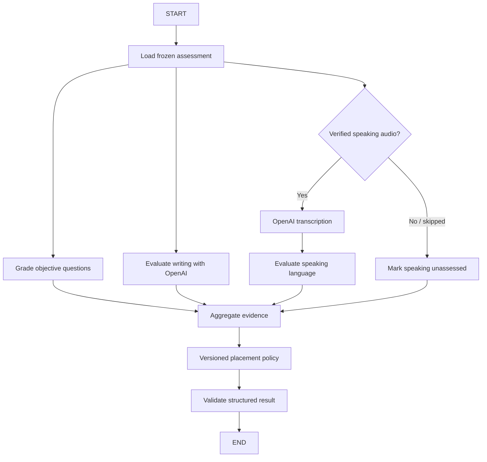

# TalkFiesta — AI Assessment API Flow and Backend Contracts (V4)

**Design status:** Proposed API architecture; not an implemented V4 migration.
**Stack:** Next.js/Auth.js BFF; FastAPI; PostgreSQL; Redis/Celery; private S3; OpenAI speech-to-text and text evaluation; LangChain; LangGraph; LangSmith.
**Scope:** Authentication → onboarding → grammar/vocabulary/writing/optional speaking → asynchronous evaluation → provisional CEFR → learning plan. This document extends `TalkFiesta-Auth-to-Assessment-API-Flow-V4.md` and uses the consolidated 14-table V4 schema.

## Architectural decision

The frontend **does not call separate public `/ai/transcribe`, `/ai/grade`, or `/ai/cefr` endpoints**. These are privileged server-side worker operations. A learner submits their assessment once; FastAPI persists the submission and a durable job; Celery executes a LangGraph workflow; the frontend polls for the status and result.

## 1. Public learner-facing APIs

All endpoints are prefixed `/api/v1`. Assessment IDs and response IDs are server-issued UUIDs. All assessment/media/job reads are owner-authorized. The Next.js BFF handles secure browser sessions, and FastAPI validates short-lived application authorization.

| Method | Endpoint | Purpose | Common HTTP |
|---|---|---|---|
| POST | `/auth/register` | Create email/password account | 201 |
| POST | `/auth/login` | Authenticate | 200 |
| POST | `/auth/google/exchange` | Exchange server-verified Google identity | 200 |
| GET | `/users/me` | Account, onboarding and current placement | 200 |
| GET | `/onboarding/state` | Authoritative resume step | 200 |
| PUT | `/onboarding/preferences` | Save goals/focus/time/topics/comfort in `users.preferences` | 200 |
| POST | `/assessments` | Create/resume INITIAL attempt | 201 / 200 |
| GET | `/assessments/{id}` | Retrieve attempt, progress | 200 |
| GET | `/assessments/{id}/current-item` | Fetch already assigned item | 200 / 204 |
| POST | `/assessments/{id}/items/next` | Assign next calibrated-bank question under lock | 201 / 200 / 204 |
| PUT | `/assessments/{id}/responses/{response_id}` | Save objective choice, writing text, or verified audio reference | 200 |
| POST | `/media/audio-uploads` | Allocate S3 object for specified assessment response | 201 |
| POST | `/media/audio-uploads/{id}/confirm` | Validate and verify upload | 200 |
| POST | `/assessments/{id}/submit` | Freeze responses; create `ai_jobs` and `outbox_events` atomically | 202 |
| GET | `/assessments/{id}/result` | Canonical evaluation-state and feedback endpoint | 200 |
| GET | `/ai-jobs/{job_id}` | **Optional** generic progress view for async jobs | 200 |
| POST | `/assessments/{id}/evaluation/retry` | **Optional** explicitly authorized retry after terminal recoverable failure | 202 |
| POST | `/onboarding/complete` | Verify final result; initialize plan + module progress once | 200 |
| GET | `/learning-plans/current` | Return personalized plan | 200 |
| GET | `/dashboard` | Show daily activities | 200 |

Keep `/assessments/{id}/result` as the only required assessment-progress endpoint in the MVP. `GET /ai-jobs/{job_id}` becomes useful when the same generic job status UI is shared by Speaking and Writing daily modules. It must never reveal model prompts, private trace IDs, transcripts of other users, credentials, or infrastructure stack traces.

## 2. Detailed sequence

```mermaid
sequenceDiagram
  actor Learner
  participant UI as Next.js
  participant API as FastAPI
  participant PG as PostgreSQL
  participant S3 as Private S3
  participant Dispatch as Outbox Dispatcher
  participant Queue as Celery/Redis
  participant Graph as LangGraph
  participant OpenAI as OpenAI API
  participant Smith as LangSmith

  Learner->>UI: Register / login
  UI->>API: Check onboarding / save preferences
  UI->>API: Create/resume assessment
  loop Adaptive items
    UI->>API: Request item / submit answer
    API->>PG: Persist assignment, answer and objective grade
  end
  opt Speaking selected
    UI->>API: Request response-bound audio upload URL
    UI->>S3: Upload audio bytes
    UI->>API: Confirm audio
    UI->>API: Link verified upload to assessment response
  end
  Learner->>UI: Submit assessment
  UI->>API: POST /assessments/{id}/submit (Idempotency-Key)
  API->>PG: TX: freeze attempt, insert ai_job + outbox_event
  API-->>UI: 202 PROCESSING + job_id
  Dispatch->>PG: Claim unsent event
  Dispatch->>Queue: Publish durable job ID
  Queue->>Graph: Execute job using persisted state
  Graph->>PG: Load answers and private content/rubric
  opt Audio present
    Graph->>S3: Download audio
    Graph->>OpenAI: Transcribe audio
    OpenAI-->>Graph: Transcript
  end
  Graph->>OpenAI: Evaluate writing and speaking language evidence
  OpenAI-->>Graph: Structured evaluations
  Graph->>Graph: Validate output and apply placement policy
  Graph-->>Smith: Sanitized trace metadata
  Graph->>PG: TX: persist results; set COMPLETED
  loop Until terminal status
    UI->>API: GET /assessments/{id}/result
    API-->>UI: Processing stage or result
  end
  UI->>API: POST /onboarding/complete
  API->>PG: TX: initialize one plan and module progress
  API-->>UI: dashboard path
```

## 3. Core AI endpoint contracts

### `POST /api/v1/assessments/{id}/submit`

**Authenticated, owner-only, idempotent.** No `model`, `prompt`, `score`, or `cefr` client inputs. The server derives the source responses from the persisted assessment.

Header: `Idempotency-Key: 4722f5bd-9aaf-45c4-b187-2f132828c44a`

Request body: `{}`

**202 Accepted** (first or repeated identical submission):

```json
{
  "assessment_id": "22222222-2222-4222-8222-222222222222",
  "assessment_status": "PROCESSING",
  "evaluation": {
    "job_id": "55555555-5555-4555-8555-555555555555",
    "status": "QUEUED",
    "stage": "WAITING_FOR_WORKER"
  },
  "result_url": "/api/v1/assessments/22222222-2222-4222-8222-222222222222/result"
}
```

**Transactional steps:** (1) assert ownership and `IN_PROGRESS`, (2) validate required assignments and answers (writing required; speaking optional/skippable), (3) freeze response versions and question/rubric release, (4) update assessment state to `PROCESSING`, (5) create one logical AI job for `INITIAL_ASSESSMENT`, (6) create one outbox event, (7) commit. No OpenAI calls during HTTP request.

### `GET /api/v1/assessments/{id}/result`

While processing, **200 OK** (alternatively set `Retry-After: 3`):

```json
{
  "assessment_id": "22222222-2222-4222-8222-222222222222",
  "status": "PROCESSING",
  "evaluation": {
    "job_id": "55555555-5555-4555-8555-555555555555",
    "status": "RUNNING",
    "stage": "EVALUATING_LANGUAGE"
  },
  "placement": null,
  "retry_after_seconds": 3
}
```

**200 OK** after successful evaluation (illustrative only):

```json
{
  "assessment_id": "22222222-2222-4222-8222-222222222222",
  "status": "COMPLETED",
  "evaluation": {"status": "SUCCEEDED", "stage": "DONE"},
  "placement": {
    "cefr": "A2",
    "provisional": true,
    "confidence": "MEDIUM",
    "skills": {
      "grammar": {"level": "A2", "assessed": true},
      "vocabulary": {"level": "B1", "assessed": true},
      "writing": {"level": "A2", "assessed": true},
      "speaking": {"level": "A2", "assessed": true},
      "pronunciation": {"level": null, "assessed": false, "reason": "AUDIO_PRONUNCIATION_NOT_EVALUATED"}
    },
    "strengths": ["Familiar workplace vocabulary"],
    "improvement_priorities": ["Past-tense accuracy"],
    "assessment_version": "initial-assessment-v1",
    "rubric_version": "placement-v1"
  }
}
```

**200 OK** on a terminal recoverable failure:

```json
{
  "assessment_id": "22222222-2222-4222-8222-222222222222",
  "status": "FAILED_FINAL",
  "evaluation": {
    "status": "FAILED_FINAL",
    "stage": "EVALUATING_LANGUAGE",
    "error": {
      "code": "AI_EVALUATION_UNAVAILABLE",
      "message": "We couldn't finish the evaluation. You can retry without recording again.",
      "retry_allowed": true
    }
  },
  "placement": null
}
```

If invalid/absent speaking is permitted by policy, mark the speaking evidence `unassessed`, lower placement confidence as appropriate, and avoid failing the entire assessment. If required writing evidence cannot be evaluated, do not fabricate a placement; retain answers for retry.

### `GET /api/v1/ai-jobs/{job_id}` — optional

Only expose cross-module job state if useful. Authenticate and verify `ai_jobs.user_id`. Response should be limited to job kind, safe stage, status, retryability and timestamps. Do not return provider prompts, stack traces, worker queue names, or learner text.

### `POST /api/v1/assessments/{id}/evaluation/retry` — optional

Available **only after a terminal recoverable failure**, with server-defined retryability and quota limits. Requests use `Idempotency-Key`. Reuse the original frozen assessment evidence, create/attach a controlled new execution attempt, and prevent concurrent paid evaluations. Auto-retry transient errors inside the worker first; this endpoint is not needed during ordinary successful flow.

## 4. Internal AI processing functions (not HTTP endpoints)

| Operation | Internal implementation | Data in/out |
|---|---|---|
| `execute_assessment_job(job_id)` | Celery task | Job ID → persisted evaluation |
| `load_assessment_evidence` | Domain repository/service | Frozen answers, task rubrics, audio refs |
| `grade_objective_questions` | Deterministic Python | Grammar/vocabulary grades |
| `transcribe_speaking_audio` | OpenAI SDK | Verified S3 audio → transcript |
| `evaluate_writing` | LangChain + OpenAI structured output | Writing + prompt/rubric → feedback |
| `evaluate_speaking_language` | LangChain + OpenAI structured output | Transcript + prompt/rubric → feedback |
| `aggregate_evidence` | LangGraph node | Structured evidence → skill summaries |
| `assign_provisional_cefr` | Versioned Python placement policy | Evidence → level and confidence |
| `persist_evaluation` | Transactional service | Validated output → assessment and job state |

For recorded speech, `gpt-transcribe` is a current OpenAI transcription option; the deployed model should be configurable. Do not infer pronunciation from transcript text. Speech pace requires validated audio duration, and pause/prosody metrics require audio- or timestamp-based measurement.

## 5. LangGraph execution graph



LangGraph coordinates the pure/AI steps. The Celery job runner controls the durable result commit and idempotency. This keeps database transactions out of graph nodes and makes retries easier to reason about.

Use one language-evaluation model call for writing and one for speaking at first. Multiple specialist agents are optional future improvements, justified by benchmark results rather than architecture aesthetics.

## 6. Persistence mapping to V4's 14 tables

| Table | AI-related use |
|---|---|
| `users` | Learner identity, preferences, onboarding state |
| `content_items` | Immutable assessment question text, hidden objective answer keys, versioned rubrics |
| `assessment_attempts` | Immutable submitted snapshot reference, assessment state, provisional placement and feedback JSONB |
| `assessment_responses` | Assigned items, answer revisions, objective grade, writing/recording refs, transcript and per-skill evaluation JSONB |
| `media_uploads` | Verified owner-bound private S3 audio reference and metadata |
| `ai_jobs` | Job type, attempt reference, status/stage, attempts, model/rubric versions, internal error code and optional trace reference |
| `outbox_events` | Reliable publication of committed work to queue |
| `learning_plans` | Personalized plan created after result |
| `module_progress` | Independent Speaking/Vocabulary/Writing enrollment positions |

No new **required** AI model/table is needed. Reuse the assessment records and generic job infrastructure. If retaining each paid retry's usage cost/event is a future requirement, add a separate job-attempt ledger later.

## 7. Job state machine and reliability

```text
QUEUED → RUNNING → SUCCEEDED
              ├→ RETRY_SCHEDULED → QUEUED
              └→ FAILED_FINAL
```

Safe user-facing stages: `WAITING_FOR_WORKER`, `TRANSCRIBING_AUDIO`, `EVALUATING_LANGUAGE`, `DETERMINING_PLACEMENT`, `SAVING_RESULTS`, `DONE`.

- Maintain an idempotency key for assessment submission and a unique active evaluation per assessment.
- Create `ai_jobs` and `outbox_events` in the same PostgreSQL transaction that freezes assessment answers.
- Use outbox dispatch, worker acknowledgement after durable result commit, and retries with exponential backoff/jitter for transient failures.
- Guard against concurrent workers using job claims/leases and conditional updates; repeated execution must not duplicate result writes or plan creation.
- OpenAI calls can still be billed twice if a worker crashes after a provider response but before durable commit. Exactly-once *external billing* cannot be guaranteed by a PostgreSQL idempotency key. Minimize with persisted step outputs and conservative retry policies.
- Keep the assessment in a visible pending/failed state during provider outages. Never discard submitted answers.
- Validate OpenAI JSON with Pydantic; use explicit `unassessed` / `insufficient_evidence` states; do not invent a CEFR score when required evidence is unavailable.
- Do not trust learner transcript text as system instructions; use strict task prompts and structured outputs.
- Sanitize LangSmith traces; restrict raw audio/transcripts/PII access. Store LangSmith trace IDs only as operational references, not as the application's source of truth.

## 8. Recommended project folders

```text
app/
├── modules/
│   ├── auth/{router,service,schemas,repository}.py
│   ├── onboarding/{router,service,schemas}.py
│   ├── assessment/
│   │   ├── router.py
│   │   ├── schemas.py
│   │   ├── service.py
│   │   ├── repository.py
│   │   ├── selection.py
│   │   ├── placement.py
│   │   └── ai/
│   │       ├── graph.py
│   │       ├── state.py
│   │       ├── nodes.py
│   │       ├── schemas.py
│   │       └── prompts/
│   ├── media/{router,service,repository}.py
│   ├── jobs/{router,service,repository}.py
│   └── learning_plans/{router,service,repository}.py
├── infrastructure/
│   ├── ai/openai_client.py
│   ├── ai/langsmith_config.py
│   ├── storage/s3_client.py
│   ├── database/session.py
│   └── messaging/outbox.py
└── workers/
    ├── celery_app.py
    ├── assessment_tasks.py
    └── outbox_dispatcher.py
```

## 9. Next learner-facing APIs **after** onboarding

| Priority | Endpoint | Purpose |
|---|---|---|
| 1 | `GET /learning-plans/current/today` | Return assigned Speaking/Vocabulary/Writing activities |
| 2 | `GET /speaking/today` | Return current speaking task |
| 3 | `POST /speaking/submissions` | Create a speaking submission |
| 4 | `POST /speaking/submissions/{id}/submit` | Accept verified audio and enqueue reusable AI pipeline |
| 5 | `GET /speaking/submissions/{id}` | Display transcript and AI feedback |
| 6 | `GET /vocabulary/today` | Return words and reviewed exercises |
| 7 | `POST /vocabulary/practice` | Grade vocabulary practice and update mastery |
| 8 | `GET /writing/today` | Current writing prompt |
| 9 | `POST /writing/submissions` | Save draft |
| 10 | `POST /writing/submissions/{id}/submit` | Enqueue feedback |
| 11 | `GET /writing/submissions/{id}` | Retrieve corrections and revision feedback |
| 12 | `GET /dashboard` | Current day, scores and streaks |

The same `ai_jobs` + outbox + worker infrastructure supports post-onboarding daily speaking and writing; avoid exposing arbitrary prompts or AI evaluation actions to the browser.

## 10. Suggested implementation milestones and tests

**A. Complete assessment AI vertical slice:** submit, durable job, worker, optional transcription, writing/speaking scoring, versioned CEFR, poll result, complete onboarding.

**B. Reuse in daily speaking:** speaking submission, audio upload verification, speaking feedback worker and progress completion.

**C. Expand to writing/vocabulary:** common typed AI evaluators and deterministic grading where possible.

**Integration tests:** repeated submit returns same job; invalid owner access is blocked; transcribe failure does not delete recording; skipped speech yields explicit `unassessed`; invalid AI JSON never silently writes a level; worker replays don't double-save; late worker results cannot overwrite newer attempts; onboarding/complete creates plan exactly once; trace redaction prevents storing learner text by default.
