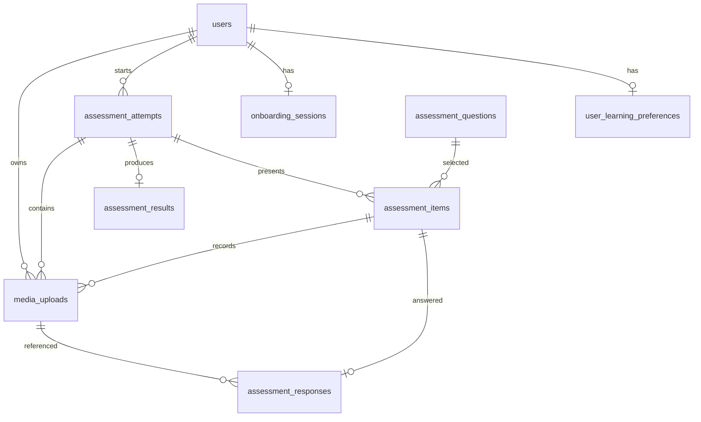
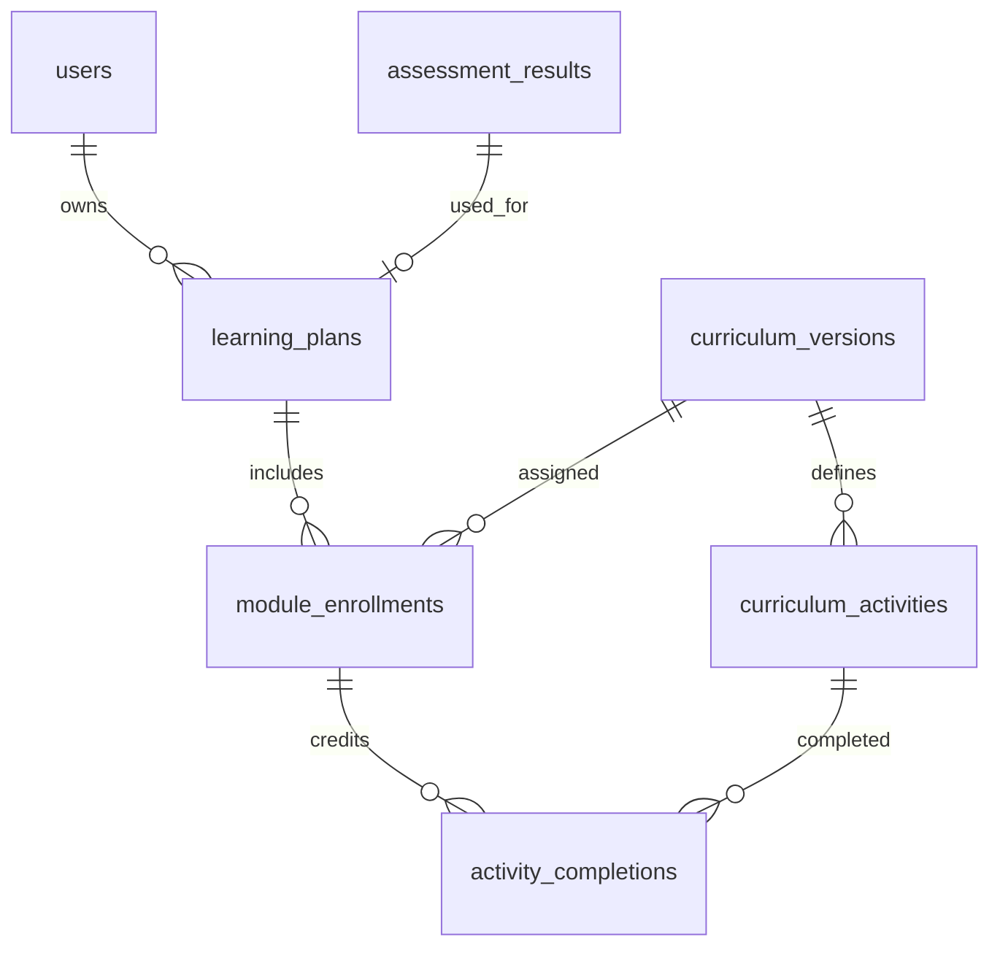
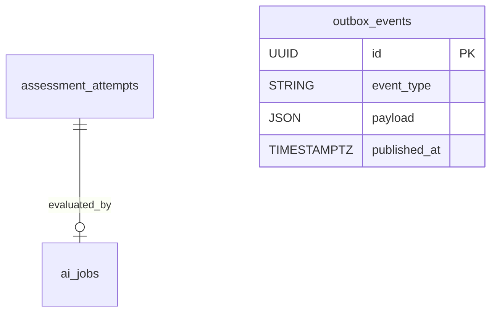

# TalkFiesta — All Database Models & Schemas

**Reference date:** 28 October 2026  
**Application:** TalkFiesta · FastAPI · SQLAlchemy 2 · Alembic · PostgreSQL  
**Current source inspected:** `TalkFiesta-FastAPI-Curriculum-Learning-v3.zip` (model registry and Alembic revisions `0001_initial`, `0002_audio_plans`, `0003_curriculum`)  
**Design sources:** `TalkFiesta-Database-Schema.md` (original product design) and `TalkFiesta-Detailed-Database-ERD-and-Backend-Scaffolding.md` (proposed extension).

> **Important distinction:** **Implemented in V3** means an ORM model and corresponding migration appear in the shipped V3 backend. **Original specification / not implemented** means the table is described in the original TalkFiesta database design but is absent from V3's ORM/migrations. **Proposed extension / not implemented** means a further engineering recommendation, not an existing table. This document is a reference and comparison, **not a single ready-to-run migration** for all future features.

## Quick inventory

- **16 actual V3 database tables**, with every mapped column, foreign key, index and table-level constraint listed in Part A.
- **23 original design tables** reproduced in Part B; **`users` overlaps** the V3 table, so **22 original table names are not yet present** in V3.
- Additional optional/recommended future tables described in Part C, clearly labeled as proposed.
- V3 currently uses **SQLAlchemy `JSON`** columns, not PostgreSQL-specific `JSONB`, unless separately migrated. Source `DateTime(timezone=True)` compiles to PostgreSQL timezone-aware timestamp. PostgreSQL UUID is used for UUID keys.
- **Python/ORM defaults are not the same as database `DEFAULT` constraints**. Only entries labeled "DB default" are established at the database level. Application code must supply ORM defaults for other inserts.

### V3 model inventory

| Domain | Implemented tables |
|---|---|
| Identity & onboarding | `users`, `user_learning_preferences`, `onboarding_sessions` |
| Assessment & audio | `assessment_questions`, `assessment_attempts`, `assessment_items`, `assessment_responses`, `assessment_results`, `media_uploads` |
| Plans & curriculum | `learning_plans`, `module_enrollments`, `curriculum_versions`, `curriculum_activities`, `activity_completions` |
| AI jobs & reliable events | `ai_jobs`, `outbox_events` |

## A. Implemented V3 schema — exact SQLAlchemy models

The following field definitions are derived from the **actual V3 SQLAlchemy model classes**, not from the earlier conceptual ERD. The corresponding migration definitions were also inspected. `NULL`/`NOT NULL` and indexes reflect the model metadata; some defaults are applied by the ORM rather than in the database.

### A.1 Current V3 ERD — Identity & assessment

### A.2 Current V3 ERD — Curriculum & progress

### A.3 Current V3 ERD — Jobs

Note: `outbox_events` has no database-enforced FK to its business aggregate; its routing `payload` holds event metadata. `activity_completions.source_type` and `source_id` are a polymorphic reference rather than a typed foreign key in V3.

### Identity & onboarding

#### `users`

**Implementation source:** `app/modules/auth/models.py`  
**Status:** Implemented in V3 (`Base.metadata` and Alembic).

| Column | SQL type (PostgreSQL) | Nullability / keys | ORM or database default |
|---|---|---|---|
| `id` | `UUID` | **PK**; NOT NULL | Python/ORM default: `uuid4` |
| `email` | `VARCHAR(320)` | NOT NULL; UNIQUE | — |
| `hashed_password` | `VARCHAR(255)` | NULL | — |
| `first_name` | `VARCHAR(100)` | NULL | — |
| `is_active` | `BOOLEAN` | NOT NULL | Python/ORM default: `True` |
| `onboarding_completed` | `BOOLEAN` | NOT NULL | Python/ORM default: `False` |
| `created_at` | `TIMESTAMP WITH TIME ZONE` | NOT NULL | DB default: `now()` |

**Indexes and other constraints:**

- Unique **`ix_users_email`** on (`email`).

#### `user_learning_preferences`

**Implementation source:** `app/modules/onboarding/models.py`  
**Status:** Implemented in V3 (`Base.metadata` and Alembic).

| Column | SQL type (PostgreSQL) | Nullability / keys | ORM or database default |
|---|---|---|---|
| `user_id` | `UUID` | **PK**; NOT NULL; FK → `users.id` (`ON DELETE CASCADE`) | — |
| `goals` | `JSON` | NOT NULL | — |
| `focus_areas` | `JSON` | NOT NULL | — |
| `topics` | `JSON` | NOT NULL | — |
| `daily_minutes` | `INTEGER` | NOT NULL | — |
| `self_reported_comfort` | `VARCHAR(25)` | NOT NULL | — |
| `timezone` | `VARCHAR(80)` | NOT NULL | Python/ORM default: `UTC` |
| `updated_at` | `TIMESTAMP WITH TIME ZONE` | NOT NULL | DB default: `now()`; ORM onupdate |

**Indexes and other constraints:** No additional table-level unique/check/index constraints beyond the keys above.

#### `onboarding_sessions`

**Implementation source:** `app/modules/onboarding/models.py`  
**Status:** Implemented in V3 (`Base.metadata` and Alembic).

| Column | SQL type (PostgreSQL) | Nullability / keys | ORM or database default |
|---|---|---|---|
| `id` | `UUID` | **PK**; NOT NULL | Python/ORM default: `uuid4` |
| `user_id` | `UUID` | NOT NULL; UNIQUE; FK → `users.id` (`ON DELETE CASCADE`) | — |
| `status` | `VARCHAR(40)` | NOT NULL | Python/ORM default: `NOT_STARTED` |
| `updated_at` | `TIMESTAMP WITH TIME ZONE` | NOT NULL | DB default: `now()`; ORM onupdate |

**Indexes and other constraints:**

- Unique constraint **`uq_onboarding_sessions_user_id`** on (`user_id`).

### Assessment & audio

#### `assessment_questions`

**Implementation source:** `app/modules/assessment/models.py`  
**Status:** Implemented in V3 (`Base.metadata` and Alembic).

| Column | SQL type (PostgreSQL) | Nullability / keys | ORM or database default |
|---|---|---|---|
| `id` | `UUID` | **PK**; NOT NULL | Python/ORM default: `uuid4` |
| `version` | `VARCHAR(40)` | NOT NULL | Python/ORM default: `starter-v1` |
| `position` | `INTEGER` | NOT NULL | — |
| `kind` | `VARCHAR(30)` | NOT NULL | — |
| `skill` | `VARCHAR(20)` | NOT NULL | — |
| `level` | `VARCHAR(2)` | NOT NULL | — |
| `prompt` | `TEXT` | NOT NULL | — |
| `choices` | `JSON` | NULL | — |
| `correct_choice_id` | `VARCHAR(5)` | NULL | — |
| `published` | `BOOLEAN` | NOT NULL | Python/ORM default: `True` |

**Indexes and other constraints:**

- Unique constraint **`uq_assessment_question_version_position`** on (`version`, `position`).

#### `assessment_attempts`

**Implementation source:** `app/modules/assessment/models.py`  
**Status:** Implemented in V3 (`Base.metadata` and Alembic).

| Column | SQL type (PostgreSQL) | Nullability / keys | ORM or database default |
|---|---|---|---|
| `id` | `UUID` | **PK**; NOT NULL | Python/ORM default: `uuid4` |
| `user_id` | `UUID` | NOT NULL; FK → `users.id` (`ON DELETE CASCADE`) | — |
| `kind` | `VARCHAR(20)` | NOT NULL | Python/ORM default: `INITIAL` |
| `status` | `VARCHAR(30)` | NOT NULL | Python/ORM default: `IN_PROGRESS` |
| `question_bank_version` | `VARCHAR(40)` | NOT NULL | Python/ORM default: `starter-v1` |
| `started_at` | `TIMESTAMP WITH TIME ZONE` | NOT NULL | DB default: `now()` |
| `submitted_at` | `TIMESTAMP WITH TIME ZONE` | NULL | — |

**Indexes and other constraints:**

- Index **`ix_assessment_attempts_user_id`** on (`user_id`).
- Unique **`uq_active_initial_attempt`** on (`user_id`) where `kind = 'INITIAL' AND status IN ('CREATED','IN_PROGRESS','SUBMITTED','PROCESSING','FAILED_RETRYABLE')`.

#### `assessment_items`

**Implementation source:** `app/modules/assessment/models.py`  
**Status:** Implemented in V3 (`Base.metadata` and Alembic).

| Column | SQL type (PostgreSQL) | Nullability / keys | ORM or database default |
|---|---|---|---|
| `id` | `UUID` | **PK**; NOT NULL | Python/ORM default: `uuid4` |
| `attempt_id` | `UUID` | NOT NULL; FK → `assessment_attempts.id` (`ON DELETE CASCADE`) | — |
| `question_id` | `UUID` | NOT NULL; FK → `assessment_questions.id` | — |
| `position` | `INTEGER` | NOT NULL | — |

**Indexes and other constraints:**

- Unique constraint **`uq_attempt_item_position`** on (`attempt_id`, `position`).

#### `assessment_responses`

**Implementation source:** `app/modules/assessment/models.py`  
**Status:** Implemented in V3 (`Base.metadata` and Alembic).

| Column | SQL type (PostgreSQL) | Nullability / keys | ORM or database default |
|---|---|---|---|
| `id` | `UUID` | **PK**; NOT NULL | Python/ORM default: `uuid4` |
| `item_id` | `UUID` | NOT NULL; UNIQUE; FK → `assessment_items.id` (`ON DELETE CASCADE`) | — |
| `selected_choice_id` | `VARCHAR(5)` | NULL | — |
| `text_answer` | `TEXT` | NULL | — |
| `is_correct` | `BOOLEAN` | NULL | — |
| `media_upload_id` | `UUID` | NULL; FK → `media_uploads.id` | — |
| `speaking_skipped` | `BOOLEAN` | NOT NULL | Python/ORM default: `False` |
| `version` | `INTEGER` | NOT NULL | Python/ORM default: `1` |
| `updated_at` | `TIMESTAMP WITH TIME ZONE` | NOT NULL | DB default: `now()`; ORM onupdate |

**Indexes and other constraints:**

- Unique constraint **`uq_assessment_responses_item_id`** on (`item_id`).

#### `assessment_results`

**Implementation source:** `app/modules/assessment/models.py`  
**Status:** Implemented in V3 (`Base.metadata` and Alembic).

| Column | SQL type (PostgreSQL) | Nullability / keys | ORM or database default |
|---|---|---|---|
| `id` | `UUID` | **PK**; NOT NULL | Python/ORM default: `uuid4` |
| `attempt_id` | `UUID` | NOT NULL; UNIQUE; FK → `assessment_attempts.id` (`ON DELETE CASCADE`) | — |
| `placement_cefr` | `VARCHAR(2)` | NULL | — |
| `confidence` | `VARCHAR(10)` | NULL | — |
| `rubric_version` | `VARCHAR(40)` | NOT NULL | — |
| `skill_evidence` | `JSON` | NOT NULL | — |
| `completed_at` | `TIMESTAMP WITH TIME ZONE` | NOT NULL | DB default: `now()` |

**Indexes and other constraints:**

- Unique constraint **`uq_assessment_results_attempt_id`** on (`attempt_id`).

#### `media_uploads`

**Implementation source:** `app/modules/media/models.py`  
**Status:** Implemented in V3 (`Base.metadata` and Alembic).

| Column | SQL type (PostgreSQL) | Nullability / keys | ORM or database default |
|---|---|---|---|
| `id` | `UUID` | **PK**; NOT NULL | Python/ORM default: `uuid4` |
| `user_id` | `UUID` | NOT NULL; FK → `users.id` (`ON DELETE CASCADE`) | — |
| `attempt_id` | `UUID` | NOT NULL; FK → `assessment_attempts.id` (`ON DELETE CASCADE`) | — |
| `item_id` | `UUID` | NOT NULL; FK → `assessment_items.id` (`ON DELETE CASCADE`) | — |
| `object_key` | `VARCHAR(255)` | NOT NULL; UNIQUE | — |
| `content_type` | `VARCHAR(80)` | NOT NULL | — |
| `content_length` | `INTEGER` | NULL | — |
| `client_duration_seconds` | `FLOAT` | NULL | — |
| `verified_duration_seconds` | `FLOAT` | NULL | — |
| `status` | `VARCHAR(20)` | NOT NULL | Python/ORM default: `INITIATED` |
| `created_at` | `TIMESTAMP WITH TIME ZONE` | NOT NULL | DB default: `now()` |

**Indexes and other constraints:**

- Unique constraint **`uq_media_uploads_object_key`** on (`object_key`).
- Index **`ix_media_uploads_user_id`** on (`user_id`).

### Plans & curriculum

#### `learning_plans`

**Implementation source:** `app/modules/learning_plans/models.py`  
**Status:** Implemented in V3 (`Base.metadata` and Alembic).

| Column | SQL type (PostgreSQL) | Nullability / keys | ORM or database default |
|---|---|---|---|
| `id` | `UUID` | **PK**; NOT NULL | Python/ORM default: `uuid4` |
| `user_id` | `UUID` | NOT NULL; FK → `users.id` (`ON DELETE CASCADE`) | — |
| `assessment_result_id` | `UUID` | NOT NULL; UNIQUE; FK → `assessment_results.id` | — |
| `cycle_number` | `INTEGER` | NOT NULL | Python/ORM default: `1` |
| `placement_cefr` | `VARCHAR(2)` | NOT NULL | — |
| `primary_goal` | `VARCHAR(40)` | NOT NULL | — |
| `daily_minutes` | `INTEGER` | NOT NULL | — |
| `status` | `VARCHAR(20)` | NOT NULL | Python/ORM default: `ACTIVE` |
| `created_at` | `TIMESTAMP WITH TIME ZONE` | NOT NULL | DB default: `now()` |

**Indexes and other constraints:**

- Unique constraint **`uq_learning_plans_assessment_result_id`** on (`assessment_result_id`).
- Unique **`uq_one_active_plan`** on (`user_id`) where `status = 'ACTIVE'`.

#### `module_enrollments`

**Implementation source:** `app/modules/learning_plans/models.py`  
**Status:** Implemented in V3 (`Base.metadata` and Alembic).

| Column | SQL type (PostgreSQL) | Nullability / keys | ORM or database default |
|---|---|---|---|
| `id` | `UUID` | **PK**; NOT NULL | Python/ORM default: `uuid4` |
| `learning_plan_id` | `UUID` | NOT NULL; FK → `learning_plans.id` (`ON DELETE CASCADE`) | — |
| `curriculum_version_id` | `UUID` | NULL; FK → `curriculum_versions.id` (`ON DELETE RESTRICT`) | — |
| `module` | `VARCHAR(20)` | NOT NULL | — |
| `current_day` | `INTEGER` | NOT NULL | Python/ORM default: `1` |
| `prioritized` | `BOOLEAN` | NOT NULL | Python/ORM default: `False` |
| `status` | `VARCHAR(20)` | NOT NULL | Python/ORM default: `AWAITING_CONTENT` |

**Indexes and other constraints:**

- Check constraint **`ck_module_enrollments_valid_enrollment_day`**: `current_day BETWEEN 1 AND 21`.
- Check constraint **`ck_module_enrollments_valid_enrollment_status`**: `status IN ('ACTIVE','COMPLETED','AWAITING_CONTENT')`.
- Unique constraint **`uq_plan_module`** on (`learning_plan_id`, `module`).

#### `curriculum_versions`

**Implementation source:** `app/modules/curriculum/models.py`  
**Status:** Implemented in V3 (`Base.metadata` and Alembic).

| Column | SQL type (PostgreSQL) | Nullability / keys | ORM or database default |
|---|---|---|---|
| `id` | `UUID` | **PK**; NOT NULL | Python/ORM default: `uuid4` |
| `cycle_number` | `INTEGER` | NOT NULL | — |
| `module` | `VARCHAR(20)` | NOT NULL | — |
| `cefr_level` | `VARCHAR(2)` | NOT NULL | — |
| `goal_variant` | `VARCHAR(40)` | NOT NULL | Python/ORM default: `GENERAL` |
| `version_number` | `INTEGER` | NOT NULL | Python/ORM default: `1` |
| `status` | `VARCHAR(20)` | NOT NULL | Python/ORM default: `DRAFT` |
| `origin` | `VARCHAR(20)` | NOT NULL | Python/ORM default: `HUMAN` |
| `description` | `TEXT` | NULL | — |
| `created_at` | `TIMESTAMP WITH TIME ZONE` | NOT NULL | DB default: `now()` |
| `published_at` | `TIMESTAMP WITH TIME ZONE` | NULL | — |

**Indexes and other constraints:**

- Check constraint **`ck_curriculum_versions_valid_curriculum_version_number`**: `version_number >= 1`.
- Unique constraint **`uq_curriculum_version_identity`** on (`cycle_number`, `module`, `cefr_level`, `goal_variant`, `version_number`).
- Check constraint **`ck_curriculum_versions_valid_curriculum_cycle`**: `cycle_number BETWEEN 1 AND 5`.
- Check constraint **`ck_curriculum_versions_valid_curriculum_status`**: `status IN ('DRAFT','PUBLISHED','ARCHIVED')`.
- Index **`ix_curriculum_lookup`** on (`cycle_number`, `module`, `cefr_level`, `goal_variant`, `status`).

#### `curriculum_activities`

**Implementation source:** `app/modules/curriculum/models.py`  
**Status:** Implemented in V3 (`Base.metadata` and Alembic).

| Column | SQL type (PostgreSQL) | Nullability / keys | ORM or database default |
|---|---|---|---|
| `id` | `UUID` | **PK**; NOT NULL | Python/ORM default: `uuid4` |
| `curriculum_version_id` | `UUID` | NOT NULL; FK → `curriculum_versions.id` (`ON DELETE RESTRICT`) | — |
| `day` | `INTEGER` | NOT NULL | — |
| `title` | `VARCHAR(180)` | NOT NULL | — |
| `topic` | `VARCHAR(80)` | NOT NULL | — |
| `instructions` | `TEXT` | NOT NULL | — |
| `estimated_minutes` | `INTEGER` | NOT NULL | — |
| `content` | `JSON` | NOT NULL | — |
| `created_at` | `TIMESTAMP WITH TIME ZONE` | NOT NULL | DB default: `now()` |

**Indexes and other constraints:**

- Check constraint **`ck_curriculum_activities_valid_curriculum_day`**: `day BETWEEN 1 AND 21`.
- Check constraint **`ck_curriculum_activities_valid_curriculum_minutes`**: `estimated_minutes BETWEEN 1 AND 90`.
- Unique constraint **`uq_curriculum_version_day`** on (`curriculum_version_id`, `day`).

#### `activity_completions`

**Implementation source:** `app/modules/learning_plans/models.py`  
**Status:** Implemented in V3 (`Base.metadata` and Alembic).

| Column | SQL type (PostgreSQL) | Nullability / keys | ORM or database default |
|---|---|---|---|
| `id` | `UUID` | **PK**; NOT NULL | Python/ORM default: `uuid4` |
| `enrollment_id` | `UUID` | NOT NULL; FK → `module_enrollments.id` (`ON DELETE CASCADE`) | — |
| `activity_id` | `UUID` | NOT NULL; FK → `curriculum_activities.id` (`ON DELETE RESTRICT`) | — |
| `source_type` | `VARCHAR(32)` | NOT NULL | — |
| `source_id` | `UUID` | NOT NULL | — |
| `local_practice_date` | `DATE` | NOT NULL | — |
| `completed_at` | `TIMESTAMP WITH TIME ZONE` | NOT NULL | DB default: `now()` |

**Indexes and other constraints:**

- Unique constraint **`uq_enrollment_activity_completion`** on (`enrollment_id`, `activity_id`).
- Unique constraint **`uq_activity_completion_source`** on (`source_type`, `source_id`).
- Index **`ix_completion_enrollment_date`** on (`enrollment_id`, `local_practice_date`).

### AI jobs & reliable events

#### `ai_jobs`

**Implementation source:** `app/modules/jobs/models.py`  
**Status:** Implemented in V3 (`Base.metadata` and Alembic).

| Column | SQL type (PostgreSQL) | Nullability / keys | ORM or database default |
|---|---|---|---|
| `id` | `UUID` | **PK**; NOT NULL | Python/ORM default: `uuid4` |
| `assessment_attempt_id` | `UUID` | NOT NULL; UNIQUE; FK → `assessment_attempts.id` | — |
| `status` | `VARCHAR(30)` | NOT NULL | Python/ORM default: `PENDING` |
| `error_code` | `VARCHAR(60)` | NULL | — |
| `created_at` | `TIMESTAMP WITH TIME ZONE` | NOT NULL | DB default: `now()` |

**Indexes and other constraints:**

- Unique constraint **`uq_ai_jobs_assessment_attempt_id`** on (`assessment_attempt_id`).

#### `outbox_events`

**Implementation source:** `app/modules/jobs/models.py`  
**Status:** Implemented in V3 (`Base.metadata` and Alembic).

| Column | SQL type (PostgreSQL) | Nullability / keys | ORM or database default |
|---|---|---|---|
| `id` | `UUID` | **PK**; NOT NULL | Python/ORM default: `uuid4` |
| `event_type` | `VARCHAR(50)` | NOT NULL | — |
| `payload` | `JSON` | NOT NULL | — |
| `published_at` | `TIMESTAMP WITH TIME ZONE` | NULL | — |
| `created_at` | `TIMESTAMP WITH TIME ZONE` | NOT NULL | DB default: `now()` |

**Indexes and other constraints:**

- Index **`ix_outbox_unpublished`** on (`created_at`) where `published_at IS NULL`.

---

## B. Original TalkFiesta schema — specified but not implemented in V3

**Provenance:** The tables below preserve the original `TalkFiesta-Database-Schema.md` model field names, types, constraints, descriptions and examples. **These are the product design, not the deployed V3 tables.** In particular, original columns such as `speaking_exercises.cycle` and `writing_prompts.prompt_text` do **not** yet exist in the V3 database. Some original design assumptions have since changed (e.g. using OpenAI rather than Gemini, 21-day module enrollments, and multiple goals).

### Original `users` design vs. current V3

The original `users` model includes `last_name`, `avatar_url`, `oauth_provider`, `oauth_provider_id`, `updated_at` and `last_login_at`; the **implemented V3 `users` does not yet have these columns**. V3 also uses Argon2 password hashing in the authentication code, whereas the original document refers to bcrypt. See the V3 `users` table in Part A for the actual model.

### Original full model definitions (design-only reference)

> **Caution — original users model only:** V3 already has a `users` table with a different, smaller column set. This historical version must not be treated as a second implemented users table.

### `users`
Core identity table. JWT tokens are issued against this record.

| Column | Type | Constraints | Description |
| :--- | :--- | :--- | :--- |
| `id` | `UUID` | `PRIMARY KEY` | Internal database unique identifier (uuid4). |
| `email` | `String` | `UNIQUE`, `INDEX`, `NOT NULL` | User's email address. |
| `hashed_password` | `String` | `NULLABLE` | bcrypt-hashed password (NULL for OAuth-only users). |
| `first_name` | `String` | `NULLABLE` | |
| `last_name` | `String` | `NULLABLE` | |
| `avatar_url` | `String` | `NULLABLE` | |
| `oauth_provider` | `Enum` | `NULLABLE` | `GOOGLE` (NULL for email/password users). |
| `oauth_provider_id` | `String` | `NULLABLE` | The user's ID from the OAuth provider. |
| `onboarding_completed`| `Boolean`| `DEFAULT FALSE` | Has the user completed level assessment + goal selection? |
| `is_active` | `Boolean` | `DEFAULT TRUE` | Soft-delete / account disable flag. |
| `created_at` | `DateTime` | `DEFAULT NOW()` | Record creation timestamp. |
| `updated_at` | `DateTime` | `DEFAULT NOW()` | Record update timestamp. |
| `last_login_at` | `DateTime` | `NULLABLE` | Tracks the last time the user logged in. |

### `user_learning_profiles`
Separates the user's core identity from their TalkFiesta learning state and preferences. Created during onboarding after level assessment and goal selection.

| Column | Type | Constraints | Description |
| :--- | :--- | :--- | :--- |
| `id` | `UUID` | `PRIMARY KEY` | Unique identifier (uuid4). |
| `user_id` | `UUID` | `UNIQUE`, `FOREIGN KEY (users.id)` | Link to the core user record (`ON DELETE CASCADE`). |
| `current_cycle` | `Integer` | `DEFAULT 1` | The user's current 21-day learning cycle (1-5). |
| `current_day` | `Integer` | `DEFAULT 1` | The user's current day within the cycle (1-21). |
| `goal` | `Enum` | `NOT NULL` | User's learning goal: `FLUENCY`, `BUSINESS`, `EXAM`, `TRAVEL`. |
| `target_cefr_level` | `String` | `NOT NULL` | Assessed CEFR level from onboarding quiz (e.g., "A2", "B1", "B2", "C1"). |
| `native_language` | `String` | `NULLABLE` | Used for personalized feedback context. |
| `timezone` | `String` | `DEFAULT 'UTC'` | User's local timezone. |
| `daily_reminder_enabled`| `Boolean`| `DEFAULT TRUE` | Preference for push/email reminders. |
| `created_at` | `DateTime` | `DEFAULT NOW()` | |
| `updated_at` | `DateTime` | `DEFAULT NOW()` | |

### `speaking_exercises`
Pre-generated exercise prompts for the 21-day cycle. Generated once per cycle by the offline content pipeline and shared across all users.

| Column | Type | Constraints | Description |
| :--- | :--- | :--- | :--- |
| `id` | `UUID` | `PRIMARY KEY` |  |
| `cycle` | `Integer` | `NOT NULL` | Cycle number (1-5). |
| `day` | `Integer` | `NOT NULL` | Day number (1-21). |
| `type` | `Enum` | `NOT NULL` | `CONVERSATIONAL`, `PUBLIC_SPEAKING`, `IMPROMPTU`. |
| `topic` | `String` | `NOT NULL` | Topic title for display (e.g., "Talking About Your Hometown"). |
| `difficulty_level` | `String` | `NOT NULL` | Difficulty label (e.g., "A2-B1"). |
| `prompt_text` | `Text` | `NOT NULL` | The full scenario and instructions given to the user. |
| `target_duration_seconds`| `Integer`| `NOT NULL` | Recommended speaking duration. |
| `instructions` | `Text` | `NULLABLE` | Additional guidance for the exercise. |
| `target_cefr_level`| `String` | `NOT NULL` | CEFR level this exercise targets (e.g., "B1"). |
| `goal_tags` | `JSONB` | `DEFAULT '[]'` | Which goal-specific Tier 2 variants exist (e.g., `["business", "exam"]`). |
| `topic_embedding` | `VECTOR` | `NULLABLE` | Embedding for deduplication similarity search against all exercises. |
| `generated_by` | `Enum` | `NOT NULL` | `AI`, `HUMAN`. |
| `review_status` | `Enum` | `NOT NULL` | `DRAFT`, `APPROVED`, `REJECTED`, `PUBLISHED`. |
| `reviewed_by` | `UUID` | `NULLABLE`, `FOREIGN KEY (users.id)` | Admin user who reviewed this exercise. |
| `generation_batch_id`| `UUID` | `FOREIGN KEY` | Link to the `content_generation_batches` row. |
| `created_at` | `DateTime` | `DEFAULT NOW()` |  |
| `updated_at` | `DateTime` | `DEFAULT NOW()` |  |

### `speaking_submissions`
User's recorded response to an exercise and the resulting multi-agent feedback. Processed asynchronously via the Celery job queue.

| Column | Type | Constraints | Description |
| :--- | :--- | :--- | :--- |
| `id` | `UUID` | `PRIMARY KEY` |  |
| `user_id` | `UUID` | `FOREIGN KEY (users.id)` |  |
| `exercise_id` | `UUID` | `FOREIGN KEY (speaking_exercises.id)` |  |
| `daily_activity_id` | `UUID` | `NULLABLE`, `FOREIGN KEY` | Link to `daily_progress` for unified tracking. |
| `audio_url` | `String` | `NOT NULL` | S3 / Supabase storage link. |
| `transcript` | `Text` | `NULLABLE` | Full transcription from Deepgram. |
| `duration_seconds` | `Integer` | `NULLABLE` | Length of the recording. |
| `word_count` | `Integer` | `NULLABLE` | Words spoken (from transcript). |
| `words_per_minute` | `Float` | `NULLABLE` | Speaking pace. |
| `pause_count` | `Integer` | `NULLABLE` | Gaps > 0.5s detected between words. |
| `filler_words_count` | `Integer` | `NULLABLE` | Count of "um", "uh", "like", "you know". |
| `filler_words_list` | `JSONB` | `NULLABLE` | Array of detected filler words with positions. |
| `fluency_score` | `Integer` | `NULLABLE` | 0–100 score from Fluency Agent (pace, pauses, fillers). |
| `grammar_score` | `Integer` | `NULLABLE` | 0–100 score from Grammar Agent. |
| `vocabulary_score` | `Integer` | `NULLABLE` | 0–100 score from Vocabulary Agent. |
| `pronunciation_score` | `Integer`| `NULLABLE` | 0–100 score from Pronunciation analysis. |
| `overall_score` | `Integer`| `NULLABLE` | Weighted aggregate score (0–100). |
| `grammar_corrections` | `JSONB` | `NULLABLE` | Inline error list with positions and explanations. |
| `vocabulary_suggestions`| `JSONB` | `NULLABLE` | Word upgrade suggestions from Vocabulary Agent. |
| `ai_feedback` | `JSONB` | `NULLABLE` | Merged narrative feedback from the Score Aggregator node. |
| `status` | `Enum` | `DEFAULT 'PENDING'` | `PENDING`, `PROCESSING`, `COMPLETED`, `FAILED`. |
| `processing_job_id` | `String` | `NULLABLE` | Celery task ID for the async feedback pipeline. |
| `submitted_at` | `DateTime` | `DEFAULT NOW()` |  |
| `completed_at` | `DateTime` | `NULLABLE` | When feedback processing finished. |

### `live_conversation_sessions`
Real-time voice conversations using Gemini 3.1 Flash Live (WebSocket). The client connects directly to Gemini; the backend issues an ephemeral token and handles post-session analysis only.

| Column | Type | Constraints | Description |
| :--- | :--- | :--- | :--- |
| `id` | `UUID` | `PRIMARY KEY` |  |
| `user_id` | `UUID` | `FOREIGN KEY (users.id)` |  |
| `topic` | `String` | `NOT NULL` | Conversation topic (e.g., "Daily Life", "Business", or custom). |
| `persona` | `Enum` | `NOT NULL` | `FRIENDLY_TUTOR`, `NATIVE_PEER`, `EXAMINER`, `INTERVIEWER`. |
| `target_duration_seconds`| `Integer`| `NOT NULL` | Planned session length. |
| `actual_duration_seconds`| `Integer`| `NULLABLE` | Actual duration (set on session end). |
| `transcript_json` | `JSONB` | `NULLABLE` | Full dual-speaker transcript: `[{speaker: "user"|"ai", text, timestamp}]`. |
| `turn_count` | `Integer` | `NULLABLE` | Number of back-and-forth exchanges. |
| `avg_response_time_seconds`| `Float`| `NULLABLE` | Average user response latency. |
| `avg_response_length_words`| `Float`| `NULLABLE` | Average words per user turn. |
| `topic_relevance_score` | `Integer`| `NULLABLE` | 0–100 score of how on-topic the user stayed. |
| `status` | `Enum` | `DEFAULT 'ACTIVE'` | `ACTIVE`, `ENDED`, `TIMED_OUT`, `ERROR`. |
| `submission_id` | `UUID` | `NULLABLE`, `FOREIGN KEY (speaking_submissions.id)` | Links to the shared scoring record once post-session analysis completes. |
| `ephemeral_token_issued_at`| `DateTime`| `NULLABLE` | When the Gemini Live ephemeral token was created. |
| `started_at` | `DateTime` | `DEFAULT NOW()` |  |
| `ended_at` | `DateTime` | `NULLABLE` |  |

### `vocabulary_words`
The master dictionary of words pre-generated for the curriculum. Generated once per cycle by the offline content pipeline and shared across all users.

| Column | Type | Constraints | Description |
| :--- | :--- | :--- | :--- |
| `id` | `UUID` | `PRIMARY KEY` |  |
| `word` | `String` | `UNIQUE`, `NOT NULL`| The word itself. |
| `definition` | `Text` | `NOT NULL` |  |
| `part_of_speech` | `String` | `NOT NULL` | e.g., "noun", "verb", "adjective". |
| `difficulty_level` | `String` | `NOT NULL` | Difficulty label (e.g., "A2-B1"). |
| `pronunciation_ipa` | `String` | `NULLABLE` | IPA phonetic transcription. |
| `pronunciation_audio_url`| `String` | `NULLABLE` | Pre-generated TTS audio of correct pronunciation. |
| `example_sentences`| `JSONB` | `NOT NULL` | Array of 3 example sentences. |
| `synonyms` | `JSONB` | `DEFAULT '[]'` | Array of synonym strings. |
| `antonyms` | `JSONB` | `DEFAULT '[]'` | Array of antonym strings. |
| `usage_tips` | `Text` | `NULLABLE` | Contextual usage guidance for learners. |
| `category` | `String` | `NOT NULL` | Semantic category (e.g., "Daily Life", "Academic"). |
| `target_cefr_level`| `String` | `NOT NULL` | CEFR level this word targets (e.g., "B1"). |
| `cycle` | `Integer` | `NOT NULL` | Introduced in this cycle (1-5). |
| `day` | `Integer` | `NOT NULL` | Introduced on this day (1-21). |
| `word_embedding` | `VECTOR` | `NULLABLE` | Embedding for deduplication similarity search. |
| `generated_by` | `Enum` | `NOT NULL` | `AI`, `HUMAN`. |
| `review_status` | `Enum` | `NOT NULL` | `DRAFT`, `APPROVED`, `REJECTED`, `PUBLISHED`. |
| `reviewed_by` | `UUID` | `NULLABLE`, `FOREIGN KEY (users.id)` | Admin user who reviewed this word. |
| `generation_batch_id`| `UUID` | `FOREIGN KEY` | Link to the `content_generation_batches` row. |
| `created_at` | `DateTime` | `DEFAULT NOW()` |  |
| `updated_at` | `DateTime` | `DEFAULT NOW()` |  |

### `vocabulary_exercise_bank`
Pre-generated deterministic exercises per word (fill-in-the-blank sentences and matching distractors). Generated once alongside the word in the offline content pipeline — no AI call needed at runtime.

| Column | Type | Constraints | Description |
| :--- | :--- | :--- | :--- |
| `id` | `UUID` | `PRIMARY KEY` |  |
| `word_id` | `UUID` | `FOREIGN KEY (vocabulary_words.id)` | The word this exercise is for. |
| `fill_blank_sentence` | `Text` | `NOT NULL` | Sentence with the target word removed (blank marker). |
| `fill_blank_correct_answer`| `String` | `NOT NULL` | The word itself — used for exact-match grading. |
| `match_definition_distractor_1`| `Text` | `NOT NULL` | Wrong definition from another word in the same day's set. |
| `match_definition_distractor_2`| `Text` | `NOT NULL` | Second wrong definition for the matching exercise. |
| `match_definition_distractor_3`| `Text` | `NOT NULL` | Third wrong definition for the matching exercise. |

### `user_vocabulary`
Spaced repetition state tracking per user per word. Uses a **fixed-interval schedule** (review on Day 2, 4, 8, 15 after first learning), not SM-2.

| Column | Type | Constraints | Description |
| :--- | :--- | :--- | :--- |
| `id` | `UUID` | `PRIMARY KEY` |  |
| `user_id` | `UUID` | `FOREIGN KEY (users.id)` |  |
| `word_id` | `UUID` | `FOREIGN KEY (vocabulary_words.id)` |  |
| `day_number` | `Integer` | `NOT NULL` | The cycle day when this word was first introduced. |
| `mastery_level` | `Integer` | `DEFAULT 1` | Fixed-interval stage: 1=New, 2=Learning, 3=Reviewing, 4=Practiced, 5=Mastered. |
| `status` | `Enum` | `DEFAULT 'LEARNING'` | `LEARNING`, `REVIEWING`, `MASTERED`. |
| `times_practiced` | `Integer`| `DEFAULT 0` | Total times the user has practiced this word. |
| `times_reviewed` | `Integer`| `DEFAULT 0` | Total review attempts. |
| `interval_days` | `Integer`| `DEFAULT 1` | Current fixed interval: 1, 2, 4, 7, or 14 days. |
| `next_review_date`| `DateTime`| `NOT NULL` | When this word is next due for review. |
| `last_reviewed_at`| `DateTime`| `NULLABLE` | Timestamp of last review attempt. |
| `learned_at` | `DateTime`| `DEFAULT NOW()` | When the word was first introduced. |
| `mastered_at` | `DateTime`| `NULLABLE` | When mastery_level reached 5. |

### `vocabulary_practice_sessions`
Tracks each daily vocabulary practice session for progress and analytics.

| Column | Type | Constraints | Description |
| :--- | :--- | :--- | :--- |
| `id` | `UUID` | `PRIMARY KEY` |  |
| `user_id` | `UUID` | `FOREIGN KEY (users.id)` |  |
| `daily_activity_id` | `UUID` | `NULLABLE`, `FOREIGN KEY` | Link to `daily_progress`. |
| `day_number` | `Integer` | `NOT NULL` | The cycle day this session corresponds to. |
| `fill_blank_score` | `Integer`| `NULLABLE` | Score out of 5. |
| `match_score` | `Integer`| `NULLABLE` | Score out of 5. |
| `context_score` | `Integer`| `NULLABLE` | Score out of 5 (from AI-graded "Use in Context"). |
| `pronunciation_score` | `Integer`| `NULLABLE` | Aggregate pronunciation score. |
| `overall_score` | `Integer`| `NULLABLE` | Weighted session score (0–100). |
| `completed_at` | `DateTime` | `DEFAULT NOW()` |  |

### `personalized_vocab_suggestions`
Words extracted asynchronously from the user's speaking/writing mistakes. Runs as a background job after speaking/writing submissions complete — non-blocking, bonus-only feature.

| Column | Type | Constraints | Description |
| :--- | :--- | :--- | :--- |
| `id` | `UUID` | `PRIMARY KEY` |  |
| `user_id` | `UUID` | `FOREIGN KEY (users.id)` |  |
| `source_type` | `Enum` | `NOT NULL` | `SPEAKING`, `WRITING`. |
| `source_submission_id`| `UUID` | `NULLABLE` | FK back to the original speaking or writing submission. |
| `original_word` | `String` | `NOT NULL` | The overused/weak word (e.g., "good"). |
| `original_sentence` | `Text` | `NOT NULL` | The user's actual sentence using the weak word. |
| `suggested_word` | `String` | `NOT NULL` | The stronger alternative (e.g., "commendable"). |
| `rewritten_sentence` | `Text` | `NOT NULL` | The user's sentence rewritten with the suggested word. |
| `status` | `Enum` | `DEFAULT 'PENDING'` | `PENDING`, `SHOWN`, `ADDED_TO_QUEUE`, `DISMISSED`. |
| `created_at` | `DateTime` | `DEFAULT NOW()` |  |

### `writing_prompts`
Pre-generated prompts for the 21-day cycle. Generated once per cycle by the offline content pipeline and shared across all users.

| Column | Type | Constraints | Description |
| :--- | :--- | :--- | :--- |
| `id` | `UUID` | `PRIMARY KEY` |  |
| `cycle` | `Integer` | `NOT NULL` | Cycle number (1-5). |
| `day` | `Integer` | `NOT NULL` | Day number (1-21). |
| `type` | `Enum` | `NOT NULL` | `DESCRIPTIVE`, `NARRATIVE`, `ARGUMENTATIVE`. |
| `difficulty_level` | `String` | `NOT NULL` | Difficulty label (e.g., "B1-B2"). |
| `prompt_title` | `String` | `NOT NULL` | Short title for display. |
| `prompt_text` | `Text` | `NOT NULL` | The full writing prompt. |
| `target_word_count` | `Integer`| `NOT NULL` | Recommended word count (scales up per cycle). |
| `time_limit_minutes` | `Integer`| `NULLABLE` | Optional time limit. |
| `focus_areas` | `JSONB` | `DEFAULT '[]'` | Specific skills this prompt targets (e.g., ["adjectives", "sensory detail"]). |
| `writing_tips` | `Text` | `NULLABLE` | Guidance specific to this prompt type. |
| `sample_outline` | `Text` | `NULLABLE` | Optional structural outline suggestion. |
| `sensitivity_flagged`| `Boolean`| `DEFAULT FALSE` | Reviewer marks prompts touching personal/emotional territory for UI softening. |
| `prompt_embedding` | `VECTOR` | `NULLABLE` | Embedding for deduplication similarity search. |
| `generated_by` | `Enum` | `NOT NULL` | `AI`, `HUMAN`. |
| `review_status` | `Enum` | `NOT NULL` | `DRAFT`, `APPROVED`, `REJECTED`, `PUBLISHED`. |
| `reviewed_by` | `UUID` | `NULLABLE`, `FOREIGN KEY (users.id)` | Admin user who reviewed this prompt. |
| `generation_batch_id`| `UUID` | `FOREIGN KEY` | Link to the `content_generation_batches` row. |
| `created_at` | `DateTime` | `DEFAULT NOW()` |  |
| `updated_at` | `DateTime` | `DEFAULT NOW()` |  |

### `writing_submissions`
The parent container for a user's writing attempt (which may have up to 3 revisions). Holds the submission-level metadata and aggregate scores.

| Column | Type | Constraints | Description |
| :--- | :--- | :--- | :--- |
| `id` | `UUID` | `PRIMARY KEY` |  |
| `user_id` | `UUID` | `FOREIGN KEY (users.id)` |  |
| `prompt_id` | `UUID` | `FOREIGN KEY (writing_prompts.id)` |  |
| `daily_activity_id` | `UUID` | `NULLABLE`, `FOREIGN KEY` | Link to `daily_progress`. |
| `revision_count` | `Integer`| `DEFAULT 1` | Cannot exceed max_revisions (3). |
| `word_count` | `Integer`| `NULLABLE` | Word count of the latest version. |
| `time_spent_seconds` | `Integer`| `NULLABLE` | Total time spent writing. |
| `grammar_score` | `Integer`| `NULLABLE` | 0–100 score from Grammar Agent (weighted 30%). |
| `structure_score` | `Integer`| `NULLABLE` | 0–100 score from Structure Agent (weighted 30%). |
| `vocabulary_score` | `Integer`| `NULLABLE` | 0–100 score from Vocabulary Agent (weighted 20%). |
| `coherence_score` | `Integer`| `NULLABLE` | 0–100 score from Coherence Agent (weighted 20%). |
| `overall_score` | `Integer`| `NULLABLE` | Weighted aggregate (0–100). |
| `status` | `Enum` | `DEFAULT 'PENDING'` | `PENDING`, `PROCESSING`, `COMPLETED`, `FAILED`. |
| `processing_job_id` | `String` | `NULLABLE` | Celery task ID for the async feedback pipeline. |
| `submitted_at` | `DateTime` | `DEFAULT NOW()` |  |
| `completed_at` | `DateTime` | `NULLABLE` | When feedback processing finished. |

### `writing_submission_versions`
Individual drafts of a submission and their respective multi-agent feedback. Each revision creates a new version row.

| Column | Type | Constraints | Description |
| :--- | :--- | :--- | :--- |
| `id` | `UUID` | `PRIMARY KEY` |  |
| `submission_id` | `UUID` | `FOREIGN KEY (writing_submissions.id)` | Link to parent submission. |
| `version_number` | `Integer`| `NOT NULL` | 1 = original, 2–4 = revisions. |
| `text_content` | `Text` | `NOT NULL` | The actual essay text for this version. |
| `grammar_score` | `Integer`| `NULLABLE` | This version's grammar score. |
| `structure_score` | `Integer`| `NULLABLE` | This version's structure score. |
| `vocabulary_score` | `Integer`| `NULLABLE` | This version's vocabulary score. |
| `coherence_score` | `Integer`| `NULLABLE` | This version's coherence score. |
| `overall_score` | `Integer`| `NULLABLE` | This version's aggregate score. |
| `ai_feedback` | `JSONB` | `NULLABLE` | Full multi-agent feedback report for this version (Grammar/Structure/Vocab/Coherence agent outputs + Supervisor merge). |
| `fixed_issues` | `JSONB` | `NULLABLE` | Comparison output from revision step: `{fixedIssues, stillPresentIssues, newIssuesIntroduced}`. Populated for versions 2+. |
| `created_at` | `DateTime` | `DEFAULT NOW()` |  |

### `domain_question_bank`
Pre-generated, human-reviewed domain-specific questions. Generated once per (domain × level) combination by the offline content pipeline.

| Column | Type | Constraints | Description |
| :--- | :--- | :--- | :--- |
| `id` | `UUID` | `PRIMARY KEY` |  |
| `domain` | `Enum` | `NOT NULL` | `SOFTWARE_TECH`, `BUSINESS_FINANCE`, `HEALTHCARE`, `SALES_MARKETING`, `CUSTOMER_SERVICE`, `ACADEMIC_RESEARCH`, `GENERAL`. |
| `level` | `Enum` | `NOT NULL` | `ENTRY`, `MID`, `SENIOR`. |
| `agent_type` | `Enum` | `NOT NULL` | `HR`, `TECHNICAL`, `MANAGER`. |
| `question_text` | `Text` | `NOT NULL` |  |
| `sub_category` | `String` | `NOT NULL` | e.g., "clinical judgment", "system design". |
| `expected_answer_notes`| `Text` | `NOT NULL` | Grounding for the post-session verdict agent — what a strong answer should cover. |
| `research_grounded`| `Boolean`| `DEFAULT FALSE` | Was this question validated against real-world sourcing? |
| `review_status` | `Enum` | `NOT NULL` | `DRAFT`, `APPROVED`, `REJECTED`, `PUBLISHED`. |
| `reviewed_by` | `UUID` | `NULLABLE`, `FOREIGN KEY (users.id)` | Domain-familiar reviewer. |
| `generation_batch_id`| `UUID` | `FOREIGN KEY` | Link to the `content_generation_batches` row. |
| `created_at` | `DateTime` | `DEFAULT NOW()` |  |
| `updated_at` | `DateTime` | `DEFAULT NOW()` |  |

### `wildcard_question_bank`
Random "curveball" questions used across all domains. Generated once as a domain-agnostic batch.

| Column | Type | Constraints | Description |
| :--- | :--- | :--- | :--- |
| `id` | `UUID` | `PRIMARY KEY` |  |
| `question_text` | `Text` | `NOT NULL` | e.g., "Where do you see yourself in 5 years?" |
| `category` | `Enum` | `NOT NULL` | `CLASSIC_CURVEBALL`, `BRAIN_TEASER`, `SELF_REFLECTION`, `PRESSURE_TEST`. |
| `suitable_agent_types`| `JSONB` | `NOT NULL` | Array of agent types that can ask this (e.g., `["HR", "MANAGER"]`). |
| `min_level` | `Enum` | `DEFAULT 'ENTRY'`| `ENTRY`, `MID`, `SENIOR`. |
| `review_status` | `Enum` | `NOT NULL` | `DRAFT`, `APPROVED`, `REJECTED`, `PUBLISHED`. |
| `generation_batch_id`| `UUID` | `FOREIGN KEY` | Link to the `content_generation_batches` row. |
| `created_at` | `DateTime` | `DEFAULT NOW()` |  |

### `interview_panel_sessions`
State tracking for a live turn-based panel session. The `session_state` JSONB column stores the full `PanelSessionState` object (domain, level, role, currentRound, currentAgent, topicsAsked, transcript, wildcardsUsed, etc.) — rehydrated from DB on every turn since each turn is its own HTTP request.

| Column | Type | Constraints | Description |
| :--- | :--- | :--- | :--- |
| `id` | `UUID` | `PRIMARY KEY` |  |
| `user_id` | `UUID` | `FOREIGN KEY (users.id)` |  |
| `domain` | `Enum` | `NOT NULL` |  |
| `level` | `Enum` | `NOT NULL` | `ENTRY`, `MID`, `SENIOR`. |
| `role` | `String` | `NULLABLE` | Optional free-text role (e.g., "Backend Developer"). |
| `company_style` | `Enum` | `NULLABLE` | `STARTUP`, `CORPORATE` — changes tone, not content. |
| `interview_mode` | `Enum` | `NOT NULL` | `FULL_PANEL`, `SINGLE_AGENT`. |
| `selected_agent_type`| `Enum` | `NULLABLE` | `HR`, `TECHNICAL`, `MANAGER` — set only for `SINGLE_AGENT` mode. |
| `target_duration_minutes`| `Integer`| `NOT NULL` | User-selected, capped at 30. |
| `actual_duration_minutes`| `Integer`| `NULLABLE` | Computed at session end. |
| `session_state` | `JSONB` | `NULLABLE` | Full `PanelSessionState` object persisted/rehydrated between turns (currentRound, currentAgent, topicsAsked, transcript[], wildcardsUsed, round_start_time, etc.). |
| `wildcards_used` | `Integer`| `DEFAULT 0` | Count of wildcard questions used (capped at 2 per session). |
| `status` | `Enum` | `DEFAULT 'ACTIVE'`| `ACTIVE`, `ENDED`, `ABANDONED`. |
| `end_reason` | `Enum` | `NULLABLE` | `NATURAL`, `USER_TARGET_REACHED`, `HARD_CEILING_REACHED`. |
| `overall_verdict` | `Enum` | `NULLABLE` | `STRONG_HIRE`, `HIRE`, `MAYBE`, `NO_HIRE` (set after post-session report completes). |
| `started_at` | `DateTime` | `DEFAULT NOW()` |  |
| `ended_at` | `DateTime` | `NULLABLE` |  |

### `panel_rounds`
Tracks each round within a panel session. In `FULL_PANEL` mode: Round 1 = HR, Round 2 = Technical, Round 3 = Manager. In `SINGLE_AGENT` mode: a single extended round with one agent.

| Column | Type | Constraints | Description |
| :--- | :--- | :--- | :--- |
| `id` | `UUID` | `PRIMARY KEY` |  |
| `session_id` | `UUID` | `FOREIGN KEY (interview_panel_sessions.id)` |  |
| `agent_type` | `Enum` | `NOT NULL` | `HR`, `TECHNICAL`, `MANAGER`. |
| `round_number` | `Integer`| `NOT NULL` | 1, 2, or 3. |
| `questions_asked` | `JSONB` | `DEFAULT '[]'` | Array of question IDs/text asked in this round. |
| `started_at` | `DateTime` | `DEFAULT NOW()` |  |
| `ended_at` | `DateTime` | `NULLABLE` |  |

### `panel_responses`
Individual Q&A turns within a round. Each turn = one question + one user answer.

| Column | Type | Constraints | Description |
| :--- | :--- | :--- | :--- |
| `id` | `UUID` | `PRIMARY KEY` |  |
| `round_id` | `UUID` | `FOREIGN KEY (panel_rounds.id)` |  |
| `question_text` | `Text` | `NOT NULL` | The question asked by the agent. |
| `user_answer_transcript`| `Text` | `NOT NULL` | Transcribed user answer. |
| `agent_reaction_text`| `Text` | `NULLABLE` | Brief agent reaction/acknowledgment. |
| `audio_url` | `String` | `NOT NULL` | S3 / Supabase storage link for the user's recorded answer. |
| `is_wildcard` | `Boolean`| `DEFAULT FALSE` | Was this pulled from `wildcard_question_bank`? |
| `submitted_at` | `DateTime` | `DEFAULT NOW()` |  |

### `panel_agent_feedback`
Individual agent verdicts generated post-session by the parallel multi-agent report pipeline.

| Column | Type | Constraints | Description |
| :--- | :--- | :--- | :--- |
| `id` | `UUID` | `PRIMARY KEY` |  |
| `session_id` | `UUID` | `FOREIGN KEY (interview_panel_sessions.id)` |  |
| `agent_type` | `Enum` | `NOT NULL` | `HR`, `TECHNICAL`, `MANAGER`, `SUMMARY` (the Panel Summary Agent). |
| `score_contribution`| `JSONB` | `NOT NULL` | This agent's category scores (e.g., `{"domain_knowledge": 82, "communication": 75}`). |
| `verdict_notes` | `Text` | `NOT NULL` | The agent's narrative feedback. |
| `best_answer_reference`| `UUID` | `NULLABLE`, `FOREIGN KEY (panel_responses.id)` | Which user answer was strongest. |
| `weakest_answer_reference`| `UUID`| `NULLABLE`, `FOREIGN KEY (panel_responses.id)` | Which user answer was weakest. |
| `created_at` | `DateTime` | `DEFAULT NOW()` |  |

### `daily_progress`
Tracks daily completion of the 21-day cycle. One row per user per day. Used by the dashboard, streak computation, and analytics.

| Column | Type | Constraints | Description |
| :--- | :--- | :--- | :--- |
| `id` | `UUID` | `PRIMARY KEY` |  |
| `user_id` | `UUID` | `FOREIGN KEY (users.id)` |  |
| `date` | `Date` | `NOT NULL` | The calendar date for this progress row. |
| `cycle` | `Integer` | `NOT NULL` | The cycle this day belongs to. |
| `day` | `Integer` | `NOT NULL` | The day number within the cycle (1-21). |
| `speaking_done` | `Boolean`| `DEFAULT FALSE` | Flow A exercise completed today. |
| `vocab_done` | `Boolean`| `DEFAULT FALSE` | Vocabulary session completed today. |
| `writing_done` | `Boolean`| `DEFAULT FALSE` | Writing submission completed today. |
| `total_practice_seconds`| `Integer`| `DEFAULT 0` | Aggregate practice time across all modules today. |
| `created_at` | `DateTime` | `DEFAULT NOW()` |  |
| `updated_at` | `DateTime` | `DEFAULT NOW()` |  |

**Index:** `UNIQUE (user_id, date)` — prevents duplicate rows for the same user+date.

### `achievements`
Catalog of all possible achievement badges.

| Column | Type | Constraints | Description |
| :--- | :--- | :--- | :--- |
| `id` | `UUID` | `PRIMARY KEY` |  |
| `key` | `String` | `UNIQUE`, `NOT NULL` | Programmatic identifier (e.g., "7_DAY_STREAK", "FIRST_PERFECT_SCORE"). |
| `title` | `String` | `NOT NULL` | Display title (e.g., "Week Warrior"). |
| `description` | `Text` | `NOT NULL` | What the user did to earn it. |
| `icon_url` | `String` | `NULLABLE` | Badge icon/image URL. |
| `module` | `Enum` | `NULLABLE` | `SPEAKING`, `VOCABULARY`, `WRITING`, or NULL for global achievements. |
| `created_at` | `DateTime` | `DEFAULT NOW()` |  |

### `user_achievements`
Join table tracking which user earned which achievement and when.

| Column | Type | Constraints | Description |
| :--- | :--- | :--- | :--- |
| `id` | `UUID` | `PRIMARY KEY` |  |
| `user_id` | `UUID` | `FOREIGN KEY (users.id)` |  |
| `achievement_id` | `UUID` | `FOREIGN KEY (achievements.id)` |  |
| `earned_at` | `DateTime` | `DEFAULT NOW()` | When the achievement was unlocked. |

**Index:** `UNIQUE (user_id, achievement_id)` — a user can only earn each achievement once.

### `content_generation_batches`
Tracks AI offline generation runs for quality control and auditing. One batch = one cycle's worth of content for one module (e.g., "Cycle 2 Speaking exercises").

| Column | Type | Constraints | Description |
| :--- | :--- | :--- | :--- |
| `id` | `UUID` | `PRIMARY KEY` |  |
| `module_type` | `Enum` | `NOT NULL` | `SPEAKING`, `VOCABULARY`, `WRITING`, `INTERVIEW_PANEL`. |
| `cycle_number` | `Integer`| `NOT NULL` | Which cycle this batch is for (1-5). |
| `prompt_version` | `String` | `NOT NULL` | Link to prompt version used for generation. |
| `triggered_by` | `UUID` | `NOT NULL`, `FOREIGN KEY (users.id)` | Admin user who triggered the generation. |
| `total_slots` | `Integer`| `NOT NULL` | How many content items were generated (e.g., 210 words, 63 exercises). |
| `approved_count` | `Integer`| `DEFAULT 0` | Items approved during review. |
| `rejected_count` | `Integer`| `DEFAULT 0` | Items rejected during review. |
| `status` | `Enum` | `NOT NULL` | `PLANNING`, `GENERATING`, `IN_REVIEW`, `PUBLISHED`. |
| `created_at` | `DateTime` | `DEFAULT NOW()` |  |
| `published_at` | `DateTime` | `NULLABLE` | When the batch was fully approved and published. |

---

## C. Recommended extensions not currently migrated

The following entities were proposed in the expanded architectural design and API contracts. They are **not SQLAlchemy models in V3**, and the indicated fields are *suggested contracts*, not extracted from migrations. Build them when their features are implemented.

| Proposed table | Suggested key columns / constraints | Reason |
|---|---|---|
| `auth_identities` | `id UUID PK`, `user_id FK`, `provider`, `provider_subject`, `UNIQUE(provider, provider_subject)` | Google and future OAuth provider linking without storing provider details on `users` |
| `user_learning_profiles` (revised) | `user_id UNIQUE FK`, `assessed_cefr`, `target_cefr`, `native_language`, `timezone`, reminder settings | Separate current placement and learner target; **not** a replacement for per-module enrollment progress |
| `assessment_question_scoring_keys` | `question_id UNIQUE FK`, private correct answer and rubric | Keep scoring keys isolated from learner-visible question payloads |
| `vocabulary_sets` | `id UUID PK`, `curriculum_version_id FK` or immutable content version, `title`, CEFR band | Group 10 vocabulary items into a daily assignment; decide FK design before migration |
| `vocabulary_set_items` | `set_id FK`, `word_id FK`, `position`, `UNIQUE(set_id,word_id)`, `UNIQUE(set_id,position)` | Publish an ordered 10-word set without duplicates |
| `vocabulary_reviews` | `id UUID PK`, `user_vocabulary_id FK`, `reviewed_at`, `correct`, `previous_interval`, `next_interval` | Historical append-only record of spaced-repetition outcomes |
| `ai_job_attempts` | `id UUID PK`, `job_id FK`, `attempt_number`, `error_code`, `started_at`, `finished_at` | Worker retries and failure analysis |
| `ai_evaluations` | `id UUID PK`, `job_id FK`, `provider`, `model`, `prompt_version`, `rubric_version`, `structured_result JSONB`, `langsmith_run_id` | Versioned AI output provenance and auditing |
| `api_idempotency_records` | `id UUID PK`, `user_id FK`, `idempotency_key`, `request_hash`, `response_status`, `response_body`, `created_at`, `expires_at` | Deduplicate retryable commands and expensive operations |
| `content_generation_batches` | See the **full original design definition** in Part B; decide whether to use direct `curriculum_versions` draft metadata instead | Human-reviewed, offline AI lesson generation |

**Caution:** `content_generation_batches` and `user_learning_profiles` also appear in the *original* product design; they are repeated here only to flag their recommended redesign or future migration. They should not be created twice.

### Draft publication and current V3 content model

The V3 `curriculum_activities.content` column stores module-specific content as a JSON payload, and `curriculum_versions` has `module`, `cefr_level`, `goal_variant`, `status`, `origin`, and `version_number`. **V3 does not yet use** `speaking_exercise_id`, `writing_prompt_id` or `vocabulary_set_id` foreign keys on curriculum activities. The detailed design document proposes typed content tables; choose one canonical representation when the daily-practice modules are implemented to avoid double sources of truth.

### Important schema gaps and inconsistencies to resolve before production

1. **JSON vs. JSONB:** Current ORM uses `JSON`, though the original spec and proposed design use PostgreSQL `JSONB`; migrate deliberately if you need `JSONB` indexing/querying.
2. **Goals:** V3 uses JSON arrays in `user_learning_preferences`, replacing the original single `goal` enum in the profile.
3. **Auth:** Google OAuth identities and profile fields are designed but not migrated in V3.
4. **Onboarding:** V3 `onboarding_sessions.user_id` is unique across *all* sessions; it supports one row per user, not a full historical series of onboarding sessions.
5. **Assessment provenance:** V3 assessment results record `rubric_version` and skill evidence but not `evaluation_model` or a distinct `completed_at` on attempts. Add if required for auditability.
6. **Assessment question stability:** V3 stores `question_id` in items but does not snapshot question prompt/options per item. Treat questions as immutable after publication or introduce snapshots.
7. **Curriculum progression:** V3 has `module_enrollments` and `activity_completions`; it does not yet have complete speaking/vocabulary/writing practice submission tables.
8. **Activity completion evidence:** V3 `activity_completions.source_type`/`source_id` are *not typed foreign keys*. Validate evidence rigorously at the service layer, or migrate to explicit typed references.
9. **Module enrollment backfills:** `module_enrollments.curriculum_version_id` is nullable for compatibility with V2; ensure every active enrollment becomes bound to an appropriate published version.
10. **Business checks:** Several states and CEFR values are Python-validated strings rather than database enums/checks. Add DB-level constraints when the value vocabulary is stable.
11. **Jobs:** Current `ai_jobs` references one assessment attempt; it is not yet the generic multi-module job schema proposed for daily practice.
12. **Cascade deletes:** Current V3 has some `ON DELETE CASCADE` relationships. For production history, decide whether GDPR/account deletion, anonymization, and retention requirements justify cascades or restricted deletes.
13. **Migrations:** SQLAlchemy model defaults and `server_default` are not interchangeable. Use the three Alembic migrations as the actual database DDL until new migrations are applied.

## D. Current migration history and model locations

| Migration | Implemented scope |
|---|---|
| `0001_initial` | Users, onboarding preferences/state, assessment questions/items/responses/results, AI jobs, outbox |
| `0002_audio_plans` | Media uploads, speaking response media link, learning plans and module enrollments |
| `0003_curriculum` | Curriculum versions/activities, enrollment-to-curriculum pinning, activity completions |

**Model location pattern:** `app/modules/<domain>/models.py` with registration in `app/infrastructure/database/model_registry.py`.

**Next migration recommendation:** Implement the daily-practice tables (speaking, vocabulary, writing), then add typed completion evidence and robust job evaluation provenance. Do not convert all original design proposals into migrations at once.
