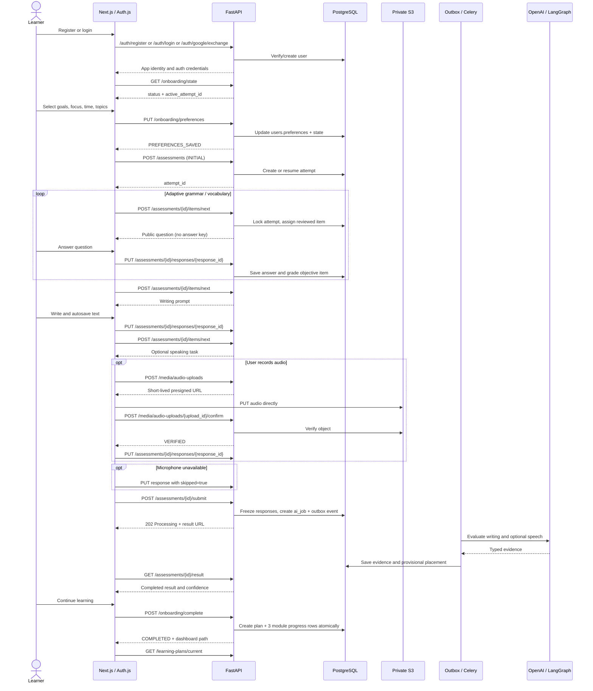

# TalkFiesta — Authentication → Onboarding → CEFR Assessment

**API & Workflow Design v1.0 | 2026-10-29**  
**Stack:** Next.js (Auth.js BFF), FastAPI, Pydantic 2, SQLAlchemy, PostgreSQL, S3, Redis/Celery, OpenAI, LangChain, LangGraph, LangSmith  
**Schema target:** TalkFiesta Simplified Database Schema V4 (14 tables) — **proposal, not necessarily migrated into the V3 codebase**.

## 1. Scope and design decisions

This document describes one complete vertical slice:

`Register/Login → check onboarding state → save learning preferences → adaptive assessment → writing and optional speaking → async evaluation → provisional CEFR → create learning plan → dashboard`.

- One FastAPI modular monolith owns business logic and application data.
- The Next.js BFF owns browser session and secure server-to-server communication; it does not implement separate grading or onboarding rules.
- For email/password, FastAPI verifies credentials. For Google, Auth.js performs OIDC and the backend accepts *only* a verified Google ID token or a trusted, signed server-side identity assertion; never a raw email address.
- The FastAPI API uses an application JWT with `sub`, `iss`, `aud`, `exp` and restricted permissions. Do not put app access tokens in `localStorage`.
- Use short-lived app access credentials and a coherent server-side session strategy; **the 14-table V4 schema does not model independently rotated/revocable FastAPI refresh sessions**. If those are required, add an `auth_sessions` table rather than burying refresh credentials in `users.profile` JSONB. For MVP, a BFF-managed browser session with trusted short-lived API token exchange avoids adding a dedicated refresh-token table.
- `users.preferences` JSONB is the sole onboarding preference store; `users.onboarding_status` is the high-level routing state.
- `assessment_attempts` owns the assessment state and result; `assessment_responses` rows double as *assigned item records* (no separate `assessment_items` table).
- `content_items` owns immutable published question versions, including private answer keys inaccessible to learners.
- `media_uploads` controls short-lived S3 uploads and recording ownership.
- The AI worker uses `ai_jobs` and `outbox_events` for durable processing; the HTTP request never waits on the model call.
- `learning_plans` and `module_progress` are created idempotently only after a completed placement is available and matching curriculum exists.
- The CEFR output is explicitly **provisional**; assessment bank and placement policy require calibration.

## 2. End-to-end sequence diagram



## 3. Recommended endpoint inventory

All paths below are prefixed with `/api/v1`; `{id}` values are server-issued UUIDs.

### 3.1 Authentication

| Method | Endpoint | Auth | HTTP | Purpose |
|---|---|---|---|---|
| `POST` | `/auth/register` | Public | 201 | Email/password account creation |
| `POST` | `/auth/login` | Public | 200 | Verify credentials, establish application identity |
| `POST` | `/auth/google/exchange` | Trusted BFF | 200 | Exchange verified Google identity for application identity |
| `POST` | `/auth/logout` | Session | 204 | End browser and, if supported, server session |
| `GET` | `/users/me` | Required | 200 | Identity, role, onboarding status |

If using a FastAPI-issued independently refreshable token strategy instead of short-lived BFF exchanges, additionally implement `/auth/refresh`, hashed rotation/revocation and a separate `auth_sessions` table. Do not claim secure revocation from stateless JWTs alone.

### 3.2 Onboarding

| Method | Endpoint | Auth | HTTP | Purpose |
|---|---|---|---|---|
| `GET` | `/onboarding/state` | Required | 200 | Authoritative resume/redirect state |
| `PUT` | `/onboarding/preferences` | Required | 200 | Upsert goals, focus, daily minutes, topics, comfort |
| `POST` | `/onboarding/complete` | Required | 200 | Accept completed placement; initialize plan exactly once |

### 3.3 Assessment

| Method | Endpoint | Auth | HTTP | Purpose |
|---|---|---|---|---|
| `POST` | `/assessments` | Required | 201 / 200 | Create or resume one active initial assessment |
| `GET` | `/assessments/{id}` | Owner | 200 | Retrieve state, progress and next action |
| `GET` | `/assessments/{id}/current-item` | Owner | 200 / 204 | Read already assigned, unanswered item |
| `POST` | `/assessments/{id}/items/next` | Owner | 201 / 200 / 204 | Assign next adaptive question (state-changing operation) |
| `PUT` | `/assessments/{id}/responses/{response_id}` | Owner | 200 | Autosave or finalize response with revision check |
| `POST` | `/assessments/{id}/submit` | Owner | 202 | Freeze answers and queue evaluation |
| `GET` | `/assessments/{id}/result` | Owner | 200 | Poll processing and fetch provisional result |

### 3.4 Audio and post-assessment

| Method | Endpoint | Auth | HTTP | Purpose |
|---|---|---|---|---|
| `POST` | `/media/audio-uploads` | Owner | 201 | Allocate assessment audio upload |
| `POST` | `/media/audio-uploads/{upload_id}/confirm` | Owner | 200 | Verify the object and bind to assessment response |
| `GET` | `/learning-plans/current` | Required | 200 | Read created personalized plan |
| `GET` | `/dashboard` | Required | 200 | Redirect destination after successful onboarding |

## 4. Representative request / response contracts

### 4.1 Register

`POST /api/v1/auth/register`

```json
{"email":"learner@example.com","password":"<user-chosen password>","display_name":"Sam"}
```

**201:**

```json
{"id":"11111111-1111-4111-8111-111111111111","email":"learner@example.com","onboarding_status":"NOT_STARTED"}
```

Password is hashed (Argon2 recommended) and never returned. Email verification/reset can be added before public launch.

### 4.2 Login and first redirect

`POST /api/v1/auth/login` → BFF-consumed token/session response. `GET /api/v1/onboarding/state`:

```json
{
  "status":"NOT_STARTED",
  "next_step":"PREFERENCES",
  "active_assessment_id":null,
  "can_access_dashboard":false
}
```

Possible `users.onboarding_status` values: `NOT_STARTED`, `PREFERENCES_SAVED`, `ASSESSING`, `RESULT_READY`, `COMPLETED`.

### 4.3 Save learning preferences

`PUT /api/v1/onboarding/preferences`

```json
{
  "goals":["BUSINESS"],
  "focus_areas":["SPEAKING","WRITING"],
  "daily_minutes":15,
  "topics":["DAILY_LIFE","TRAVEL"],
  "self_reported_comfort":"SIMPLE",
  "timezone":"Asia/Riyadh"
}
```

**200:** `{"status":"PREFERENCES_SAVED","saved":true}`.

Validate allowed enums, nonempty unique selected goals, bounded list sizes, daily-minute options, and IANA timezone. Save normalized preferences in **`users.preferences` JSONB**, not a redundant `user_learning_preferences` table in V4.

### 4.4 Start or resume the assessment

`POST /api/v1/assessments`  
Header: `Idempotency-Key: <opaque unique key>`

```json
{"kind":"INITIAL"}
```

**201 Created:**

```json
{
  "id":"22222222-2222-4222-8222-222222222222",
  "status":"IN_PROGRESS",
  "content_release":"placement-bank-v1",
  "estimated_minutes":7,
  "resumed":false
}
```

If an active `INITIAL` attempt already exists, return the same attempt with `200` and `resumed:true` (do not create a duplicate).

### 4.5 Request next adaptive question

`POST /api/v1/assessments/{attempt_id}/items/next`

**201 Created:**

```json
{
  "response_id":"33333333-3333-4333-8333-333333333333",
  "position":1,
  "skill":"GRAMMAR",
  "kind":"MULTIPLE_CHOICE",
  "prompt":"I have lived here ____ 2022.",
  "choices":[
    {"id":"a","text":"for"},
    {"id":"b","text":"since"},
    {"id":"c","text":"during"}
  ],
  "revision":0
}
```

The server first creates `assessment_responses(status=ASSIGNED, position, question_content_id)` under an assessment lock. A repeated call while an unanswered item exists returns **the same assigned item**, rather than consuming another question. A `GET /current-item` retrieves it without mutation.

Adaptive selection is a deterministic backend policy. Correct answers, hidden grading rubrics, and private question metadata are never returned in learner-facing JSON.

### 4.6 Save objective answer / writing / speaking

`PUT /api/v1/assessments/{attempt_id}/responses/{response_id}`

**Multiple choice**:

```json
{"kind":"MULTIPLE_CHOICE","selected_choice_id":"b","expected_revision":0}
```

**Writing**:

```json
{"kind":"SHORT_WRITING","text":"I work as a developer, and yesterday ...","expected_revision":0}
```

**Speaking**:

```json
{"kind":"RECORDED_SPEAKING","media_upload_id":"44444444-4444-4444-8444-444444444444","expected_revision":0}
```

**Speaking skipped**:

```json
{"kind":"RECORDED_SPEAKING","skipped":true,"skip_reason":"MIC_UNAVAILABLE","expected_revision":0}
```

**200:**

```json
{"response_id":"33333333-3333-4333-8333-333333333333","status":"ANSWERED","revision":1,"saved":true}
```

The server rejects answers for unassigned items or another user's attempt. Use `409 VERSION_CONFLICT` when `expected_revision` is stale. If the *same request* has already been saved, a duplicate retry can return the previously committed outcome without changing the answer.

### 4.7 Speaking upload sequence

1. `POST /media/audio-uploads` with `purpose=ASSESSMENT`, a valid `assessment_response_id`, desired `content_type=audio/webm`, and expected size; get `upload_id`, presigned PUT URL and expiry.
2. Browser PUTs bytes to private S3 using the signed URL.
3. `POST /media/audio-uploads/{upload_id}/confirm`; backend verifies user ownership, assessment-response binding, existence, size, type and usable audio.
4. `PUT /assessments/{id}/responses/{response_id}` referencing the **verified** `media_upload_id`.
5. If microphone access is missing, save `SKIPPED` with reason; the user may proceed with reduced placement confidence.

### 4.8 Submit assessment

`POST /api/v1/assessments/{attempt_id}/submit`  
Header: `Idempotency-Key: <opaque unique key>`

**202 Accepted:**

```json
{
  "attempt_id":"22222222-2222-4222-8222-222222222222",
  "status":"PROCESSING",
  "job_id":"55555555-5555-4555-8555-555555555555",
  "result_url":"/api/v1/assessments/22222222-2222-4222-8222-222222222222/result"
}
```

**Single DB transaction:** validate required responses → freeze attempt → insert `ai_jobs` and `outbox_events` → commit. No synchronous model call inside this endpoint. The same request must not create duplicate billable work.

### 4.9 Poll and retrieve assessment result

`GET /api/v1/assessments/{attempt_id}/result`

While processing:

```json
{"status":"PROCESSING","placement":null,"retry_after_seconds":3}
```

Once finished (illustrative **not a real graded result**):

```json
{
  "status":"COMPLETED",
  "placement":{
    "cefr":"A2",
    "provisional":true,
    "confidence":"MEDIUM",
    "skills":{
      "grammar":{"level":"A2","assessed":true},
      "vocabulary":{"level":"B1","assessed":true},
      "writing":{"level":"A2","assessed":true},
      "speaking":{"level":null,"assessed":false,"reason":"MIC_UNAVAILABLE"}
    },
    "strengths":["Understands everyday vocabulary"],
    "improvement_priorities":["Past tense accuracy"],
    "rubric_version":"placement-v1"
  }
}
```

The worker uses deterministic grading for MCQs, OpenAI transcription for uploaded audio, LangChain structured writing/speaking evaluation, and a **versioned placement policy** to estimate CEFR. LangGraph orchestrates the graph; LangSmith collects appropriately redacted traces. This short test must not be presented as formal CEFR certification.

### 4.10 Complete onboarding and create first plan

`POST /api/v1/onboarding/complete`

```json
{"assessment_attempt_id":"22222222-2222-4222-8222-222222222222"}
```

**200:**

```json
{
  "status":"COMPLETED",
  "learning_plan_id":"66666666-6666-4666-8666-666666666666",
  "next_path":"/dashboard"
}
```

**Transactional service behavior:** lock `users` row → verify assessment belongs to user, has completed result and published curriculum exists → create one active `learning_plans` row and three `module_progress` rows, each with its pinned content release → update `users.onboarding_status=COMPLETED` and `current_cefr` → commit. If plan already exists, return it. If published content is missing, return a recoverable error and do **not** mark onboarding complete.

## 5. V4 table-by-flow mapping

| Workflow | Primary writes | Supporting reads |
|---|---|---|
| Register/login | `users` | `users` |
| Goal/preferences | `users.preferences`, `users.onboarding_status` | `users` |
| Start assessment | `assessment_attempts` | `content_items` |
| Assign question | `assessment_responses` (`ASSIGNED`) | `assessment_attempts`, `content_items` |
| Save answer | `assessment_responses` | `assessment_attempts`, `content_items` |
| Store audio | `media_uploads` | `assessment_responses`, S3 metadata |
| Submit assessment | `assessment_attempts`, `ai_jobs`, `outbox_events` | `assessment_responses` |
| AI results | `assessment_responses.grading`, `assessment_attempts.result`, `assessment_attempts.placement_cefr` | Audio, question/rubric releases |
| Complete onboarding | `learning_plans`, `module_progress`, `users` | `assessment_attempts`, `content_items` |

No extra `onboarding_sessions`, `assessment_items`, or `assessment_results` tables are needed in V4; they are composed into the existing `users`, `assessment_responses`, and `assessment_attempts` respectively.

## 6. Status models

### User onboarding state

```text
NOT_STARTED → PREFERENCES_SAVED → ASSESSING → RESULT_READY → COMPLETED
```

### Assessment attempt state

```text
IN_PROGRESS → SUBMITTED → PROCESSING → COMPLETED
                             ├→ FAILED_RETRYABLE → PROCESSING
                             └→ FAILED_FINAL
```

### Assessment response state

```text
ASSIGNED → ANSWERED
         └→ SKIPPED (only where permitted)
```

Status transitions are validated in the *service layer*; the browser cannot set the state arbitrarily.

## 7. Critical security and reliability contracts

1. Every `GET/PUT/POST` involving an assessment ID must verify `assessment_attempts.user_id == current_user.id` (otherwise 404 or forbidden according to a consistent disclosure policy).
2. Only server-assigned, immutable published questions may be presented; never disclose correct choices or unpublished answer keys.
3. Keep a single active `INITIAL` attempt per user with a partial unique index; enforce unique `(attempt_id, position)` and `(attempt_id, question_content_id)` in `assessment_responses`.
4. Put a transaction lock around adaptive assignment and onboarding completion; use response revision checks for draft autosave.
5. Require verified owner-bound `media_uploads`, strict content type/size/duration controls, and private S3 storage. Explicitly define audio retention and deletion.
6. Do not mark onboarding completed until a complete assessment result and a usable curriculum are persisted.
7. Submission requests and AI jobs must be idempotent; enqueue with outbox events and replay safely after failures.
8. Output schemas must be Pydantic validated, with `unassessed` fields when data is missing; pronunciation must not be inferred from text.
9. Configure limits on assessments, audio duration, concurrent AI jobs, and provider token usage.
10. Do not log passwords, bearer credentials, raw recordings, or learner transcripts into application logs or default LangSmith traces.

## 8. Error contract

```json
{
  "error": {
    "code": "ASSESSMENT_ALREADY_SUBMITTED",
    "message": "This assessment cannot be edited after submission.",
    "request_id": "request-uuid"
  }
}
```

| Status | Typical case |
|---|---|
| `400` | Invalid assessment transition, missing required item |
| `401` | Unauthenticated or expired session |
| `403` / `404` | Unauthorized owned resource, consistent disclosure behavior |
| `409` | Revision conflict, reused idempotency key for different payload, duplicate resource |
| `413` | Audio too large |
| `422` | Pydantic/request validation error |
| `429` | Rate limit or assessment abuse limit |
| `503` | Unavailable curriculum or temporarily unavailable processing |

## 9. Backend module-to-service mapping

```text
app/
├── modules/
│   ├── auth/
│   │   ├── router.py
│   │   ├── schemas.py
│   │   ├── service.py
│   │   └── repository.py
│   ├── onboarding/
│   │   ├── router.py
│   │   ├── schemas.py
│   │   └── service.py
│   ├── assessment/
│   │   ├── router.py
│   │   ├── schemas.py
│   │   ├── models.py
│   │   ├── repository.py
│   │   ├── service.py
│   │   ├── selection.py          # deterministic adaptive question selection
│   │   ├── placement.py          # calibrated, versioned policy
│   │   └── ai/
│   │       ├── graph.py
│   │       ├── state.py
│   │       ├── nodes.py
│   │       ├── evaluators.py
│   │       └── prompts/
│   ├── media/
│   ├── learning_plans/
│   └── jobs/
├── infrastructure/
│   ├── database/
│   ├── storage/
│   ├── ai/
│   └── messaging/
└── workers/
    ├── celery_app.py
    ├── assessment_tasks.py
    └── outbox_dispatcher.py
```

Routers validate and delegate. Services own business transactions. Repositories do not commit independently. LangGraph runs only in the AI worker, not in the request handler.

## 10. Suggested implementation order & acceptance tests

1. Register/login and protected `GET /users/me`.
2. Resumable `GET /onboarding/state` and validated `PUT /onboarding/preferences`.
3. Assessment creation/resume, published question bank, one assigned question at a time.
4. Versioned answer autosave and writing input.
5. Presigned audio upload, object verification, skip-speaking path.
6. Submit + transaction outbox + Celery worker + LangGraph structured results.
7. Provisional CEFR result polling.
8. Idempotent onboarding completion and three independent module enrollments.

**Integration tests:** repeated login resumes prior step; concurrent start creates one active attempt; concurrent next-item requests assign only one question; answer revisions reject stale updates; answer keys never leak; audio bound to wrong user is rejected; skipped speaking produces an explicit unassessed status; repeated submit creates one job; worker retry doesn't double-apply results; `onboarding/complete` creates one plan and exactly three modules; missing curriculum leaves onboarding uncompleted.

---

**Boundary:** This contract describes the *proposed simplified V4 architecture*. The V3 FastAPI scaffold and its migrations have not automatically been converted to these exact tables, fields, or endpoint semantics.
