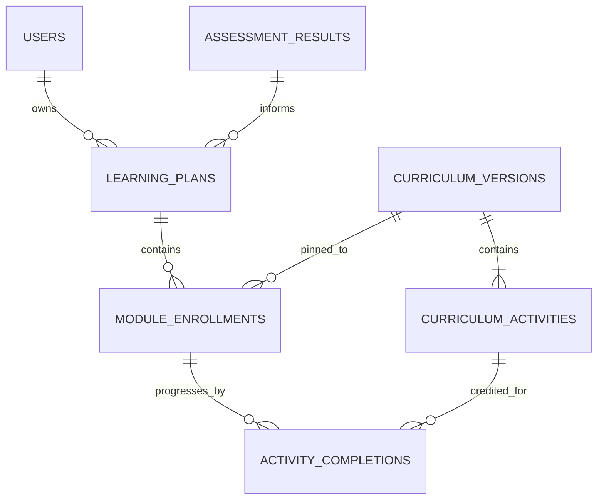

# TalkFiesta — Curriculum & Learning Plan Engine (V3)

**Architectural stage:** Step 8, based on the prior HLD/ERD/API specification.  
**Status:** Runnable backend source scaffold; developmental sample curriculum, not production-reviewed instruction.

## 1. What V3 adds

- Published and versioned 21-day curricula with a separate version per **module × CEFR band × goal variant × cycle**.
- Immutable version **assignment**: a learner stays pinned to their assigned `curriculum_version_id` even if the catalog later has newer versions.
- Three independently tracked learning module enrollments: Speaking, Vocabulary, Writing.
- A source-backed **activity completion ledger**: valid, accepted practice submissions advance only their module, never all three modules together.
- Today/timeline/dashboard endpoints with ownership checks and local-date activity aggregation.
- A repeatable demo curriculum script: Cycle 1, A1/A2/B1, three modules, 21 days each, ten distinct vocabulary entries per day.
- An **optional** OpenAI + LangChain + LangGraph offline curriculum authoring graph. Generated material remains DRAFT until an administrator/editor reviews it and publishes a complete 21-day version.

**Not included:** live practice submission endpoints, user-facing generative lessons, pronunciation scoring, validated CEFR curricula, adaptive spaced-repetition grading, interview panels, cycle 2–5 courses, admin review UI, offline authoring calibration, and production content editorial sign-off.

## 2. Data entities and relationships



### `curriculum_versions`

| Column | Type | Rule |
|---|---|---|
| `id` | UUID | Primary key |
| `cycle_number` | integer | 1–5 |
| `module` | string | `SPEAKING`, `VOCABULARY`, `WRITING` |
| `cefr_level` | string | A1, A2, B1 sample bands |
| `goal_variant` | string | `GENERAL`, with optional BUSINESS/TRAVEL variants |
| `version_number` | integer | 1,2,... |
| `status` | string | DRAFT / PUBLISHED / ARCHIVED |
| `origin` | string | DEMO / AI / HUMAN |
| `published_at` | timestamp | Nullable |

Unique identity: `(cycle_number, module, cefr_level, goal_variant, version_number)`.

### `curriculum_activities`

| Column | Type | Rule |
|---|---|---|
| `id` | UUID | Primary key |
| `curriculum_version_id` | UUID FK | Belongs to one immutable curriculum version |
| `day` | integer | 1–21, unique within version |
| `title`, `topic`, `instructions` | string/text | Required |
| `estimated_minutes` | integer | 1–90 |
| `content` | JSON | Validated separately for each module |

Published version requirements: exactly 21 valid days. Each vocabulary day needs exactly ten unique words, each with term/definition/example, and no repeated term anywhere in the 21-day version.

### `module_enrollments` (extended)

Added nullable `curriculum_version_id` reference. Null means pre-existing V2 enrollment awaiting content. The system binds only a published version and does not automatically upgrade already-pinned learners.

`current_day` is the **next required curriculum day**. On accepted Day 21 completion, `current_day` stays at 21 and `status` becomes `COMPLETED`.

### `activity_completions`

| Column | Type | Rule |
|---|---|---|
| `id` | UUID | Primary key |
| `enrollment_id` | UUID FK | One learner's module enrollment |
| `activity_id` | UUID FK | The assigned curriculum activity |
| `source_type` | string | Accepted `SPEAKING_SUBMISSION` / `VOCABULARY_SESSION` / `WRITING_SUBMISSION` |
| `source_id` | UUID | ID of accepted practice record |
| `local_practice_date` | DATE | Learner timezone date |
| `completed_at` | TIMESTAMPTZ | Accepted submission timestamp |

Unique `(enrollment_id, activity_id)` and `(source_type, source_id)` prevent double credit. Future module services must verify the source record belongs to the learner and represents a valid, accepted submission **in the same transaction** before invoking the internal completion service.

## 3. Curriculum selection

1. Read active learning plan: cycle, provisional CEFR level, primary goal.
2. For each of Speaking/Vocabulary/Writing, try matching a **PUBLISHED** version with exact cycle, module, CEFR and goal variant.
3. If no goal-specific version is published, use the matching **GENERAL** variant.
4. If no matching published version exists, retain `AWAITING_CONTENT`; do not silently substitute a different CEFR level or reveal DRAFT material.
5. Once a version is assigned, pin its UUID. New publication creates a new version; it cannot replace an in-progress learner's assigned exercises.

This is initial plan selection, **not runtime per-user generation**. Topic preferences and focus areas are stored in the onboarding preferences; V3 prioritizes focus in plan metadata. Full topic-level personalization is deferred until a richer, reviewed activity catalog exists.

## 4. API contract additions

All endpoints require an authenticated learner except the trusted internal CLI operations.

| Method | Endpoint | Purpose |
|---|---|---|
| `GET` | `/api/v1/curriculum/catalog` | Published curriculum metadata only |
| `GET` | `/api/v1/learning-plans/current` | Active plan and pinned versions |
| `GET` | `/api/v1/learning-plans/current/today` | The current activity for each module |
| `GET` | `/api/v1/learning-plans/current/modules/{module}/timeline` | 21-day module status; no unlocked future content |
| `GET` | `/api/v1/dashboard` | Active days, streak, module completion and today's activities |
| `POST` | `/api/v1/onboarding/complete` | Unchanged public contract; now attempts curriculum binding |

**No endpoint for arbitrary completion exists.** Completion is an internal domain-service method: `complete_validated_activity(...)` and must only follow a validated practice submission.

Example response from `GET /api/v1/learning-plans/current/today` (simplified):

```json
{
  "learning_plan_id": "<UUID>",
  "cycle_number": 1,
  "placement_cefr": "A2",
  "daily_target_minutes": 15,
  "modules": [
    {"module": "SPEAKING", "current_day": 1, "status": "ACTIVE", "activity": {"id": "<UUID>", "day": 1, "title": "Day 1: Introductions speaking", "content": {"exercise_type": "CONVERSATIONAL", "prompt": "Introduce yourself to a new classmate", "target_seconds": 75}}},
    {"module": "VOCABULARY", "current_day": 1, "status": "ACTIVE", "activity": {"id": "<UUID>", "day": 1, "content": {"words": ["... ten entries ..."]}}},
    {"module": "WRITING", "current_day": 1, "status": "ACTIVE", "activity": {"id": "<UUID>", "day": 1, "content": {"prompt": "Write a friendly introduction to someone new", "target_words": 70}}}
  ]
}
```

The example shortens some fields and does not represent an exact complete response payload.

## 5. Backend code structure

```text
app/modules/curriculum/
  models.py           # CurriculumVersion and CurriculumActivity
  service.py          # Validation, version publication, selection
  router.py           # Authenticated published-catalog read endpoint
  ai/draft_graph.py   # Offline OpenAI/LangChain/LangGraph draft authoring
app/modules/learning_plans/
  models.py           # LearningPlan, ModuleEnrollment, ActivityCompletion
  service.py          # Create/bind plan, today, timeline, internal completion, dashboard
  router.py           # APIs
alembic/versions/
  0003_curriculum_and_completion.py
scripts/
  demo_curriculum_content.py
  seed_cycle1_curriculum.py
  generate_curriculum_draft.py
  publish_curriculum.py
tests/
  test_curriculum_v3_sync.py
  test_curriculum_v3_api.py
```

## 6. Setup from V2

Use a new/updated checkout, never apply V3 code against an un-migrated database.

```bash
cp .env.example .env
# Use your own JWT_SECRET and OPENAI_API_KEY

docker compose up -d db redis minio create-bucket
docker compose run --rm api alembic upgrade head

# Initial assessment bank (V2)
docker compose run --rm api python -m scripts.seed_assessment_questions

# Safe DRAFT mode (default)
docker compose run --rm api python -m scripts.seed_cycle1_curriculum

# DEVELOPMENT ONLY: allow the sample curricula to be assigned to learners
docker compose run --rm api python -m scripts.seed_cycle1_curriculum --publish-demo

docker compose up -d api worker dispatcher
```

Optional goal-specific demo variants (may improve matching for BUSINESS or TRAVEL goals):

```bash
docker compose run --rm api python -m scripts.seed_cycle1_curriculum --publish-demo --goal-variant BUSINESS
```

Run locally at `http://localhost:8000/docs` using an authenticated token. A learner needs a completed V2 assessment and onboarding before accessing a plan/dashboard.

### Optional OpenAI curriculum authoring

```bash
# 21 calls for one 21-day draft; provider usage will incur costs.
docker compose run --rm api python -m scripts.generate_curriculum_draft --module SPEAKING --cefr A2 --version 2

# AFTER human editorial review, an authorized operator may publish the version:
docker compose run --rm api python -m scripts.publish_curriculum --version-id UUID --approved-by-reviewer
```

The graph generates structured outputs; source is always saved as `origin=AI`, `status=DRAFT`. Publishing validates the full version. There is deliberately no user-facing AI curriculum generation endpoint. The CLI approval switch is an **operational assertion**, not a fully implemented reviewer audit/authorization workflow; deploy an authenticated review and audit system before public production publishing. LangSmith tracing is optional and off by default for privacy.

## 7. Reliability and threat boundaries

- Only trusted practice-domain services can create completion events. The V3 learner API cannot mark its own activities complete.
- Version pinning prevents curriculum drift mid-course.
- The database transaction must atomically save accepted practice submission + activity completion (future practice modules).
- PostgreSQL row locks and unique constraints enforce progression consistency in production; run concurrency tests using PostgreSQL, not SQLite alone.
- Use private S3 + user-owned upload IDs for future speaking practice; assessment upload endpoints remain distinct.
- No arbitrary cross-user curriculum enrollment reads.
- Keep content generation offline and reviewed; do not assume an OpenAI response is CEFR-calibrated or educationally correct.
- Content history requires a stronger **database immutability policy** and audit trail once publication is used in production. The current workflow avoids editing published versions, but an operator with direct SQL access could still mutate rows.
- Streaks are computed from completion dates in the learner's IANA timezone; daylight-saving transitions and timezone changes need end-to-end acceptance testing.

## 8. Verification status

- Source compilation: completed.
- ORM metadata: 16 tables after V3 schema additions.
- V1→V2→V3 migration upgrade and full downgrade: SQLite smoke test passed.
- Demo seeding: nine versions + 189 activities for GENERAL; the vocabulary seed contains 210 distinct terms per version; repeated seed is idempotent.
- Isolated synchronous curriculum publication validation: 5 tests passed.
- Complete FastAPI HTTP/async integration and OpenAI generation calls: **not executed** in this workspace because some V2 runtime/test packages are unavailable here. Tests are included for local/Docker verification.
- Not production-reviewed courseware: all seeded content is illustrative, and AI drafts require editorial review before publication.

## 9. Next milestone

**Step 9 — Daily Speaking Practice Engine**, using assigned `curriculum_activities`, private S3 uploads, OpenAI speech-to-text, LangGraph feedback, durable accepted submissions and `complete_validated_activity()`. Then implement Vocabulary review sessions and Writing revision workflows.
