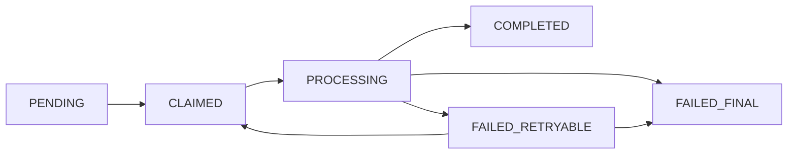

# TalkFiesta — Detailed API Design & Backend Implementation Contracts

**System-design stage:** Step 5 — proposed MVP API specification v1.0  
**Date:** 27 October 2026  
**Inputs:** `TalkFiesta.md`, `TalkFiesta-Codebase-Structure.md`, `TalkFiesta-Database-Schema.md`, `TalkFiesta-Detailed-Database-ERD-and-Backend-Scaffolding.md`  
**Stack:** Next.js + Auth.js BFF; Python FastAPI; Pydantic 2; PostgreSQL + SQLAlchemy 2 + Alembic; Redis + Celery; private S3; OpenAI; LangChain + LangGraph + LangSmith.

> **Status:** This is a **proposed implementation contract**, not a claim that endpoints or models are already deployed. It preserves TalkFiesta's existing 21-day speaking, vocabulary, and writing concepts, and incorporates the later decisions for independent module progress, provisional CEFR assessments, and OpenAI-based AI feedback.

## 1. Scope and constraints

**MVP:** Email/password and Google identity, first-login onboarding, goal/time/topic preferences, short initial CEFR assessment (grammar/vocabulary/writing/optional speaking), personalized 21-day plan, speaking recording + transcription + feedback, vocabulary daily set and review, writing submissions + up to three revisions, progress and achievements, minimal content administration.

**Phase 2, not implemented in this API v1:** Live bidirectional AI voice chat, real-time interview-panel orchestration, cycles 2–5 where content is not published, social features.

**Nonnegotiable invariants:**
1. PostgreSQL is the system of record; Redis is never the only copy of accepted learner work.
2. Every learner-bound query is scoped by authenticated `user_id`, derived from verified credentials, never from a body field.
3. A client-submitted S3 key, duration, CEFR level, score, or `completed=true` cannot be trusted without backend verification.
4. A valid speaking/writing **submission acceptance** may complete the assigned learning activity before AI feedback finishes.
5. Exactly one active initial assessment, one active learning plan, and one enrollment per module per plan, enforced in PostgreSQL.
6. An assessment submission or practice submission can be retried without starting a second paid evaluation or advancing curriculum twice.
7. Assessment questions and rubrics are versioned; published curriculum is immutable for learners already assigned to it.
8. CEFR placement is **provisional** and derived from available evidence. Transcript-only evaluation is **not** pronunciation grading.

## 2. API-wide conventions

| Topic | Contract |
|---|---|
| Base URL | `https://api.talkfiesta.example/api/v1` (example placeholder) |
| Payload | `application/json`; audio uploaded directly to S3 via signed PUT |
| Identifier | UUID, lowercase string representation |
| Time | UTC ISO-8601 with timezone (`2026-10-27T10:30:00Z`); practice date separate `YYYY-MM-DD` |
| Auth | `Authorization: Bearer <FastAPI-issued access JWT>` on protected FastAPI calls; browser gets it through server-side BFF handling |
| Version | `/api/v1` for breaking contracts; independent `rubric_version`, `prompt_version`, `schema_version` for AI |
| Request correlation | Client may send `X-Request-ID`; server returns authoritative `X-Request-ID` |
| Idempotency | `Idempotency-Key: <opaque UUID>` on state-creating `POST` commands (explicitly noted below) |
| Optimistic control | `expected_version` on draft/answer saves; `409 VERSION_CONFLICT` if stale |
| Pagination | `limit` (default 20, maximum 100) + opaque `cursor`; never expose raw offset-based paging for large event histories |
| Successful response | Return resource JSON directly, no universal `data` wrapper; `204` has no body |
| Errors | `application/problem+json` with machine-readable `code`; human `detail` contains no internal secrets |
| API schema | OpenAPI generated at `/openapi.json`; generate TypeScript types/client from it |

### 2.1 Success and error patterns

`POST` resource creation: `201 Created` + `Location`. Async command: `202 Accepted` + status/resource reference + `Retry-After` when polling. Valid update: `200 OK` or `204 No Content`. Reusing a successful idempotency key with the same request returns the original stored response; same key with different payload returns `409 IDEMPOTENCY_KEY_REUSED`.

**Error example:**

```json
{
  "type": "https://api.talkfiesta.example/problems/version-conflict",
  "title": "Conflict",
  "status": 409,
  "code": "VERSION_CONFLICT",
  "detail": "The answer has changed. Refresh the current version before saving.",
  "request_id": "req_7fd742",
  "errors": []
}
```

| HTTP | Error code example | When |
|---|---|---|
| 400 | `INVALID_STATE_TRANSITION` | Cannot submit an already finalized attempt |
| 401 | `UNAUTHENTICATED` | Missing/expired or invalid API credentials |
| 403 | `INSUFFICIENT_ROLE` | Normal learner calls admin endpoint |
| 404 | `RESOURCE_NOT_FOUND` | No resource **owned by current user**, or no such resource |
| 409 | `VERSION_CONFLICT`, `ACTIVE_ATTEMPT_EXISTS` | Concurrent save / conflicting operation |
| 413 | `AUDIO_TOO_LARGE` | Upload exceeds configured limit |
| 415 | `UNSUPPORTED_AUDIO_FORMAT` | Unsupported recorded audio |
| 422 | `VALIDATION_ERROR` | Pydantic field error or missing required answer |
| 429 | `RATE_LIMITED`, `AI_QUOTA_EXCEEDED` | Abuse or user budget limit; set `Retry-After` where applicable |
| 503 | `PROVIDER_UNAVAILABLE`, `CONTENT_NOT_AVAILABLE` | Dependencies unavailable, or no suitable published curriculum |

An unauthorized user's resource ID normally returns 404 rather than leaking whether another person's resource exists. Never return internal error traces or raw OpenAI responses from these APIs.

### 2.2 Durable idempotency storage

Add **`api_idempotency_records`** to the previously proposed database design. Store `user_id`, `route_scope`, `idempotency_key`, canonical `request_hash`, `status` (`IN_PROGRESS`/`COMPLETED`), `response_http_status`, `response_json` (or a stable resource reference), `created_at`, and `expires_at`. Enforce `UNIQUE(user_id, route_scope, idempotency_key)`.

- Same key + same payload after success → return the same semantic result/resource.
- Same key + different payload → `409 IDEMPOTENCY_KEY_REUSED`.
- In-progress duplicate → return the original in-progress resource/receipt, or `409 COMMAND_IN_PROGRESS` with `Retry-After`; choose one policy consistently per command.
- Idempotency is scoped to user and operation; persistent domain uniqueness (one active plan, one completion, unique AI job source/version) remains mandatory because headers may be absent or changed.
- Set an expiration/retention policy that exceeds the client's retry window. Expiring an HTTP idempotency record must **not** allow duplication of the underlying domain action.

This is a **proposed extension** to the Step 4 ERD, not an existing table in the uploaded schema.

### 2.3 Enumeration contracts

```text
OnboardingStatus = NOT_STARTED | PREFERENCES_SAVED | ASSESSMENT_IN_PROGRESS | ASSESSMENT_PROCESSING | RESULT_READY | COMPLETED
AssessmentStatus = CREATED | IN_PROGRESS | SUBMITTED | PROCESSING | COMPLETED | FAILED_RETRYABLE | FAILED_FINAL
AssessmentKind = INITIAL | REASSESSMENT
AssessmentSkill = GRAMMAR | VOCABULARY | WRITING | SPEAKING
AssessmentItemKind = MULTIPLE_CHOICE | SHORT_WRITING | RECORDED_SPEAKING
ProcessingStatus = PENDING | PROCESSING | COMPLETED | FAILED_RETRYABLE | FAILED_FINAL
Module = SPEAKING | VOCABULARY | WRITING
PlanStatus = ACTIVE | COMPLETED | CANCELLED
EnrollmentStatus = ACTIVE | COMPLETED | PAUSED
PracticeStatus = DRAFT | SUBMITTED | COMPLETED
UploadStatus = CREATED | UPLOADED | VERIFIED | REJECTED | EXPIRED
ContentStatus = DRAFT | IN_REVIEW | APPROVED | PUBLISHED | RETIRED
CEFR = A1 | A2 | B1 | B2 | C1 | C2
Confidence = LOW | MEDIUM | HIGH
```

Do not expose an `overall_score` when the rubric/evidence cannot meaningfully support one; use nullable fields plus `not_assessed_reasons`.

## 3. Authentication & authorization contract

**Trust boundary:** Auth.js runs on the Next.js server and manages the browser-facing session. FastAPI remains the authority for app users and API authorization; a signed, short-lived FastAPI access token is used for its API. The BFF handles the backend token server-side; do not write it to localStorage. FastAPI refresh sessions (if implemented) use hashed, rotated refresh credentials and revocation records.

**Google login:** Auth.js completes OIDC login. The backend accepts an authenticated **server-side identity exchange** only after verifying a trusted Google ID token or a short-lived signed BFF assertion with strict `iss`, `aud`, `exp`, `jti`, and provider-identity validation. Never accept a plain email or user ID as proof of login. Email/password sessions use the same application user identity.

**Roles:** `LEARNER`, `CONTENT_REVIEWER`, `ADMIN`; object-level authorization is checked even for reviewers where relevant. Define one canonical identity system; do not maintain unrelated independent JWT identities in Next.js and FastAPI.

### Routes

| Method | Path | Auth | Contract / status |
|---|---|---|---|
| `POST` | `/auth/register` | Public | `{email,password,first_name?}` -> `201` user summary; verify-email policy configurable |
| `POST` | `/auth/login` | Public | `{email,password}` -> `200` BFF/server-consumable token result |
| `POST` | `/auth/google/exchange` | Trusted BFF | Verified OIDC/BFF assertion -> app token result |
| `POST` | `/auth/refresh` | Secure refresh session | Rotate refresh credential; `200` new access identity |
| `POST` | `/auth/logout` | Authenticated | Revoke session; `204` |
| `GET` | `/users/me` | Learner | Current user and onboarding summary; `200` |
| `PATCH` | `/users/me` | Learner | Limited profile changes; `200` |
| `GET` | `/users/me/preferences` | Learner | Current learning preferences; `200` |
| `PATCH` | `/users/me/preferences` | Learner | Update non-assessment preferences safely; `200` |

**Recommended, separate auth stories:** email verification, forgot/reset password, account-deletion requests, session listing/revocation, account linking/unlinking. These are essential before wider public launch, but not used in the instructional flows below.

**`GET /users/me` response**

```json
{
  "id": "11111111-1111-4111-8111-111111111111",
  "email": "learner@example.com",
  "first_name": "Sam",
  "roles": ["LEARNER"],
  "onboarding_completed": false,
  "onboarding_status": "PREFERENCES_SAVED"
}
```

## 4. Onboarding API

| Method | Route | Auth | Meaning |
|---|---|---|---|
| `GET` | `/onboarding/state` | Learner | Get current resumable state; no mutation |
| `PUT` | `/onboarding/preferences` | Learner | Upsert multiple goals, focus skills, daily minutes, topics, comfort |
| `POST` | `/onboarding/complete` | Learner | Idempotently accept completed assessment and initialize first plan |

**`GET /onboarding/state` (200)**

```json
{
  "status": "ASSESSMENT_IN_PROGRESS",
  "step": "ASSESSMENT",
  "session_id": "22222222-2222-4222-8222-222222222222",
  "active_assessment_id": "33333333-3333-4333-8333-333333333333",
  "preferences_saved": true,
  "can_complete": false
}
```

**`PUT /onboarding/preferences` request**

```json
{
  "goals": ["BUSINESS"],
  "focus_areas": ["SPEAKING", "WRITING"],
  "daily_minutes": 15,
  "topics": ["DAILY_LIFE", "TRAVEL"],
  "self_reported_comfort": "SIMPLE",
  "timezone": "Asia/Riyadh"
}
```

**Validation:** 1–4 unique goals, 1–3 distinct focus areas, 1–8 topics; `daily_minutes` in published allowed options `{5,10,15,30}` (extend via configuration); `timezone` is an IANA zone. Return normalized input plus `updated_at`. Saving twice is idempotent. User may edit preferences later without deleting assessment history.

**`POST /onboarding/complete` request:**

```json
{"assessment_result_id":"44444444-4444-4444-8444-444444444444"}
```

**`200 OK` response:**

```json
{
  "status": "COMPLETED",
  "learning_plan_id": "55555555-5555-4555-8555-555555555555",
  "dashboard_path": "/dashboard"
}
```

**Transaction rule:** Lock user's onboarding/session row; validate result ownership, finalized status and suitable published curriculum; create active plan/enrollments or return already-created plan; mark onboarding complete; commit **once**. No LLM call in this transaction. If curriculum matching fails, return `503 CONTENT_NOT_AVAILABLE`; do not mark completed.

## 5. Assessment API — adaptive objective + subjective evaluation

| Method | Path | Status | Contract |
|---|---|---|---|
| `POST` | `/assessments` | `201` or `200` | Start/resume initial attempt; require `Idempotency-Key` |
| `GET` | `/assessments/{attempt_id}` | `200` | State, progress, assessment metadata |
| `GET` | `/assessments/{attempt_id}/current-item` | `200` | Read assigned unanswered/current item (read-only) |
| `POST` | `/assessments/{attempt_id}/items/next` | `201` or `200` | Assign next adaptive item **with a DB lock**; never GET for mutation |
| `PUT` | `/assessments/{attempt_id}/responses/{item_id}` | `200` | Idempotent answer autosave with `expected_version` |
| `POST` | `/assessments/{attempt_id}/submit` | `202` | Freeze answers, create AI job + outbox; require `Idempotency-Key` |
| `GET` | `/assessments/{attempt_id}/result` | `200` | Pending/processing/failure/finalized outcome |
| `GET` | `/assessments` | `200` | Cursor-paginated historical attempts |

**Important:** Creating the next adaptive question changes persistent assessment state. Therefore it is **POST**. A safe GET can only read already-assigned items. The server must not expose private correct answers, difficulty-selection thresholds or unpublished scoring notes to learners.

**`POST /assessments` request**

```json
{"kind":"INITIAL"}
```

**`201 Created` response**

```json
{
  "id": "33333333-3333-4333-8333-333333333333",
  "kind": "INITIAL",
  "status": "IN_PROGRESS",
  "question_bank_version": "placement-2026-01",
  "estimated_minutes": 6,
  "completed_items": 0,
  "current_item_id": null
}
```

If an active initial attempt already exists, this command should return its resource with `200` and `resumed=true` rather than creating a second attempt. A reassessment must be a separate user-initiated workflow and must not accidentally overwrite onboarding placement.

**`POST /assessments/{attempt_id}/items/next` (201/200)**

```json
{
  "id": "66666666-6666-4666-8666-666666666666",
  "position": 2,
  "kind": "MULTIPLE_CHOICE",
  "skill": "GRAMMAR",
  "prompt": "I have worked here ____ 2022.",
  "choices": [
    {"id":"a","text":"for"},
    {"id":"b","text":"since"},
    {"id":"c","text":"during"}
  ],
  "response_version": 0
}
```

For writing, return `kind=SHORT_WRITING` with `instructions`, `min_words`, `recommended_words`; for speaking, return `kind=RECORDED_SPEAKING` with `target_seconds`, `max_seconds`, and `skippable=true`. If no further item is required, return `204`.

**`PUT /assessments/{attempt_id}/responses/{item_id}` examples**

Choice:

```json
{"kind":"MULTIPLE_CHOICE","selected_choice_id":"b","expected_version":0}
```

Writing:

```json
{"kind":"SHORT_WRITING","text":"Yesterday I went to work ...","expected_version":1}
```

Speaking:

```json
{"kind":"RECORDED_SPEAKING","audio_upload_id":"77777777-7777-4777-8777-777777777777","expected_version":0}
```

Speaking skipped by learner:

```json
{"kind":"RECORDED_SPEAKING","skipped":true,"skip_reason":"MIC_UNAVAILABLE","expected_version":0}
```

**`200` response**:

```json
{
  "assessment_item_id":"66666666-6666-4666-8666-666666666666",
  "saved":true,
  "response_version":1,
  "saved_at":"2026-10-27T10:33:00Z"
}
```

**Critical checks:** answer is for an item assigned to current user's own active attempt; choices belong to item; text within min/max; uploaded audio verified and bound to this exact assessment/item; answers immutable after submit. Retry with same body should not create duplicates. In an optimistic version race return `409 VERSION_CONFLICT` with latest version metadata only.

**`POST /assessments/{attempt_id}/submit` (202 Accepted)**

```json
{
  "attempt_id":"33333333-3333-4333-8333-333333333333",
  "status":"PROCESSING",
  "job_id":"88888888-8888-4888-8888-888888888888",
  "result_url":"/api/v1/assessments/33333333-3333-4333-8333-333333333333/result"
}
```

Within one SQL transaction: check required responses, freeze attempt, write `ai_jobs` + `outbox_events`, commit, return `202` with `Retry-After: 3`. Multiple-click submission with same idempotency key returns same logical job. Objective scores were saved deterministically when answers were accepted or during finalization; never ask an LLM to regrade exact-answer questions.

**`GET /assessments/{attempt_id}/result` — processing**

```json
{
  "attempt_id":"33333333-3333-4333-8333-333333333333",
  "status":"PROCESSING",
  "placement":null,
  "can_retry":false
}
```

**`GET .../result` — completed**

```json
{
  "attempt_id":"33333333-3333-4333-8333-333333333333",
  "status":"COMPLETED",
  "placement":{
    "cefr":"A2",
    "provisional":true,
    "confidence":"MEDIUM",
    "skills":{
      "grammar":{"level":"A2","assessed":true},
      "vocabulary":{"level":"B1","assessed":true},
      "writing":{"level":"A2","assessed":true},
      "speaking":{"level":null,"assessed":false,"reason":"MIC_UNAVAILABLE"}
    },
    "strengths":["Everyday vocabulary"],
    "improvement_priorities":["Past tense accuracy"],
    "rubric_version":"cefr-placement-v1"
  },
  "can_retry":false
}
```

This is **illustrative JSON**, not a real evaluated learner result. Do not claim that short onboarding exercises can reliably certify all six CEFR levels. A placement policy must be benchmarked against human-reviewed examples.

## 6. Media API — reusable private audio upload contract

**New supporting data-model requirement:** `media_uploads(id,user_id,purpose,resource_id,object_key,status,size_bytes,content_type,checksum,created_at,verified_at,expires_at)`; this table is an extension of Step 4 schema. A `media_upload_id` is provided by the browser instead of trusting caller-chosen S3 keys.

| Method | Route | Meaning |
|---|---|---|
| `POST` | `/media/audio-uploads` | Allocate a private object key and return short-lived presigned PUT URL; `201` |
| `POST` | `/media/audio-uploads/{upload_id}/confirm` | Verify object exists and belongs to its intended resource; `200` |
| `GET` | `/media/audio-uploads/{upload_id}/playback-url` | Short-lived authorized playback URL; `200` |

**Create request:**

```json
{
  "purpose":"ASSESSMENT_SPEAKING",
  "resource_id":"66666666-6666-4666-8666-666666666666",
  "content_type":"audio/webm",
  "declared_size_bytes":1260000
}
```

`purpose` is `ASSESSMENT_SPEAKING` or `DAILY_SPEAKING`; `resource_id` must be an assessment item or a speaking submission/upload reservation **owned by caller**. Issue a server-assigned upload ID/key. For daily speaking, create a draft submission or upload reservation before allocating a URL; the client must not invent a submission ID.

**Create response (`201`):**

```json
{
  "upload_id":"77777777-7777-4777-8777-777777777777",
  "method":"PUT",
  "upload_url":"https://signed-storage-url.example/temporary",
  "required_headers":{"Content-Type":"audio/webm"},
  "expires_at":"2026-10-27T10:39:00Z"
}
```

**Confirm response (`200`):**

```json
{
  "upload_id":"77777777-7777-4777-8777-777777777777",
  "status":"VERIFIED",
  "verified_size_bytes":1260000,
  "content_type":"audio/webm"
}
```

Never include actual AWS credentials in these responses. Verification includes authorized purpose/resource binding, object HEAD, allowed size and media type, and later decoded audio validation using an audio parser/probe. Do not assume browser MIME or extension is trustworthy. A recommended MVP cap is **10 MB** and **90 seconds** per clip (configurable); ensure provider upload size and format are supported. OpenAI currently documents up to 25 MB file transcription and formats including WebM, WAV, MP3, MP4, M4A and MPEG; `gpt-transcribe` is its recommended recorded-file starting model (https://developers.openai.com/api/docs/guides/speech-to-text).

Object URLs expire, storage is private, and abandoned uploads are cleaned up. The same verified upload cannot be rebound to another learner or used for a different task.

## 7. Learning plans API

| Method | Route | Purpose |
|---|---|---|
| `GET` | `/learning-plans/current` | Current active plan with per-module day/status |
| `GET` | `/learning-plans/{plan_id}` | Historical or active plan (owner-only) |
| `GET` | `/learning-plans/current/activities` | Published assigned exercises for requested module/day |
| `GET` | `/learning-plans/history` | Cursor-paginated completed plans |

**`GET /learning-plans/current` response:**

```json
{
  "id":"55555555-5555-4555-8555-555555555555",
  "cycle_number":1,
  "status":"ACTIVE",
  "placement_cefr":"A2",
  "daily_minutes_target":15,
  "modules":[
    {"module":"SPEAKING","current_day":8,"completed_days":7,"status":"ACTIVE","required_for_completion":true},
    {"module":"VOCABULARY","current_day":12,"completed_days":11,"status":"ACTIVE","required_for_completion":false},
    {"module":"WRITING","current_day":5,"completed_days":4,"status":"ACTIVE","required_for_completion":true}
  ]
}
```

Use independent `module_enrollments.current_day` and immutable `activity_completions`. The `current_day` means the **next unfinished required day**, not the present calendar day. A module finishing day 21 becomes `COMPLETED` while `current_day` stays 21. Show `completed_days=21` for a fully completed module.

**`GET /learning-plans/current/activities?module=SPEAKING` (200)**

```json
{
  "module":"SPEAKING",
  "day":8,
  "activity":{
    "id":"99999999-9999-4999-8999-999999999999",
    "type":"CONVERSATIONAL",
    "title":"Introduce yourself at work",
    "instructions":"Speak for 45 seconds about your job.",
    "target_duration_seconds":45
  }
}
```

Never return arbitrary curriculum content based solely on a client-supplied day number without confirming that it is published and accessible under this learner's enrollment/version.

## 8. Speaking API — daily recorded practice

| Method | Route | Purpose |
|---|---|---|
| `GET` | `/speaking/today` | Current assigned speaking activity |
| `POST` | `/speaking/submissions/drafts` | Create owned draft for activity, enabling audio upload binding; `201` |
| `POST` | `/speaking/submissions/{submission_id}/submit` | Accept verified uploaded audio; create completion + job/outbox; `202`, idempotent |
| `GET` | `/speaking/submissions/{submission_id}` | Submission status and feedback if ready |
| `GET` | `/speaking/history` | Cursor-paginated speaking records |

**Create draft request:**

```json
{"activity_id":"99999999-9999-4999-8999-999999999999"}
```

**`201` response**: `{ "submission_id":"aaaaaaaa-aaaa-4aaa-8aaa-aaaaaaaaaaaa", "status":"DRAFT" }`.

**Submit request** (`Idempotency-Key` required):

```json
{
  "audio_upload_id":"77777777-7777-4777-8777-777777777777",
  "client_recorded_duration_seconds":45
}
```

**`202` response:**

```json
{
  "submission_id":"aaaaaaaa-aaaa-4aaa-8aaa-aaaaaaaaaaaa",
  "activity_status":"COMPLETED",
  "evaluation_status":"PENDING",
  "job_id":"bbbbbbbb-bbbb-4bbb-8bbb-bbbbbbbbbbbb",
  "feedback_url":"/api/v1/speaking/submissions/aaaaaaaa-aaaa-4aaa-8aaa-aaaaaaaaaaaa"
}
```

**When feedback is ready (`GET .../submissions/{id}`):**

```json
{
  "submission_id":"aaaaaaaa-aaaa-4aaa-8aaa-aaaaaaaaaaaa",
  "activity_status":"COMPLETED",
  "evaluation_status":"COMPLETED",
  "duration_seconds":45,
  "transcript":"Yesterday I go to office and discuss a project.",
  "language_feedback":{
    "grammar":{"rubric_rating":2,"max_rating":5},
    "vocabulary":{"rubric_rating":3,"max_rating":5},
    "coherence":{"rubric_rating":3,"max_rating":5},
    "task_fulfillment":{"rubric_rating":4,"max_rating":5},
    "corrections":[{"original":"Yesterday I go","corrected":"Yesterday I went","explanation":"Use past tense for a past event."}],
    "improved_answer":"Yesterday I went to the office and discussed a project."
  },
  "pronunciation_score":null,
  "rubric_version":"speaking-language-v1"
}
```

**Acceptance rule:** Verify draft belongs to user, assigned activity belongs to the active speaking enrollment/day, verified audio belongs to draft, limits pass and submission not already accepted. Within **one transaction**: accept submission, create `activity_completions`, advance speaking enrollment (conditional lock), create `ai_job` + `outbox_event`. Return success regardless of subsequent model availability. A repeated submission cannot grant another day or bill a second logical evaluation.

**Reminder:** Transcript-derived grammar/vocabulary/coherence findings are not audio pronunciation findings. Approximate WPM requires trustworthy duration; real pause/filler measurements require audio or timed transcript signals.

## 9. Vocabulary API — daily words, practice, spaced repetition

| Method | Route | Purpose |
|---|---|---|
| `GET` | `/vocabulary/today` | Get current assigned 10-word set and safe exercise metadata |
| `POST` | `/vocabulary/sessions` | Start/resume practice for current activity (idempotent) |
| `PUT` | `/vocabulary/sessions/{session_id}/answers/{exercise_id}` | Save answer (optimistic version) |
| `POST` | `/vocabulary/sessions/{session_id}/submit` | Grade deterministic items, validate completion; `200` or `202` if AI context feedback is queued |
| `GET` | `/vocabulary/reviews/due` | Words due today or overdue (local date) |
| `POST` | `/vocabulary/reviews` | Record review attempt and reschedule it atomically |
| `GET` | `/vocabulary/bank` | Paginated learned words/mastery state |

**`GET /vocabulary/today` safe example:**

```json
{
  "day":2,
  "activity_id":"cccccccc-cccc-4ccc-8ccc-cccccccccccc",
  "words":[
    {"id":"dddddddd-dddd-4ddd-8ddd-dddddddddddd","word":"reliable","definition":"Can be trusted","examples":["She is a reliable colleague."],"pronunciation_audio_url":null}
  ],
  "total_words":10
}
```

The one-word array above is abbreviated for readability; the real published set should have ten items before it can be assigned. Neither correct answer choices nor grading rubrics are included in learner response payloads.

**`POST /vocabulary/sessions/{id}/submit` response:**

```json
{
  "session_id":"eeeeeeee-eeee-4eee-8eee-eeeeeeeeeeee",
  "activity_status":"COMPLETED",
  "deterministic_score":8,
  "max_deterministic_score":10,
  "context_evaluation_status":"PENDING",
  "next_review_count":4
}
```

Grade matching/fill blanks in Python. For learner-authored sentence usage, queue semantic evaluation through LangChain/OpenAI; do not block curriculum credit when objective completion requirements are satisfied. All review history is append-only and `user_vocabulary.next_review_on` is updated in the same transaction. Overdue reviews remain due independent of 21-day advancement.

**`POST /vocabulary/reviews` request:** `{ "user_vocabulary_id":"...", "result":"CORRECT", "client_attempt_id":"uuid" }`. De-duplicate `client_attempt_id` per user, update mastery state atomically, and return next review date.

## 10. Writing API — draft, submitted version and revisions

| Method | Route | Purpose |
|---|---|---|
| `GET` | `/writing/today` | Current assigned prompt and writing guidance |
| `POST` | `/writing/submissions` | Create/resume draft for assigned activity; `201` / `200` |
| `PATCH` | `/writing/submissions/{submission_id}/draft` | Autosave draft, `expected_version` |
| `POST` | `/writing/submissions/{submission_id}/submit` | Freeze original as version 1, accept activity completion, queue feedback; `202` |
| `POST` | `/writing/submissions/{submission_id}/versions` | Submit next revision, versions 2–4, queue comparison; `202` |
| `GET` | `/writing/submissions/{submission_id}` | Parent submission and processing status |
| `GET` | `/writing/submissions/{submission_id}/versions` | Chronological revision and feedback history |
| `GET` | `/writing/portfolio` | Cursor-paginated past writing submissions |

**Create request:** `{ "activity_id":"ffffffff-ffff-4fff-8fff-ffffffffffff" }`.

**Autosave:**

```json
{"text":"Hello, I would like to describe ...","expected_version":2}
```

**Submit original (202):**

```json
{
  "submission_id":"abababab-abab-4bab-8bab-abababababab",
  "version_id":"bcbcbcbc-bcbc-4cbc-8cbc-bcbcbcbcbcbc",
  "version_number":1,
  "activity_status":"COMPLETED",
  "evaluation_status":"PENDING",
  "job_id":"cdcdcdcd-cdcd-4dcd-8dcd-cdcdcdcdcdcd"
}
```

**Revision request** (`POST .../versions`, idempotency key required):

```json
{
  "base_version_number":1,
  "text":"Hello, yesterday I visited ..."
}
```

**Revision response:** `202` with `version_number=2`, `evaluation_status=PENDING`. If versions 1–4 already exist, return `409 REVISION_LIMIT_REACHED`. If two clients submit from the same base version concurrently, one succeeds and the other receives `409 STALE_REVISION_BASE`. Never overwrite earlier version text or feedback. A revision **does not create a second activity completion**.

## 11. Dashboard and progress APIs

| Method | Route | Purpose |
|---|---|---|
| `GET` | `/dashboard` | Composed read model for home screen |
| `GET` | `/progress/overview` | Overall progress, totals, scores |
| `GET` | `/progress/modules/{module}` | Module trends and completion |
| `GET` | `/progress/calendar?month=2026-10` | Timezone-aware streak/heatmap |
| `GET` | `/progress/achievements` | Earned and available badges |

**`GET /dashboard` response:**

```json
{
  "greeting":"Welcome back",
  "learning_plan":{"cycle_number":1,"placement_cefr":"A2","daily_minutes_target":15},
  "modules":[
    {"module":"SPEAKING","current_day":8,"completed_days":7,"next_activity_id":"99999999-9999-4999-8999-999999999999"},
    {"module":"VOCABULARY","current_day":12,"completed_days":11,"next_activity_id":"cccccccc-cccc-4ccc-8ccc-cccccccccccc"},
    {"module":"WRITING","current_day":5,"completed_days":4,"next_activity_id":"ffffffff-ffff-4fff-8fff-ffffffffffff"}
  ],
  "streak":{"current_days":3,"best_days":7,"timezone":"Asia/Riyadh"},
  "today":{"qualifying_activities":1,"practice_seconds":360},
  "outstanding_reviews":4,
  "pending_feedback_count":1
}
```

The dashboard reads from denormalized projections (`daily_progress`) where appropriate, but the source of truth for curriculum advancement remains immutable completions and module enrollments. A rebuild/reconciliation command must be available. Apply cache invalidation after meaningful updates; never show stale private cross-user data.

## 12. Content-administration APIs (minimal MVP)

Only `CONTENT_REVIEWER`/`ADMIN` roles can use these endpoints.

| Method | Route | Purpose |
|---|---|---|
| `GET` | `/admin/content/batches` | Generated content batches for review |
| `POST` | `/admin/content/batches` | Request offline content generation (async + idempotent) |
| `GET` | `/admin/content/items?status=IN_REVIEW` | View pending items |
| `POST` | `/admin/content/items/{id}/approve` | Approve item (audited) |
| `POST` | `/admin/content/items/{id}/reject` | Reject with reason (audited) |
| `POST` | `/admin/content/curriculum-versions/{id}/publish` | Validate completeness and atomically publish |

Publication requires approved items, exactly 10 words in each published daily vocabulary set, correct module/day coverage, and no broken references. Publication locks that curriculum version's contents against in-place mutation. Administrative actions record actor, time, and reason.

## 13. Job processing contract: FastAPI ↔ outbox ↔ Celery ↔ LangGraph

### 13.1 Job types and routing

| Job type | Queue | Domain owner | Output |
|---|---|---|---|
| `ASSESSMENT_EVALUATE` | `assessment` | assessment | Provisional skill evidence and placement |
| `SPEAKING_FEEDBACK` | `feedback` | speaking | Transcript and language review |
| `WRITING_FEEDBACK` | `feedback` | writing | Typed scoring and revisions |
| `VOCAB_CONTEXT` | `vocabulary` | vocabulary | Context appropriateness feedback |
| `CONTENT_GENERATE` | `content` | curriculum | Unpublished, reviewable content batch |

**Celery messages contain IDs only:** `{"job_id":"uuid"}`. The worker reloads authorized durable data from PostgreSQL and S3; no plaintext audio, transcripts, JWTs or API credentials in broker messages.

### 13.2 State machine



Under a transaction, worker claims a job with conditional update/lock, records attempt and lease/heartbeat, processes outside a long-lived DB transaction, then conditionally persists the single accepted result. Redelivery and worker crashes must not publish duplicate feedback/credit. Retry transient API failures with exponential backoff and jitter; do **not** retry permanently invalid recordings or schema-invalid content forever. Monitor stuck claims and reconcile. Provider calls themselves may be repeated after a crash; use practical caps and account for this in cost budgets.

### 13.3 Outbox publication

1. API transaction writes domain submission + completion (when applicable) + `ai_jobs` + `outbox_events`.
2. Dispatcher locks unpublished rows (`FOR UPDATE SKIP LOCKED`), sends message to Celery, and marks publication status; it retries failed publication.
3. Celery worker uses `ai_job_id` as logical idempotency identity.
4. Results are saved in `ai_evaluations` and source-domain tables; completion is committed before status is exposed.

The dispatcher may publish twice if it crashes between send and marking published; the worker **must** be idempotent. Celery's documentation explicitly recommends this because redelivery is possible (https://docs.celeryq.dev/en/stable/userguide/tasks.html).

### 13.4 LangGraph and LangSmith

Use LangGraph only for actual multi-step evaluation such as `transcribe → evaluate → aggregate → validate`; use ordinary Python for fixed answer grading, profile CRUD, plan initialization, and score-policy application. LangChain wraps OpenAI model calls, prompt templates, Pydantic structured outputs. Prompt/rubric versioning is independent of the API version. Persist accepted evaluation metadata: `model_id`, `prompt_version`, `rubric_version`, `schema_version`, `tokens`, `estimated_cost`, `langsmith_run_id`, and `evaluation_status`.

LangSmith gets **redacted production traces**, not raw user content by default; the app owns all durable transcripts/feedback in PostgreSQL. For transcripts, preserve recognized text and corrected answer separately. The CEFR service uses calibrated evidence rather than numeric averages.

## 14. Service interfaces and transaction boundaries

Recommended `Protocol`-style application interfaces (illustrative, not finished implementation):

```python
from typing import Protocol
from uuid import UUID

class OnboardingService(Protocol):
    async def get_state(self, *, user_id: UUID): ...
    async def save_preferences(self, *, user_id: UUID, data): ...
    async def complete(self, *, user_id: UUID, assessment_result_id: UUID): ...

class AssessmentService(Protocol):
    async def start_or_resume(self, *, user_id: UUID, kind: str, key: str): ...
    async def allocate_next_item(self, *, user_id: UUID, attempt_id: UUID): ...
    async def save_response(self, *, user_id: UUID, attempt_id: UUID, item_id: UUID, data): ...
    async def submit(self, *, user_id: UUID, attempt_id: UUID, key: str): ...

class SpeakingService(Protocol):
    async def create_draft(self, *, user_id: UUID, activity_id: UUID): ...
    async def submit(self, *, user_id: UUID, submission_id: UUID, upload_id: UUID, key: str): ...

class LearningPlanService(Protocol):
    async def create_from_assessment(self, *, user_id: UUID, result_id: UUID): ...
    async def advance_module_on_completion(self, *, enrollment_id: UUID, activity_id: UUID): ...
```

**Unit-of-work policy:** A route obtains a request-scoped database session. The application service owns one transaction and decides when to commit; repositories never call `commit()` independently. A worker opens its own DB session per attempt. External OpenAI calls and S3 network operations run **outside** database transactions.

**Transactional boundaries:**
- `complete_onboarding`: lock user/onboarding; find curriculum; insert plan + enrollments; update completion; commit.
- `assessment_submit`: lock attempt; verify answers; freeze; insert ai_job + outbox; commit.
- `speaking_submit`: lock draft/enrollment; verify upload; insert activity completion + update enrollment + job + outbox; commit.
- `writing_submit`: lock draft/enrollment; insert frozen version 1, activity completion, update enrollment, job + outbox; commit.
- `writing_revision`: lock parent; verify version limit/base version; insert new immutable version + job/outbox; commit.
- `vocabulary_review`: lock user_vocabulary; append review and update next review in same transaction.

Use DB uniqueness constraints as the final concurrency barrier, even if service checks exist.

## 15. Pydantic 2 contracts — representative starter code

The code below defines real input/output shapes for the first implementation slice. Models are representative; other endpoints follow the same conventions.

```python
# app/modules/onboarding/schemas.py
from datetime import datetime
from enum import StrEnum
from typing import Literal
from uuid import UUID
from pydantic import BaseModel, ConfigDict, Field

class Goal(StrEnum):
    BUSINESS = "BUSINESS"
    FLUENCY = "FLUENCY"
    TRAVEL = "TRAVEL"
    EXAM = "EXAM"

class FocusArea(StrEnum):
    SPEAKING = "SPEAKING"
    VOCABULARY = "VOCABULARY"
    WRITING = "WRITING"

class PreferencesUpsert(BaseModel):
    model_config = ConfigDict(extra="forbid")
    goals: list[Goal] = Field(min_length=1, max_length=4)
    focus_areas: list[FocusArea] = Field(min_length=1, max_length=3)
    topics: list[str] = Field(min_length=1, max_length=8)
    daily_minutes: Literal[5, 10, 15, 30]
    self_reported_comfort: Literal["BEGINNER", "SIMPLE", "COMFORTABLE", "ADVANCED"]
    timezone: str  # validate via zoneinfo.ZoneInfo in model validator/service

class AssessmentStart(BaseModel):
    kind: Literal["INITIAL", "REASSESSMENT"] = "INITIAL"

class AnswerSave(BaseModel):
    # In production, prefer a discriminated union per answer kind.
    kind: Literal["MULTIPLE_CHOICE", "SHORT_WRITING", "RECORDED_SPEAKING"]
    expected_version: int = Field(ge=0)
    selected_choice_id: str | None = None
    text: str | None = None
    audio_upload_id: UUID | None = None
    skipped: bool = False
    skip_reason: str | None = None

class AsyncJobReceipt(BaseModel):
    job_id: UUID
    evaluation_status: Literal["PENDING", "PROCESSING"]
    status_url: str
    accepted_at: datetime
```

**Production refinements:** add uniqueness validators for preference arrays, IANA timezone validation, and a discriminated union for answer-specific required fields. The schema deliberately does not allow `user_id`, `cefr`, `score`, or `is_admin` in learner-submitted request bodies.

## 16. Thin router and service pseudocode

```python
# app/modules/assessment/router.py — illustrative contract
from uuid import UUID
from fastapi import APIRouter, Depends, Header, status

router = APIRouter(prefix="/assessments", tags=["Assessments"])

@router.post("/{attempt_id}/submit", status_code=status.HTTP_202_ACCEPTED)
async def submit_assessment(
    attempt_id: UUID,
    idempotency_key: str = Header(alias="Idempotency-Key"),
    current_user = Depends(get_current_user),
    service = Depends(get_assessment_service),
):
    return await service.submit(
        user_id=current_user.id,
        attempt_id=attempt_id,
        key=idempotency_key,
    )
```

Here `get_current_user` and `get_assessment_service` are application dependencies that must be implemented. In a real module, import them from `app.api.deps` or feature-specific `dependencies.py`; include a typed response model and central exception mapping.

**Implementation outline for `AssessmentService.submit`:**

```text
BEGIN TRANSACTION
  lock assessment_attempt WHERE id=? AND user_id=?
  assert status == IN_PROGRESS
  check required items and verified audio (or declared speaking skip)
  check idempotency key/unique job scope
  mark answers immutable; status = SUBMITTED
  insert ai_jobs (unique source + job type + run/version)
  insert outbox_events (unique event key)
COMMIT
return 202 {attempt_id, status, job_id, result_url}
```

All provider network I/O happens later in Celery workers. This design prevents a client timeout or duplicated HTTP request from causing inconsistent state.

## 17. Backend folder structure matching API ownership

```text
talkfiesta-backend/
├── app/
│   ├── main.py
│   ├── api/
│   │   ├── deps.py                     # DB/session/current user/auth/transaction deps
│   │   └── v1/router.py                # compose feature routers
│   ├── core/
│   │   ├── config.py                   # validated settings / env
│   │   ├── security.py                 # JWT validation, roles, OIDC exchange trust
│   │   ├── exceptions.py               # domain exceptions
│   │   ├── error_handlers.py           # application/problem+json mapping
│   │   ├── idempotency.py              # HTTP idempotency command service
│   │   └── logging.py                  # correlation IDs, redaction
│   ├── modules/
│   │   ├── auth/                       # router, schemas, models, repo, service
│   │   ├── users/
│   │   ├── onboarding/
│   │   ├── assessment/
│   │   │   ├── router.py
│   │   │   ├── schemas.py
│   │   │   ├── models.py
│   │   │   ├── repository.py
│   │   │   ├── service.py
│   │   │   ├── item_selector.py        # deterministic adaptive selection
│   │   │   ├── placement_policy.py     # calibrated, versioned decision policy
│   │   │   └── ai/
│   │   │       ├── graph.py
│   │   │       ├── state.py
│   │   │       ├── nodes.py
│   │   │       ├── schemas.py
│   │   │       └── prompts/
│   │   ├── media/                       # secure S3 upload lifecycle
│   │   ├── curriculum/
│   │   ├── learning_plans/
│   │   ├── speaking/                    # + ai/{graph,nodes,schemas,prompts}
│   │   ├── vocabulary/
│   │   ├── writing/                     # + ai/{graph,nodes,schemas,prompts}
│   │   ├── progress/
│   │   ├── dashboard/
│   │   └── jobs/                        # ai_jobs, evaluations, outbox, dispatch
│   ├── infrastructure/
│   │   ├── database/
│   │   │   ├── base.py
│   │   │   ├── session.py
│   │   │   ├── model_registry.py
│   │   │   └── unit_of_work.py
│   │   ├── auth/
│   │   ├── storage/s3_client.py
│   │   ├── ai/openai_client.py
│   │   ├── ai/langsmith.py
│   │   ├── cache/redis_client.py
│   │   └── messaging/celery_app.py
│   ├── workers/
│   │   ├── assessment_tasks.py
│   │   ├── speaking_tasks.py
│   │   ├── vocabulary_tasks.py
│   │   ├── writing_tasks.py
│   │   ├── content_tasks.py
│   │   └── outbox_dispatcher.py
│   └── shared/
│       ├── types.py
│       ├── pagination.py
│       └── clock.py
├── alembic/versions/
├── tests/
│   ├── unit/
│   ├── api/
│   ├── integration/
│   ├── workers/
│   └── eval/                         # golden datasets + AI regression checks
├── scripts/
│   ├── seed_questions.py
│   ├── seed_curriculum.py
│   └── reconcile_jobs.py
├── docker-compose.yml
├── Dockerfile
├── pyproject.toml
├── alembic.ini
└── .env.example
```

**Conventions:** A feature router imports only its public application service. Repositories don't call other modules' repositories. Cross-module business operations call public domain services. Workers pass durable IDs into service methods and open their own DB sessions. One shared SQLAlchemy `Base` and model registry power Alembic.

## 18. Security, quality and operational contracts

### Security
- Rate-limit login, register, password reset and API endpoints initiating paid AI work; cap per-user daily audio/AI minutes and concurrent jobs.
- Prevent IDOR/BOLA: all reads/updates scoped by `user_id` and role; object storage URLs issued only after ownership checks.
- Signed S3 uploads: short-lived URL, private prefix, exact binding to `media_upload_id`/purpose/resource; verify upload before acceptance.
- Validate audio decoded duration, size and supported format. Strip or reject unsupported file metadata if needed; malware scanning policy based on risk.
- Do not let learner-supplied prompt text, transcripts or language corrections become system instructions; versioned evaluator system prompts treat learner content as untrusted input.
- Encrypt in transit and at rest; configure deletion/retention for recordings and transcripts. Redact content in logs and LangSmith by default.
- For cookies, set `Secure`, `HttpOnly`, `SameSite`; enforce CSRF protection on browser-authenticated state changes; use narrow CORS configuration.
- Use secret manager/env injection for API keys; no provider secrets in frontend bundles.

### Performance & reliability targets (proposed)
- Typical non-AI API p95 under 300 ms in a defined load test; external/processing time excluded.
- API never waits synchronously for full transcription + LLM evaluation.
- Async result polling starts at about 3 seconds and backs off; honor `Retry-After`; stop on terminal states.
- Celery workers have provider-aware concurrency limits and budgets; queue depth alone is not enough to scale past provider rate limits.
- Record `X-Request-ID`, `ai_job_id`, `assessment_attempt_id` and an opaque `langsmith_run_id` for diagnosis; exclude personal content.
- Use a reconciliation job for outbox events and stuck jobs; test worker-kill and duplicate-delivery scenarios.

## 19. Contract tests and acceptance criteria

| Test ID | Must prove |
|---|---|
| API-01 | Public and protected endpoints return expected 401/403 semantics |
| API-02 | User A cannot read User B's assessment, upload or submission, even knowing UUID |
| API-03 | `PUT` answer autosave with stale `expected_version` returns 409 |
| API-04 | `POST /items/next` assigns exactly one next question under concurrent calls |
| API-05 | Question responses never contain correct answer keys or unpublished rubric data |
| API-06 | Two identical assessment submits share the same evaluation job |
| API-07 | A changed body with reused `Idempotency-Key` is rejected |
| API-08 | Audio upload ID cannot be reused for another user/task |
| API-09 | Invalid or oversized audio is rejected without AI charges |
| API-10 | Accepted speaking submission credits an activity exactly once, even if AI fails |
| API-11 | Concurrent speaking/writing completions do not skip curriculum days |
| API-12 | Writing versions capped at 1 original + 3 revisions; stale revision rejected |
| API-13 | Skipped speaking produces missing evidence, not fake pronunciation score |
| API-14 | Initial placement creates at most one active plan and records curriculum version |
| API-15 | A published curriculum update never changes a learner's assigned activities |
| API-16 | Vocabulary overdue reviews persist until completed, independent of current cycle day |
| API-17 | Worker crash/retry doesn't duplicate scores or assessment completion |
| API-18 | Outbox dispatcher catches committed but unpublished events |
| API-19 | Timezone-streak recomputation agrees with immutable completion records |
| API-20 | API OpenAPI schema generation and generated TS types remain stable in CI |

**Suggested tools:** pytest + pytest-asyncio, httpx `ASGITransport`, testcontainers PostgreSQL/Redis, a fake S3 adapter for unit tests or MinIO for integration, mocked OpenAI responses, and LangSmith/fixtures for AI evaluation regression. Run migrations against ephemeral PostgreSQL in CI.

## 20. Open design decisions (explicitly not yet finalized)

1. **Module enrollment requirement:** enroll all three but mark only selected focus areas required, or require all three for completion? Recommendation: all available; focused areas required.
2. **Content availability by CEFR:** exact published bands/goals for Cycle 1 and fallback rules. Do not promise advanced placement content that does not exist.
3. **Assessment scoring calibration:** human-rated CEFR benchmark and allowed use of provisional results.
4. **User data retention:** audio, raw transcripts, draft retention and account deletion timeline.
5. **Browser session design:** Auth.js + FastAPI token exchange details, cookie domain and CSRF posture according to frontend/backend origins.
6. **Pricing and paid quotas:** cap audio seconds, LLM tokens, retries and concurrent jobs before enabling broad usage.
7. **Daily vocabulary requirement:** exactly 10 new words per curriculum day vs shorter recommended practice when learner chooses 5 minutes.

## 21. Delivery order (vertical slices)

1. **Foundation:** shared FastAPI configuration, health endpoint, error handler, JWT authorization dependencies, SQLAlchemy Base/session, Alembic, test harness; then Auth and `/users/me`.
2. **Onboarding:** session/preferences persistence and `GET /onboarding/state`.
3. **Assessment engine:** reviewed question bank, attempt, item assignment, answer autosave, objective grading, concurrency tests.
4. **AI worker foundation:** `media_uploads`, S3 uploads, `ai_jobs`, outbox/dispatcher, OpenAI transcription, LangChain structured eval, LangGraph workflow, LangSmith trace redaction.
5. **Assessment finalization:** submit, result polling, provisional placement, idempotent onboarding completion.
6. **Curriculum and learning plans:** versioned content, enrollments, independent 21-day progress, first dashboard.
7. **Speaking daily flow:** draft → verified upload → submission accepted → progress → async feedback.
8. **Vocabulary:** daily set, deterministic exercises, context-feedback job, due reviews and mastery state.
9. **Writing:** draft, accept, three revisions, async feedback, portfolio.
10. **Progress/Admin/Operations:** analytics, achievements, content review workflow, observability, rate limits, performance/reliability hardening.

**Recommended very first vertical slice:** A real authenticated user can submit onboarding preferences, resume them after refresh, start an assessment, save answers and resume. Then introduce AI asynchronously. This gives you an end-to-end contract before layering on costly provider calls.

---

### Reference documentation
- FastAPI security / dependency injection: https://fastapi.tiangolo.com/tutorial/security/ ; https://fastapi.tiangolo.com/tutorial/dependencies/
- Pydantic 2 fields & validation: https://docs.pydantic.dev/latest/concepts/fields/
- OpenAI file transcription: https://developers.openai.com/api/docs/guides/speech-to-text
- Celery task reliability: https://docs.celeryq.dev/en/stable/userguide/tasks.html
- SQLAlchemy transactions/sessions: https://docs.sqlalchemy.org/en/20/orm/session_basics.html

**Design note:** The above endpoints and field names are proposed v1 contracts. Freeze an OpenAPI document after reviewing the remaining product decisions; apply backwards-compatible additions within `/api/v1`, and use `/api/v2` for breaking changes.
