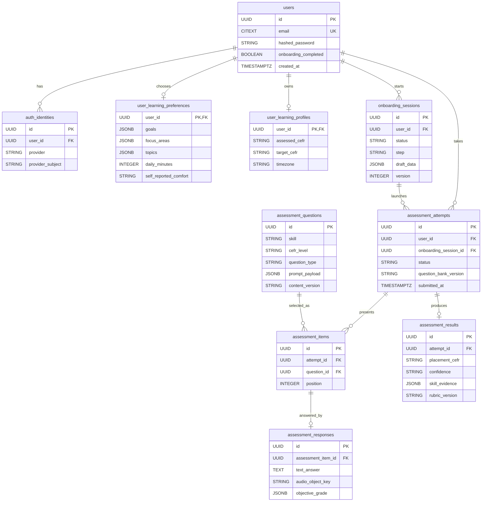
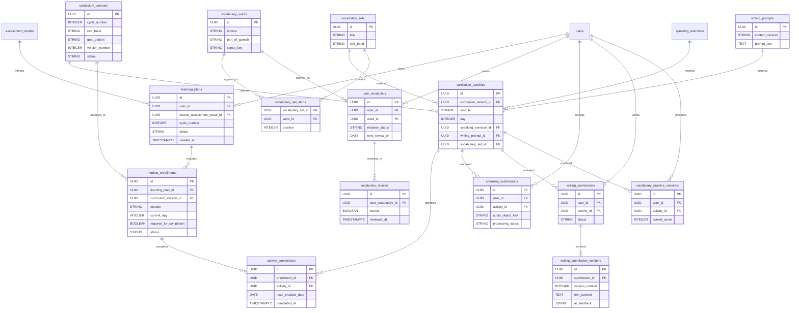
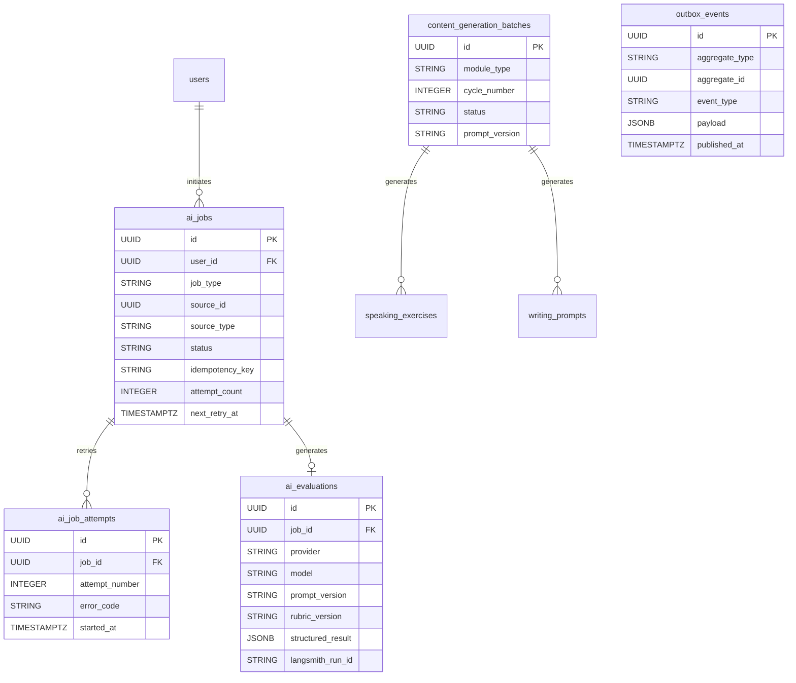

# TalkFiesta — Detailed Database Design, ERD & Backend Scaffolding

**Architecture status:** Proposed v1 MVP design (27 October 2026)  
**Baseline:** `TalkFiesta.md`, `TalkFiesta-Codebase-Structure.md`, `TalkFiesta-Database-Schema.md`  
**Target implementation:** Next.js frontend; Python FastAPI modular monolith; PostgreSQL/SQLAlchemy 2/Alembic; Redis/Celery; private S3; OpenAI + LangChain + LangGraph + LangSmith.

> **How to read:** This is an evolution of the uploaded database design, not a claim that the proposed new tables already exist. **Retain** means preserve the existing conceptual entity; **extend** means change its columns/constraints; **new** is a proposed MVP addition; **defer** means the original product has the entity, but it is not required for MVP.

## 1. Design principles

1. **PostgreSQL is authoritative** for identities, onboarding state, questions, attempts, enrolments, submissions, and completed activities. Redis is not a permanent store.
2. **Multi-goal preferences** are separate from the user's identity and separately versioned assessment history.
3. **CEFR assessed placement** and **learner's desired CEFR goal** are different columns. The result is a **provisional** level, not a certification.
4. **Curriculum versions are immutable once published.** A learner stays associated with the assigned version so future content edits do not rewrite their history.
5. **Speaking, vocabulary and writing advance independently** in 21-day tracks. A calendar date is not a curriculum day.
6. **Accepting a valid practice submission can complete an activity before LLM feedback is ready.** AI feedback has its own status.
7. **A database transaction + outbox** makes acceptance and intention-to-process atomic. Celery workers process idempotently (delivery may occur more than once).
8. **Typed foreign keys for core business relations** are preferred to unchecked polymorphic IDs. JSONB is reserved for rubrics, per-question schemas, immutable scoring snapshots and other genuinely variable payloads.
9. **PII and audio:** Private object keys, access-controlled playback, retention/deletion lifecycle, no secrets in logs or LangSmith traces; timestamps stored as `TIMESTAMPTZ` in UTC.
10. **All user-bound resources enforce ownership**; never trust `user_id`, `duration`, or object keys merely because the browser supplied them.

## 2. ERD — Identity, onboarding and assessment



**Question answer-key privacy:** The private correct answer and scoring rubric live in a server-only column/table (`assessment_question_scoring_keys`) and are never present in learner API responses. Snapshot the selected question content/version into `assessment_items` if content can be modified while attempts are active.

### Key tables and requirements

| Table | Status | Essential fields / constraints |
|---|---|---|
| `users` | Retain/extend | `id PK`, normalized `email UNIQUE`, nullable password hash for OAuth-only users, `onboarding_completed`, status, UTC timestamps. Separate account deletion lifecycle. |
| `auth_identities` | New | `id`, `user_id FK`, `provider`, `provider_subject`, `UNIQUE(provider,provider_subject)`; supports provider linking and avoids putting one OAuth provider on the user row. |
| `onboarding_sessions` | New | `user_id FK`, `status`, `current_step`, `draft_data JSONB`, `version`, `completed_at`; partial unique index for one unfinished onboarding session per user. |
| `user_learning_preferences` | New | `user_id UNIQUE FK`, `goals JSONB`, `focus_areas JSONB`, `topics JSONB`, `daily_minutes SMALLINT`, `self_reported_comfort`, updated_at; validate allowed options in Pydantic. |
| `assessment_questions` | New | `skill`, `question_type`, `cefr_level`, version, approved/published status, prompt content, review metadata; immutable after publication. |
| `assessment_question_scoring_keys` | New | `question_id UNIQUE FK`, private correct answer(s), scoring config; never included in public response models. |
| `assessment_attempts` | New | `user_id FK`, `onboarding_session_id FK nullable`, status, timestamps, question_bank_version, idempotency key; partial unique index for one active initial assessment per user. Reassessments allowed after previous attempt finalization. |
| `assessment_items` | New | `attempt_id FK`, `question_id FK`, `position`, `question_snapshot JSONB`, `UNIQUE(attempt_id,position)`; prevents later curriculum edits changing presented evidence. |
| `assessment_responses` | New | `assessment_item_id UNIQUE FK`, text/selected option, `audio_object_key`, objective grade, response status, updated_at. Autosave idempotently before submission; freeze after final submit. |
| `assessment_results` | New | `attempt_id UNIQUE FK`, provisional placement, confidence, per-skill evidence JSONB, rubric/model versions, completed_at. |
| `user_learning_profiles` | Extend | `user_id UNIQUE FK`, `assessed_cefr`, `target_cefr`, `timezone`, native language, reminders. **Remove `current_day` as cross-module authority**; individual enrollments own progress. |

**Assessment status:** `CREATED → IN_PROGRESS → SUBMITTED → PROCESSING → COMPLETED`; explicit `FAILED_RETRYABLE` and `FAILED_FINAL`. A user may reattempt after a terminal state. Assessment results should record missing-speaking evidence rather than fabricate a pronunciation score.

## 3. ERD — Curriculum, learner plans, activities and submissions



**Mermaid diagram simplification:** It omits a few straightforward FKs (e.g., `activity_completions` evidence references and submission-to-enrollment FKs) to remain readable. See the invariants below.

### Main entity contracts

| Table | Status | Essential fields / constraints |
|---|---|---|
| `curriculum_versions` | New | `cycle_number` 1–5, CEFR band, goal/topic variant, version number, state (`DRAFT`,`APPROVED`,`PUBLISHED`,`RETIRED`), `UNIQUE(cycle_number,cefr_band,goal_variant,version_number)`. Published versions immutable. |
| `curriculum_activities` | New | `curriculum_version_id FK`, module, day 1–21, and exactly one typed FK to `speaking_exercises`, `writing_prompts`, or `vocabulary_sets`; `UNIQUE(curriculum_version_id,module,day)` for one required activity per module/day/version. Additional activities require an explicit slot/order column. |
| `speaking_exercises` | Retain | Cycle, day, prompt, target CEFR, review status, publication metadata, generation batch; content is referenced by immutable activity versions. |
| `writing_prompts` | Retain | Prompt text, type, target words, review status, generation batch; referenced by curriculum activities. |
| `vocabulary_words` | Extend | Do not assume a spelling is globally unique across senses; prefer `(lemma,part_of_speech,sense_key)` or a stable dictionary ID. |
| `vocabulary_sets` / `vocabulary_set_items` | New | Daily published 10-word sets; unique `(set_id,word_id)` and `(set_id,position)`, positions 1–10. Enforce exactly ten on publication transaction, not only with a row-level CHECK. |
| `learning_plans` | New | `user_id FK`, `source_assessment_result_id FK nullable for later cycles`, `cycle_number` 1–5, status, snapshot of plan configuration. Unique partial index: one `ACTIVE` plan per user. Creating same plan with same assessment must be idempotent. |
| `module_enrollments` | New | `learning_plan_id FK`, `module`, assigned `curriculum_version_id FK`, day 1–21, status, optional `required_for_completion`; `UNIQUE(learning_plan_id,module)`. One enrollment per module for a plan; history preserved across plans. |
| `activity_completions` | New | `enrollment_id FK`, `activity_id FK`, completed timestamp, `local_practice_date`, typed evidence FK to a speaking submission, writing submission, or vocabulary session. `UNIQUE(enrollment_id,activity_id)`. Add nullable `speaking_submission_id`, `writing_submission_id` and `vocabulary_session_id` with a CHECK requiring exactly one non-null evidence FK. A completion is immutable/auditable. Validate activity belongs to enrollment's assigned curriculum version and module, atomically. |
| `speaking_submissions` | Retain/extend | `user_id FK`, `enrollment_id FK`, `activity_id FK`, private `audio_object_key`, duration, raw transcript, metrics, feedback, evaluation status, job id, timestamps. Multiple attempts allowed; one accepted completion per activity. |
| `writing_submissions` | Retain/extend | User, activity, enrollment, status, submitted_at; a parent for revisions. `writing_submission_versions`: `UNIQUE(submission_id,version_number)`, versions **1–4** (original + max 3 revisions). |
| `vocabulary_exercise_bank` | Retain | Deterministic approved exercises tied to words; no LLM call for exact-answer grading. |
| `vocabulary_practice_sessions` | Retain/extend | User, activity, enrollment, separate exercise-type scores; accept only if required attempts are valid. |
| `user_vocabulary` | Retain | `UNIQUE(user_id,word_id)`, mastery stage, next review date, last review date and counters. |
| `vocabulary_reviews` | New | Append-only record: `user_vocabulary_id`, `reviewed_at`, response/result, prior/next interval; avoids history being overwritten by current mastery state. |
| `personalized_vocab_suggestions` | Retain | Suggested replacements extracted from speaking/writing feedback, with source reference and status. |
| `daily_progress` | Retain as projection | One `user_id,local_practice_date` summary for dashboard/streak. Rebuildable from `activity_completions`; must **not** be a second source of truth for module advancement. |
| `achievements`, `user_achievements` | Retain | Catalog and awarded user badges; `UNIQUE(user_id,achievement_id)`. |
| `content_generation_batches` | Retain | Generate/review/publish curriculum content offline. Link content and versioned prompts to batch. |

**Content-availability rule:** Do not enroll an A2, B2 or C1 learner into a nonexistent appropriate published curriculum. Before allowing onboarding completion, the plan service must find content that matches a defined placement fallback policy or clearly mark the level as unsupported.

### Critical progression rules

- `module_enrollments.current_day` is **the next uncompleted required day**, not today's date. It advances in a transaction when an activity-completion row is inserted.
- `activity_completions` is inserted after **valid durable submission acceptance** for speaking/writing, or successful completion of required deterministic vocabulary practice. AI result completion is separate.
- Completion insert, enrollment advancement and outbox event write occur in **one PostgreSQL transaction**. A retry must not advance twice.
- A user's active plan can include one, two or three module enrollments, based on a product decision; `required_for_completion` explicitly identifies which count toward cycle completion.
- On `current_day=21` completing, set enrollment `COMPLETED` rather than assigning day 22; advancing to another cycle creates a **new** learning plan/enrollment record, preserving history.
- Calendar streaks are based on qualifying events and saved time zone at event time. `daily_progress` is a projection (aggregated view/table), not the authority.
- Review dates use real calendar dates even if the learner pauses curriculum progression.

## 4. ERD — AI processing, reliable jobs and content review



| Table | Status | Meaning |
|---|---|---|
| `ai_jobs` | New | Durable logical work item for `ASSESSMENT_EVALUATE`, `SPEAKING_FEEDBACK`, `WRITING_FEEDBACK`, `VOCAB_CONTEXT` and `CONTENT_GENERATE`. Include source type + UUID, status, queue priority, version, idempotency key, and attempts. |
| `ai_job_attempts` | New | Each worker attempt, failure class and diagnostics; no raw audio/transcripts in log messages. |
| `ai_evaluations` | New | One accepted structured output for each logical job: model/provider identifiers, prompt/rubric/schema versions, tokens, cost estimates, LangSmith trace/run ID and JSONB feedback. |
| `outbox_events` | New | `event_type`, aggregate, minimal event payload, created/published times, retry count/last error, unique event key; dispatcher sends Celery messages after transaction commit. |

**Important compromise:** Generic `ai_jobs.source_type/source_id` is operational metadata, not a core domain relationship. Referential integrity remains on the authoritative assessment/submission records; their own status and `ai_job_id` maintain direct links. Outbox events carry only opaque IDs and a small routing payload.

**Celery semantics:** Workers may receive a task more than once. Use stable logical job IDs and conditional status transitions; do not make correctness depend on "exactly once" delivery.

## 5. What stays for Phase 2?

The uploaded database document also defines `live_conversation_sessions`, `domain_question_bank`, `wildcard_question_bank`, `interview_panel_sessions`, `panel_rounds`, `panel_responses`, and `panel_agent_feedback`. **Keep these in the roadmap, not in the MVP initial migration** unless their features are actively being built. The stored full `session_state JSONB` for the original turn-based interview panel can later be complemented with LangGraph checkpoints.

## 6. Indexes and constraints (minimum review set)

| Table | Index/constraint | Reason |
|---|---|---|
| users | `UNIQUE(lower(email))` or unique `CITEXT` | Case-insensitive login identity |
| auth_identities | `UNIQUE(provider,provider_subject)` | One provider identity maps to one account |
| onboarding_sessions | Partial `UNIQUE(user_id) WHERE status NOT IN ('COMPLETED','CANCELLED')` | One active flow |
| assessment_attempts | Partial `UNIQUE(user_id) WHERE kind='INITIAL' AND status IN ('CREATED','IN_PROGRESS','SUBMITTED','PROCESSING','FAILED_RETRYABLE')` | Prevent duplicate active initial assessments |
| assessment_items | `UNIQUE(attempt_id,position)` | Stable question order |
| assessment_responses | `UNIQUE(assessment_item_id)` | Idempotent autosave |
| assessment_results | `UNIQUE(attempt_id)` | One finalized placement result per attempt |
| curriculum_activities | `UNIQUE(curriculum_version_id,module,day)` | One required daily activity per version/module/day |
| vocabulary_set_items | `UNIQUE(set_id,word_id)`, `UNIQUE(set_id,position)` | No duplicates in a set |
| learning_plans | Partial `UNIQUE(user_id) WHERE status='ACTIVE'` | One active learning plan |
| module_enrollments | `UNIQUE(learning_plan_id,module)` | Independent module states |
| activity_completions | `UNIQUE(enrollment_id,activity_id)` | Cannot complete same day twice |
| writing_submission_versions | `UNIQUE(submission_id,version_number)`, `CHECK(version_number BETWEEN 1 AND 4)` | Safe revision history |
| user_vocabulary | `UNIQUE(user_id,word_id)` | One spaced-repetition state per word |
| user_vocabulary | `INDEX(user_id,next_review_on)` | Efficient due reviews |
| daily_progress | `UNIQUE(user_id,local_practice_date)` | One projection per user's calendar day |
| ai_jobs | `UNIQUE(idempotency_key)` for non-null logical keys; `INDEX(status,next_retry_at)` | Retry/dedup and worker reclamation |
| outbox_events | `INDEX(published_at,created_at) WHERE published_at IS NULL` | Efficient dispatcher polling |

Also add `CHECK(day BETWEEN 1 AND 21)`, `CHECK(cycle_number BETWEEN 1 AND 5)`, `CHECK(daily_minutes > 0)`, and score bounds. Use `ON DELETE RESTRICT` for submitted/graded historical content; avoid broad cascades that accidentally erase learner history. Account-deletion requests need a designed, audited deletion/anonymization procedure.

## 7. Transaction and consistency boundaries

### A. Complete assessment + create learning plan

1. Worker writes AI evaluation and final `assessment_results` row, then marks assessment `COMPLETED` in a database transaction.
2. `LearningPlanService` uses `source_assessment_result_id` as a logical dedupe key. It checks published matching curricula, inserts `learning_plans` + required `module_enrollments` and updates the user's learning profile.
3. Set `onboarding_sessions.status=COMPLETED` and `users.onboarding_completed=true` **only after** plan creation succeeds. Protect from concurrent retries using row locks and unique constraints.
4. If matching curriculum is unavailable, keep the result and expose an explicit recoverable `PLAN_PENDING` state; never silently assign inappropriate content.

### B. Accept a speaking or writing submission

1. Confirm authenticated ownership and published activity assignment.
2. Validate uploaded object and request; insert module submission row (`feedback_status=PENDING`).
3. Insert `activity_completions` (on conflict do nothing), advance the module enrollment if and only if this is its next required day, and update or queue projection updates.
4. Insert `ai_jobs` + `outbox_events` within the same transaction; commit.
5. Worker asynchronously processes the transcript/feedback and writes `ai_evaluations`; retries cannot duplicate user credit.

### C. Vocabulary review

1. Lock the `(user_id,word_id)` `user_vocabulary` row, append a `vocabulary_reviews` event, and update mastery/next_review_on in the same transaction.
2. Daily vocabulary session completion is independent of overdue review; do not move `current_day` merely because a scheduled review ran.

### D. Concurrency and failure recovery

- Use `SELECT ... FOR UPDATE` when advancing `module_enrollments` to prevent concurrent double advancement.
- Add explicit `idempotency_key` for commands that start paid work or create state; store hash/user context where appropriate.
- A periodic reconciliation job searches for `PENDING` jobs without published events, expired leases and stuck `PROCESSING` jobs.
- Do not hold database transactions open during S3 or OpenAI calls.

## 8. Backend scaffolding — recommended modular monolith

The original `TalkFiesta-Codebase-Structure.md` organizes DB models, API endpoints, agents and CRUD by technical layer. The following is a **proposed refinement**: organize domain code by business feature, keeping common infrastructure in `app/infrastructure`. This makes ownership of the ERD and service contracts easier to enforce.

```text
talkfiesta-backend/
├── app/
│   ├── main.py                       # lifespan, middleware and router wiring
│   ├── core/
│   │   ├── config.py                 # Pydantic Settings
│   │   ├── security.py               # token validation, permission policies
│   │   ├── exceptions.py
│   │   └── logging.py                # correlation IDs and sanitized logs
│   ├── api/
│   │   ├── deps.py                   # db session, user, role, idempotency
│   │   └── v1/router.py              # aggregates feature routers
│   ├── modules/
│   │   ├── auth/
│   │   │   ├── router.py
│   │   │   ├── schemas.py
│   │   │   ├── service.py
│   │   │   ├── repository.py
│   │   │   └── models.py             # users, auth_identities
│   │   ├── onboarding/
│   │   │   ├── router.py
│   │   │   ├── schemas.py
│   │   │   ├── service.py
│   │   │   ├── repository.py
│   │   │   └── models.py
│   │   ├── assessment/
│   │   │   ├── router.py
│   │   │   ├── schemas.py
│   │   │   ├── service.py
│   │   │   ├── repository.py
│   │   │   ├── models.py
│   │   │   ├── question_selector.py    # deterministic/adaptive selection
│   │   │   ├── placement_policy.py    # versioned CEFR placement policy
│   │   │   └── ai/
│   │   │       ├── graph.py           # LangGraph orchestration
│   │   │       ├── state.py
│   │   │       ├── nodes.py
│   │   │       ├── evaluators.py
│   │   │       └── prompts/           # versioned prompt templates
│   │   ├── learning_plans/
│   │   │   ├── router.py
│   │   │   ├── schemas.py
│   │   │   ├── service.py
│   │   │   ├── repository.py
│   │   │   ├── models.py
│   │   │   └── progression.py
│   │   ├── speaking/
│   │   │   ├── router.py
│   │   │   ├── schemas.py
│   │   │   ├── service.py
│   │   │   ├── repository.py
│   │   │   ├── models.py
│   │   │   └── ai/
│   │   │       ├── graph.py
│   │   │       ├── state.py
│   │   │       ├── nodes.py
│   │   │       └── prompts/
│   │   ├── vocabulary/
│   │   │   ├── router.py
│   │   │   ├── schemas.py
│   │   │   ├── service.py
│   │   │   ├── repository.py
│   │   │   ├── models.py
│   │   │   ├── srs.py                 # review scheduling
│   │   │   └── ai/
│   │   ├── writing/
│   │   │   ├── router.py
│   │   │   ├── schemas.py
│   │   │   ├── service.py
│   │   │   ├── repository.py
│   │   │   ├── models.py
│   │   │   └── ai/
│   │   ├── progress/
│   │   │   ├── router.py
│   │   │   ├── service.py
│   │   │   ├── repository.py
│   │   │   └── models.py
│   │   ├── curriculum/
│   │   │   ├── router.py             # published read + admin endpoints
│   │   │   ├── service.py
│   │   │   ├── repository.py
│   │   │   ├── models.py
│   │   │   └── publication.py
│   │   └── jobs/
│   │       ├── models.py             # ai_jobs, job_attempts, evaluations
│   │       ├── repository.py
│   │       ├── outbox.py             # outbox writer/dispatcher
│   │       └── service.py
│   ├── infrastructure/
│   │   ├── database/
│   │   │   ├── base.py               # DeclarativeBase + naming conventions
│   │   │   ├── session.py            # async API session factory
│   │   │   ├── sync_session.py       # sync worker session factory (optional)
│   │   │   └── model_registry.py     # import all mapped classes for Alembic
│   │   ├── cache/redis.py
│   │   ├── storage/s3.py
│   │   ├── ai/
│   │   │   ├── openai_audio.py
│   │   │   ├── langchain_models.py
│   │   │   └── tracing.py
│   │   └── messaging/celery_app.py
│   ├── workers/
│   │   ├── assessment_tasks.py
│   │   ├── speaking_tasks.py
│   │   ├── writing_tasks.py
│   │   ├── vocabulary_tasks.py
│   │   ├── content_tasks.py
│   │   └── dispatch_outbox.py
│   └── shared/
│       ├── types.py
│       ├── clock.py
│       └── pagination.py
├── alembic/
│   ├── env.py
│   └── versions/
├── tests/
│   ├── unit/
│   ├── integration/
│   ├── api/
│   ├── workers/
│   └── eval/                      # LangSmith golden dataset evaluation tests
├── scripts/
│   ├── seed_assessment_questions.py
│   ├── seed_curriculum.py
│   └── reconcile_jobs.py
├── docker-compose.yml
├── Dockerfile
├── pyproject.toml
├── alembic.ini
├── .env.example
└── README.md
```

### Module code contracts

- `router.py`: HTTP only (FastAPI validation, dependencies, mapping exceptions to status codes); **no model/provider calls or raw SQL**.
- `service.py`: business rules, transaction orchestration and calls to other modules' public services.
- `repository.py`: SQLAlchemy queries and persistence; **never owns assessment scoring policy**.
- `models.py`: SQLAlchemy ORM persistence classes with named constraints.
- `schemas.py`: Pydantic request/response schemas; prevent accidental exposure of private answer keys.
- `ai/graph.py`: compiled LangGraph and state transitions; `nodes.py`: model- or STT-related operations; prompts are versioned.
- `workers/*_tasks.py`: thin Celery adapters, lookup durable job by ID and call domain job service; no application decisions coded in queue handlers.
- `infrastructure/*`: provider-specific adapters (OpenAI, S3, Redis, LangSmith, DB session).

**Synchronous worker sessions:** An async SQLAlchemy session for FastAPI plus a separate synchronous session factory for ordinary Celery tasks is a simple MVP pairing. Both connect to the same PostgreSQL database and share ORM metadata. Avoid crossing session objects across worker processes.

## 9. Representative SQLAlchemy 2 models

The snippet illustrates important constraints and enum/state representation. It is intentionally a **partial template**, not the entire schema/migration.

```python
import uuid
from datetime import datetime
from sqlalchemy import (
    CheckConstraint, DateTime, ForeignKey, Index,
    Integer, String, UniqueConstraint, func, text
)
from sqlalchemy.dialects.postgresql import UUID
from sqlalchemy.orm import DeclarativeBase, Mapped, mapped_column

class Base(DeclarativeBase):
    pass

class ModuleEnrollment(Base):
    __tablename__ = "module_enrollments"
    __table_args__ = (
        UniqueConstraint("learning_plan_id", "module", name="uq_enrollment_plan_module"),
        CheckConstraint("current_day BETWEEN 1 AND 21", name="ck_enrollment_day"),
    )
    id: Mapped[uuid.UUID] = mapped_column(UUID(as_uuid=True), primary_key=True, default=uuid.uuid4)
    learning_plan_id: Mapped[uuid.UUID] = mapped_column(ForeignKey("learning_plans.id", ondelete="RESTRICT"), nullable=False)
    curriculum_version_id: Mapped[uuid.UUID] = mapped_column(ForeignKey("curriculum_versions.id", ondelete="RESTRICT"), nullable=False)
    module: Mapped[str] = mapped_column(String(20), nullable=False)
    current_day: Mapped[int] = mapped_column(Integer, nullable=False, default=1)
    status: Mapped[str] = mapped_column(String(20), nullable=False, default="ACTIVE")

class ActivityCompletion(Base):
    __tablename__ = "activity_completions"
    __table_args__ = (
        UniqueConstraint("enrollment_id", "activity_id", name="uq_completion_enrollment_activity"),
    )
    id: Mapped[uuid.UUID] = mapped_column(UUID(as_uuid=True), primary_key=True, default=uuid.uuid4)
    enrollment_id: Mapped[uuid.UUID] = mapped_column(ForeignKey("module_enrollments.id", ondelete="RESTRICT"), nullable=False)
    activity_id: Mapped[uuid.UUID] = mapped_column(ForeignKey("curriculum_activities.id", ondelete="RESTRICT"), nullable=False)
    completed_at: Mapped[datetime] = mapped_column(DateTime(timezone=True), server_default=func.now(), nullable=False)

class LearningPlan(Base):
    __tablename__ = "learning_plans"
    id: Mapped[uuid.UUID] = mapped_column(UUID(as_uuid=True), primary_key=True, default=uuid.uuid4)
    user_id: Mapped[uuid.UUID] = mapped_column(ForeignKey("users.id", ondelete="RESTRICT"), nullable=False)
    cycle_number: Mapped[int] = mapped_column(Integer, nullable=False)
    status: Mapped[str] = mapped_column(String(20), nullable=False, default="ACTIVE")

Index("uq_one_active_learning_plan", LearningPlan.user_id,
      unique=True, postgresql_where=text("status = 'ACTIVE'"))
```

For the complete codebase, create `Base` **once** in `infrastructure/database/base.py`, import it in all models, and import all model modules through `model_registry.py` for Alembic discovery. Add your standard timestamp mixin and consistent naming convention there.

## 10. Initial routes and ownership

| HTTP endpoint | Module | Behavior |
|---|---|---|
| `GET /api/v1/onboarding/state` | onboarding | Return resumable step and status |
| `PUT /api/v1/onboarding/preferences` | onboarding | Idempotent preference upsert |
| `POST /api/v1/assessments` | assessment | Start/resume initial attempt |
| `GET /api/v1/assessments/{id}/next-question` | assessment | Safe adaptive selection; no answer key |
| `PUT /api/v1/assessments/{id}/responses/{item_id}` | assessment | Autosave answer for assigned question |
| `POST /api/v1/assessments/{id}/submit` | assessment | Freeze + durable outbox/worker job |
| `GET /api/v1/assessments/{id}/result` | assessment | Pending or structured result |
| `POST /api/v1/onboarding/complete` | onboarding/plans | Idempotently initialize plan from result |
| `GET /api/v1/learning-plans/current` | learning_plans | Current enrolled curriculum and day |
| `POST /api/v1/speaking/submissions` | speaking | Accept uploaded audio for an assigned activity |
| `POST /api/v1/writing/submissions` | writing | Accept writing draft/first submission |
| `POST /api/v1/writing/submissions/{id}/versions` | writing | Add revision (up to 3 after original) |
| `GET /api/v1/vocabulary/due-reviews` | vocabulary | Review queue by due date |
| `GET /api/v1/dashboard` | progress | Read compiled current progress |

## 11. Migration rollout

1. Create core infrastructure, SQLAlchemy `Base`, model registry, initial Alembic migration, `users` and `auth_identities`.
2. Add `onboarding_sessions`, `user_learning_preferences`, assessment question/key/attempt/item/response/result models.
3. Add curriculum versions/activities and immutable speaking/writing/vocabulary content; seed an approved Cycle 1 variant set **before** plan creation is enabled.
4. Add learning plans, module enrollments and completions, followed by module submission/revision/review models.
5. Add AI jobs, attempts, evaluations and outbox. Connect Celery workers and the dispatcher.
6. Add dashboard projections, achievements and operational indexes; test recovery and duplicate handling.
7. Later, migrate or implement Live Conversation and Interview Panel models when Phase 2 begins.

Sample developer workflow:

```bash
uv sync
alembic revision --autogenerate -m "initial talkfiesta schema"
# Review generated migration carefully before applying.
alembic upgrade head
docker compose up --build
pytest -q
```

**Migration caution:** Alembic autogenerate creates *candidate* revisions; manually inspect renames, indexes, check constraints, PG types, data backfills and defaults before executing in production. Schema migrations must not be implicitly run by every API pod at startup.

## 12. Must-pass integration tests

1. Simultaneous requests cannot create two active learning plans for one user.
2. Same assessment submission cannot spawn two paid evaluations.
3. A stale question-bank update does not change an in-progress assessment's assigned question snapshot.
4. AI failure does not undo previously accepted speaking completion or learner streak.
5. Two concurrent practice submissions cannot advance the same enrollment from Day 1 to Day 3.
6. Writing revision versions are unique, ordered, and capped at version 4.
7. A user cannot obtain another user's recording or assessment by guessing UUIDs.
8. A Celery task redelivered after DB commit does not double-create feedback or user credit.
9. The reconciliation worker eventually enqueues committed-but-unpublished outbox jobs.
10. Curriculum updates do not rewrite the content that was assigned to active learners.
11. The vocabulary due-review index finds overdue and today's items regardless of curriculum day.
12. Account deletion removes or anonymizes personal content according to documented retention rules.

## 13. Open product/engineering decisions to finalize

- Can all learners always enroll in all three modules, or only selected focus modules? Recommendation: enroll all three as available, mark focus modules `required_for_completion`, and keep voluntary practice optional (document the exact UX).
- Do we guarantee 10 new vocabulary words each curriculum day even when daily time is 5 minutes? Recommendation: 10 words remain the curriculum goal, while suggested daily activities can be deferred.
- Do we allow multiple required activities per module/day? MVP recommendation: one per day/module/version; use a `slot` and update uniqueness when the product expands.
- How many CEFR bands/goal variants will be published before launch? This controls whether placement can immediately generate an appropriate learning plan.
- What is the speaking recording retention window and whether users can opt out of retaining audio after feedback? Decide before accepting production uploads.
- How are assessment and speaking evaluator outputs calibrated to external human-rated CEFR examples? Record rubric version and evaluation dataset before relying on scores for placement.

---

**Summary:** The central domain aggregates are `AssessmentAttempt`, `LearningPlan`, `ModuleEnrollment`, `ActivityCompletion`, `SpeakingSubmission`, `WritingSubmission`, and `UserVocabulary`. FastAPI services own state transitions; SQLAlchemy/PG protect invariants; Celery handles asynchronous AI calls; LangGraph models complex AI pipelines; LangSmith measures their behavior. Build the initial migrations in that dependency order.
