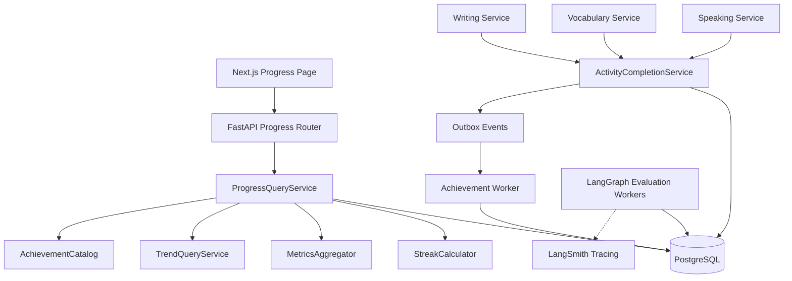
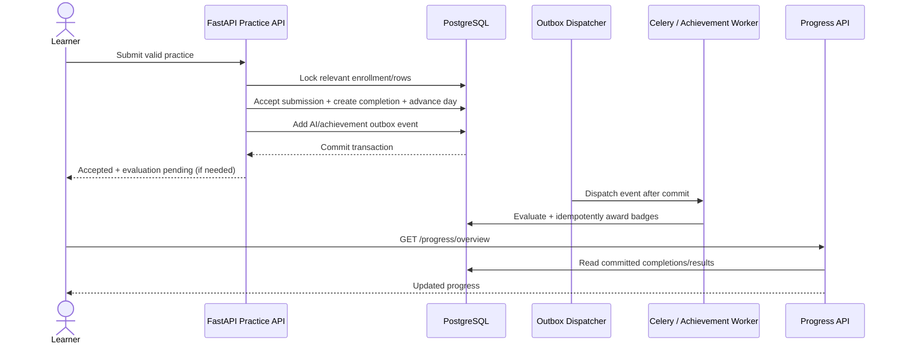

# TalkFiesta — Progress, Analytics & Achievements APIs (V4)

**Document:** Backend API & Implementation Contract  
**Status:** Proposed V4 design — not implemented in the V3 backend  
**Version:** 1.0 · 2026-11-06  
**Stack:** Next.js / Auth.js BFF · FastAPI · Pydantic v2 · SQLAlchemy 2 · PostgreSQL · Redis/Celery · OpenAI / LangChain / LangGraph · LangSmith  
**Schema baseline:** `TalkFiesta-Simplified-Database-Schema-v4.md` — 14-table proposal  
**Related specifications:** `TalkFiesta-Dashboard-and-Learning-Plan-APIs-V4.md`, `TalkFiesta-Speaking-APIs-V4.md`, `TalkFiesta-Vocabulary-and-Writing-API-Specifications-V4.md`

> **Core principle:** Progress APIs are **read-only for learners**. All completion credits are issued only by validated Speaking, Vocabulary, Writing (and future eligible live-session) services. AI feedback may arrive after activity completion. No new tables are required for these endpoints.

---

## 1. Scope and goals

### Learner-facing outcomes

1. Understand **how much of the active 21-day cycle is completed** overall and independently for Speaking, Vocabulary, and Writing.
2. Understand the **current practice streak**, longest streak, active calendar days, and actual credited practice time.
3. See **speaking and writing performance trends** with consistent score definitions and rubric/model provenance.
4. See **vocabulary words learned, mastered, reviewing, and due** without treating daily word exposure as mastery.
5. Browse **activity history**, including completed activities with feedback still processing.
6. See **earned and locked achievements** and why each badge was awarded.
7. See **historical provisional CEFR placements** from initial assessments and later reassessments, explicitly *not* an official CEFR certification.
8. Keep the API efficient and predictable, with read-only queries that reuse the existing V4 data model.

### Non-goals

- No public `POST /progress/increment`, `/progress/mark-complete`, `/streaks/increment`, or `/achievements/award` endpoints.
- No separate `daily_progress`, `achievement_catalog`, `performance_snapshots`, or `score_events` tables for V4 MVP.
- No AI calls to calculate simple counters, streaks, percentages, due-review counts, or trend averages.
- No automatic inference of speaking pronunciation from transcript-based feedback.
- No mixing scores from incompatible rubrics into a single unqualified time series.

---

## 2. API-wide conventions

| Topic | Contract |
|---|---|
| Base path | `/api/v1` |
| Authentication | Auth.js/BFF browser session plus verified FastAPI application authorization |
| Ownership | All resources scoped to authenticated `current_user.id`; no client-provided `user_id` |
| Response payloads | Typed Pydantic v2 DTOs; timestamps ISO 8601 with offset (`Z` for UTC) |
| Module names | Canonical `SPEAKING`, `VOCABULARY`, `WRITING`; path values may be lowercase and normalized |
| Date range | Inclusive `from` / `to` dates in `YYYY-MM-DD`; interpreted as *local dates* using `users.timezone` |
| Timezone | Valid IANA identifier from `users.timezone`; immutable `activity_completions.local_practice_date` is recorded when credit is issued |
| Pagination | Cursor-based `limit` default `20`, maximum `50`; opaque cursor, stable ordering and deterministic tie-breaker |
| Caching | `Cache-Control: private, no-store` by default; introduce short-lived user-scoped cache only after correctness testing |
| Authorization failures | `401` missing auth, `403` disabled account, `404` unowned resource if identified by ID, `409` onboarding required |
| Validation | `422` invalid module, date range, grouping, or query value |
| Performance objective | Preliminary p95 under 300 ms for typical progress reads with a documented dataset and load test; not a guarantee |

**Standard error:**

```json
{
  "error": {
    "code": "ONBOARDING_REQUIRED",
    "message": "Complete onboarding to view learning progress.",
    "details": {},
    "request_id": "req_example_01"
  }
}
```

**Pagination convention** for list responses:

```json
{
  "items": [],
  "pagination": {
    "next_cursor": null,
    "has_more": false
  }
}
```

All example IDs, scores, and dates in this document are illustrative. None represent actual learner activity.

---

## 3. Endpoint catalogue

| Priority | Method | Endpoint | Purpose | Status |
|---|---|---|---|---|
| P0 | `GET` | `/api/v1/progress/overview` | Overall progress, active plan summary, module status, learning metrics | `200` |
| P0 | `GET` | `/api/v1/progress/modules/{module}` | Module-specific completion and current analytics | `200` |
| P0 | `GET` | `/api/v1/progress/streaks` | Current/longest streak, active days, streak policy | `200` |
| P0 | `GET` | `/api/v1/progress/activity-calendar` | Date-bucketed completion heatmap | `200` |
| P0 | `GET` | `/api/v1/progress/achievements` | Earned and locked achievement badges | `200` |
| P1 | `GET` | `/api/v1/progress/modules/{module}/trends` | Historical score, pace, or mastery trend by module | `200` |
| P1 | `GET` | `/api/v1/progress/activity-history` | Paginated chronological activity ledger | `200` |
| P1 | `GET` | `/api/v1/progress/cefr-history` | Initial and repeat provisional placement history | `200` |

**Existing APIs retained, not duplicated:**
- `GET /api/v1/dashboard` remains the fast home-screen aggregation.
- `GET /api/v1/learning-plans/current` owns the active plan resource.
- `GET /api/v1/learning-plans/current/modules/{module}/timeline` owns the full 21-day lesson-by-lesson timeline.
- `GET /api/v1/vocabulary/progress` may provide deeper word-level detail; the unified Progress service provides cross-module metrics.
- `GET /api/v1/writing/portfolio` and `GET /api/v1/speaking/submissions` remain detailed submission-history endpoints.

The Progress endpoints are projections over domain records; they are not separate sources of truth.

---

# Part A — Progress & Streak APIs

## 4. `GET /api/v1/progress/overview`

**Purpose:** Main analytics page. Includes active-cycle completion, summarized modules, practice time, recent averages and vocabulary mastery. This is a larger analytics response than `/dashboard`.

**Query:**
- `scope=current` (default): only the current active plan for cycle-level completion metrics.
- `scope=all`: lifetime practice and historical cycle totals, while still describing the active plan distinctly.

**Response `200`:**

```json
{
  "as_of": "2026-11-06T10:00:00Z",
  "timezone": "Asia/Riyadh",
  "active_plan": {
    "plan_id": "11111111-1111-4111-8111-111111111111",
    "cycle": 1,
    "placement_cefr": "A2",
    "status": "ACTIVE",
    "required_modules": ["SPEAKING", "VOCABULARY", "WRITING"],
    "required_activities": 63,
    "completed_activities": 8,
    "completion_percent": 12.7
  },
  "modules": [
    {
      "module": "SPEAKING",
      "status": "ACTIVE",
      "current_day": 4,
      "completed_days": 3,
      "total_days": 21,
      "completion_percent": 14.3
    },
    {
      "module": "VOCABULARY",
      "status": "ACTIVE",
      "current_day": 5,
      "completed_days": 4,
      "total_days": 21,
      "completion_percent": 19.0
    },
    {
      "module": "WRITING",
      "status": "ACTIVE",
      "current_day": 2,
      "completed_days": 1,
      "total_days": 21,
      "completion_percent": 4.8
    }
  ],
  "practice": {
    "total_seconds": 3600,
    "active_days": 4,
    "current_streak_days": 4,
    "longest_streak_days": 4
  },
  "vocabulary": {
    "learning": 18,
    "reviewing": 9,
    "mastered": 4,
    "due_now": 3
  },
  "ai_feedback": {
    "pending_count": 2,
    "completed_count": 6
  }
}
```

**Invariants and derivations:**

1. `required_activities = 21 × count(required enrolled modules)` under the V4 rule of one required `CORE` activity per module per day. Here: `21 × 3 = 63`.
2. `completed_activities = count(activity_completions)` attached to required content items belonging to the active plan; exclude `EXTRA` exercises, older cycles, and repeated revisions.
3. `completion_percent = round(100 × completed_activities / required_activities, 1)`. Here: `8 / 63 = 12.7%`.
4. `completed_days` counts required day credits per module; do **not** blindly calculate `current_day - 1` if optional activities or reconciliation are involved.
5. `practice.total_seconds` uses accepted credits from `activity_completions.duration_seconds`; never add audio upload size, draft edit time, or repeated AI evaluation time.
6. `vocabulary` represents the learner's current word states from `user_vocabulary`, not the total words appearing in lessons.
7. `ai_feedback.pending_count` includes the learner's accepted submissions in `PENDING` or `PROCESSING`, not drafts.
8. For `scope=all`, preserve a separate active-cycle breakdown; don't use lifetime completions as the numerator of the active cycle.

**Edge states:**
- Not yet onboarded → `409 ONBOARDING_REQUIRED`.
- Onboarding completed but no active plan: `active_plan: null`, empty `modules`, and historical lifetime metrics may still be returned with `200` (useful between cycles). **Keep this consistent with the stricter `GET /learning-plans/current` 404 contract.**
- Zero denominators yield `0.0` percent, not division by zero.

## 5. `GET /api/v1/progress/modules/{module}`

**Purpose:** Detail page for one enrolled module, combining learning progress and relevant skill metrics.

**Query:** `?cycle=1` optional; default current plan. Historical cycle lookup must confirm plan ownership.

**Speaking example:**

```json
{
  "module": "SPEAKING",
  "cycle": 1,
  "progress": {
    "status": "ACTIVE",
    "current_day": 4,
    "completed_days": 3,
    "total_days": 21,
    "completion_percent": 14.3
  },
  "metrics": {
    "completed_submissions": 3,
    "evaluated_submissions": 2,
    "pending_feedback": 1,
    "average_overall_score": 76.5,
    "average_words_per_minute": 112.0,
    "pronunciation_score": null
  },
  "recent_submissions": [
    {
      "id": "44444444-4444-4444-8444-444444444441",
      "day": 3,
      "submitted_at": "2026-11-05T10:00:00Z",
      "evaluation_status": "PROCESSING",
      "score": null
    }
  ]
}
```

**Writing variant — `metrics`:**

```json
{
  "completed_submissions": 1,
  "evaluated_submissions": 1,
  "pending_feedback": 0,
  "average_overall_score": 78.0,
  "average_word_count": 92.0,
  "total_revision_submissions": 2,
  "rubric_version": "writing-v1"
}
```

**Vocabulary variant — `metrics`:**

```json
{
  "unique_words_encountered": 31,
  "learning": 18,
  "reviewing": 9,
  "mastered": 4,
  "reviews_due": 3,
  "completed_daily_quizzes": 4,
  "average_quiz_score": 86.0
}
```

**Data semantics:**
- `SPEAKING`: `practice_submissions.mode='RECORDED_SPEAKING'`, current plan module; pace is only returned if source duration/transcript allow it, and is labeled approximate. No transcript-only pronunciation scores.
- `WRITING`: `practice_submissions.mode='WRITING'`; group by `revision_group_id` when answering *days completed*, include revised versions in `total_revision_submissions`, and avoid treating each revision as a new completed day.
- `VOCABULARY`: `user_vocabulary` for current mastery, `practice_submissions.mode IN ('VOCAB_QUIZ', 'VOCAB_REVIEW')` for exercise performance. Word counts are lifetime user-owned unless a filter specifically restricts them to a cycle.
- Only include `score` where evaluation is complete. Never convert unscored attempts to zero.
- If multiple rubric versions exist, `average_overall_score` must either filter to one compatible rubric or be `null`, with a `comparability_warning` explaining why.
- No `GET` operation here modifies module state or mastery.

**`404`** if a valid module is not enrolled in the selected plan; **`422`** for invalid module or cycle.

## 6. `GET /api/v1/progress/streaks`

**Purpose:** Streak summary derived entirely from unique credited local practice dates.

**Response `200`:**

```json
{
  "timezone": "Asia/Riyadh",
  "as_of_local_date": "2026-11-06",
  "current_streak_days": 4,
  "longest_streak_days": 9,
  "last_active_local_date": "2026-11-05",
  "active_days_total": 37,
  "streak_status": "ACTIVE_FROM_YESTERDAY",
  "policy": {
    "qualifying_event": "AT_LEAST_ONE_VALID_ACTIVITY_COMPLETION_PER_LOCAL_DAY",
    "today_required_to_keep_streak": true,
    "grace_days": 0
  }
}
```

**Exact streak algorithm:**

1. Retrieve distinct `activity_completions.local_practice_date` for the learner. Multiple module completions on the same date count as **one active day**.
2. Current streak anchor: use *today* if today is active; otherwise *yesterday* if yesterday is active; otherwise current streak is `0`.
3. Count consecutive dates backward from the anchor with no gaps.
4. Longest streak is the maximum length of any uninterrupted sequence of credited dates.
5. `streak_status` values: `ACTIVE_TODAY`, `ACTIVE_FROM_YESTERDAY`, `BROKEN`, `NO_ACTIVITY`.
6. The streak is unaffected by AI evaluation jobs that are pending or failed after a valid activity credit.
7. `activity_completions.local_practice_date` is immutable after credit. Changing the user's timezone does not retroactively move historical activity between dates; use the current timezone to decide today/yesterday. If global travel-time semantics later require more precision, optionally store `timezone_at_credit` on the **same** table; no new model required.
8. No additional grace day, streak freeze or paid streak protection in V4.

**Privacy/security:** Do not expose a learner's active dates to another account.

## 7. `GET /api/v1/progress/activity-calendar`

**Purpose:** Calendar heatmap for a date interval, showing distinct activities per local date and time credited.

**Query:**
- `from=2026-11-01` (required)
- `to=2026-11-30` (required)
- `module=SPEAKING` (optional; if omitted, all modules)
- Restrict request to **366 days** maximum to bound query and payload size.

**Response `200` (sparse: only active dates):**

```json
{
  "timezone": "Asia/Riyadh",
  "from": "2026-11-01",
  "to": "2026-11-30",
  "module": null,
  "active_days": 2,
  "total_completions": 3,
  "total_seconds": 900,
  "days": [
    {
      "date": "2026-11-04",
      "completion_count": 2,
      "modules": ["SPEAKING", "VOCABULARY"],
      "practice_seconds": 600
    },
    {
      "date": "2026-11-05",
      "completion_count": 1,
      "modules": ["WRITING"],
      "practice_seconds": 300
    }
  ]
}
```

**Rules:**
- The client renders absent dates as zero activity; don't return one record per blank day unless a future explicit `include_empty=true` option is introduced.
- Counts come from `activity_completions`, not new sessions, draft autosaves, word reviews that do not earn activity credit, or AI feedback completions.
- `modules` is a distinct set for that day; chronological ordering ascending.
- When a module filter is selected, only count credits whose `module_progress.module` matches.
- For `from > to`, missing parameters, invalid date format, and ranges over 366 days, return `422`.

---

# Part B — Performance Trends, History and Achievements

## 8. `GET /api/v1/progress/modules/{module}/trends`

**Purpose:** Produce time series for charting. All points are computed from stored evaluations or review/mastery records.

**Query:**
- `metric` required; permitted metrics depend on module.
- `from` / `to`: optional local date filter, default most recent 30 days.
- `granularity=day|week` default `week`.
- `rubric_version` optional; default most recent compatible rubric version for score metrics.

**Permitted metrics**:

| Module | Metrics | Source |
|---|---|---|
| `SPEAKING` | `overall_score`, `grammar_score`, `vocabulary_score`, `approx_wpm` | Evaluated `practice_submissions` / validated feedback |
| `WRITING` | `overall_score`, `grammar_score`, `structure_score`, `vocabulary_score`, `coherence_score`, `word_count` | Evaluated writing versions; default first submission per activity |
| `VOCABULARY` | `quiz_score`, `mastered_count`, `review_accuracy` | Quiz/review submissions and `user_vocabulary` |

**Example — Writing score trend:**

```json
{
  "module": "WRITING",
  "metric": "overall_score",
  "granularity": "week",
  "rubric_version": "writing-v1",
  "aggregation": "MEAN_OF_FIRST_EVALUATED_SUBMISSION_PER_REQUIRED_ACTIVITY",
  "unit": "SCORE_0_100",
  "points": [
    {"period_start": "2026-10-19", "value": 65.0, "sample_size": 2},
    {"period_start": "2026-10-26", "value": 71.5, "sample_size": 2},
    {"period_start": "2026-11-02", "value": 78.0, "sample_size": 1}
  ],
  "notes": ["A short-term trend does not establish a validated CEFR level change."]
}
```

**Compatibility requirements:**
- Score values are meaningful only for a defined scale and rubric. Use a single `rubric_version` unless a documented, validated crosswalk exists. If no compatible results, return `points: []` and a reason.
- `ai_jobs.rubric_version` is the provenance source for AI-scored outputs; ideally write an immutable score snapshot/rubric reference into the relevant `practice_submissions.feedback` as well for simpler joins and auditing.
- For writing trend, **default to the first evaluated submission (version 1)** for each unique required activity so a learner's revisions don't inflate practice improvement; a future `revision_policy=latest` can be introduced explicitly.
- For speaking trend, only include final completed evaluations. Approximate WPM uses validated audio duration when available; do not imply it is a speaking fluency score.
- For vocabulary `mastered_count`, the 14-table V4 schema records current `user_vocabulary.status` and `mastered_at`, but no daily snapshots of historical status. The safe MVP trend is **cumulative first-mastered words by their stored `mastered_at` timestamps**, which is *not* a historical reconstruction of changing mastered states if a mastered word is later demoted. Label it `cumulative_first_mastered` in output, or defer a precise state-history chart until a richer event ledger is available.
- `review_accuracy` should count submitted `VOCAB_REVIEW` answers from immutable `practice_submissions`, not derive an accuracy percentage from `times_practiced`.
- Empty periods can be omitted and rendered as gaps, not false zero scores.

**Errors:** `422 INVALID_TREND_METRIC` for unsupported module-metric combinations; `422 INVALID_DATE_RANGE` for bad dates.

## 9. `GET /api/v1/progress/activity-history`

**Purpose:** Chronological, paginated history of actual credited activities, with pointers to module-specific feedback.

**Query:** `?module=WRITING&limit=20&cursor=...` (all optional).

**Response `200`:**

```json
{
  "items": [
    {
      "completion_id": "66666666-6666-4666-8666-666666666661",
      "module": "WRITING",
      "cycle": 1,
      "day": 1,
      "title": "Write a short professional introduction",
      "completed_at": "2026-11-05T10:20:00Z",
      "local_practice_date": "2026-11-05",
      "practice_seconds": 300,
      "source_submission_id": "77777777-7777-4777-8777-777777777771",
      "evaluation_status": "PROCESSING",
      "score": null,
      "details_url": "/api/v1/writing/submissions/77777777-7777-4777-8777-777777777771"
    }
  ],
  "pagination": {
    "next_cursor": null,
    "has_more": false
  }
}
```

**Rules:**
- Sort by `(completed_at DESC, activity_completions.id DESC)` and encode both in the opaque cursor.
- Query starts from `activity_completions` so only accepted, credited activities appear; no duplicate rows for writing revisions.
- Feedback status and score can join from `practice_submissions` where `source_submission_id` is populated. Feedback pending must **not** erase completion.
- Optional `practice_sessions` sources should use a session detail route only after that feature exists; no fake submission reference.
- Use an allowlisted module-to-path mapping for `details_url`; never build it from untrusted arbitrary content.

## 10. `GET /api/v1/progress/achievements`

**Purpose:** Learner's badge catalogue and awarded history, without a separate achievements table.

**Query:** `?status=all|earned|locked` (default `all`).

**Achievement catalogue source:** Versioned Python/server configuration (V4 choice); `user_achievements` stores awards with `achievement_key`, `context` and `earned_at`.

**Response `200`:**

```json
{
  "earned_count": 2,
  "available_count": 4,
  "achievements": [
    {
      "key": "FIRST_SPEAKING_DAY",
      "title": "First Words",
      "description": "Complete your first speaking activity.",
      "status": "EARNED",
      "earned_at": "2026-11-02T10:00:00Z",
      "progress": {"current": 1, "target": 1}
    },
    {
      "key": "SEVEN_DAY_STREAK",
      "title": "Week Warrior",
      "description": "Practice on seven consecutive local dates.",
      "status": "EARNED",
      "earned_at": "2026-11-05T10:00:00Z",
      "progress": {"current": 7, "target": 7}
    },
    {
      "key": "FIRST_PERFECT_SCORE",
      "title": "Perfect Practice",
      "description": "Earn 100 on a compatible final graded exercise.",
      "status": "LOCKED",
      "earned_at": null,
      "progress": {"current": 0, "target": 1}
    },
    {
      "key": "CYCLE_COMPLETE",
      "title": "Cycle Finisher",
      "description": "Complete all required modules in one 21-day cycle.",
      "status": "LOCKED",
      "earned_at": null,
      "progress": {"current": 8, "target": 63}
    }
  ]
}
```

**Achievement examples:** `FIRST_SPEAKING_DAY`, `SEVEN_DAY_STREAK`, `FIRST_PERFECT_SCORE`, `CYCLE_COMPLETE`, `TEN_WORDS_MASTERED`.

**Awarding workflow:**

1. A domain service commits an `activity_completions` credit, or a worker commits validated evaluation feedback, together with an `outbox_events` record where asynchronous achievement evaluation is needed.
2. `AchievementPolicy` loads the learner's relevant immutable events and current progress.
3. If a rule is satisfied, insert `user_achievements(user_id, achievement_key, context, earned_at)`.
4. A unique `(user_id, achievement_key)` constraint prevents duplicate one-time awards, even if workers retry.
5. The API reads `user_achievements` joined in application code to a versioned badge-definition catalogue.

**V4 policy note:** `CYCLE_COMPLETE` is a one-time badge under the `unique(user_id, achievement_key)` constraint. If the product needs a repeatable badge *per cycle*, change the uniqueness key or use distinct versioned keys such as `CYCLE_1_COMPLETE`, `CYCLE_2_COMPLETE`. Do not promise repeatable identical keys with the existing constraint.

**Important:** The example above is a synthetic fixture; badge award timestamps and the 7-day condition are illustrative, not independently verified against the separate streak example in this document.

## 11. `GET /api/v1/progress/cefr-history`

**Purpose:** Show the learner's initial placement and later reassessment history. These are **provisional CEFR estimates**.

**Response `200`:**

```json
{
  "current_placement_cefr": "B1",
  "certified": false,
  "assessments": [
    {
      "assessment_id": "88888888-8888-4888-8888-888888888881",
      "kind": "INITIAL",
      "completed_at": "2026-09-01T12:00:00Z",
      "placement_cefr": "A2",
      "confidence": "MEDIUM",
      "rubric_version": "placement-v1"
    },
    {
      "assessment_id": "88888888-8888-4888-8888-888888888882",
      "kind": "REASSESSMENT",
      "completed_at": "2026-11-01T12:00:00Z",
      "placement_cefr": "B1",
      "confidence": "MEDIUM",
      "rubric_version": "placement-v1"
    }
  ]
}
```

**Rules:**
- Query only `assessment_attempts` with `status='COMPLETED'`; order oldest-first for the chart.
- `placement_cefr`, `confidence` from typed columns; rubric metadata from `assessment_attempts.result`.
- Treat missing speaking evidence, low confidence or incompatible assessment versions explicitly; do not infer continuous proficiency from discrete estimates.
- Historical CEFR changes are **not** calculated by averaging Speaking/Writing numeric scores.

---

# Part C — Internal Architecture & Correctness

## 12. Service design and ownership



**Separation of concerns:**

| Component | Owns |
|---|---|
| `ProgressRouter` | Authenticated read endpoints and API validation |
| `ProgressQueryService` | Cross-module progress aggregation; no writes |
| `ModuleAnalyticsService` | Module-specific projections and summary statistics |
| `StreakCalculator` | Deterministic calendar-date streak policy |
| `TrendQueryService` | Time series, date bucketing, rubric-compatible scores |
| `AchievementCatalog` | Versioned badge definitions/thresholds |
| `AchievementPolicy` | Award eligibility, idempotent award insertion |
| `ActivityCompletionService` | **Existing shared write service**, invoked only by validated domain submissions; credits progress atomically |
| `AssessmentService` | CEFR result persistence; Progress only reads the history |
| `AI workers` | Store validated feedback; do not credit the same activity a second time |

**No LangGraph or OpenAI call is required to serve analytics GET endpoints.** LangSmith is for the AI evaluations upstream, not a score store or analytics database.

## 13. Exact V4 table mapping (no new tables)

| V4 table | Analytics role |
|---|---|
| `users` | Owner, timezone, current provisional CEFR |
| `assessment_attempts` | Provisional CEFR history |
| `content_items` | Published activity titles, module, `slot='CORE'`; optional content release association |
| `learning_plans` | Cycle and active/historical plan |
| `module_progress` | Module enrollment, current day, status, pinned release |
| `practice_submissions` | Completed evaluation scores, modes, writing revisions, transcript-derived metrics |
| `user_vocabulary` | Word mastery status, next due review, mastery timestamps |
| `activity_completions` | Activity credits, local dates, duration, source pointers |
| `user_achievements` | Awarded achievement records |
| `ai_jobs` | Optional rubric/model provenance and processing status |
| `outbox_events` | Durable achievement evaluation or progress reconciliation events |

The other V4 tables (`assessment_responses`, `practice_sessions`, `media_uploads`) remain part of the system but are not ordinarily required for MVP progress summary queries. `practice_sessions` can participate in activity credits later if live practice becomes eligible.

### Important V4 limits, without adding models

- **No historical word-status snapshots:** `user_vocabulary` tracks the *current* state. Accurate historic daily `mastered_count` after demotions needs event history. Use cumulative first-mastery or current totals, accurately labeled.
- **No general event log of every button interaction:** reported practice time is credited time, not accurate screen-open or writing-keyboard time unless the submission workflow validates and records it.
- **Rubric provenance must be attached to score data:** since `practice_submissions` does not have a top-level `rubric_version` column, put a version into validated `feedback` and/or join the relevant `ai_jobs` row; avoid mixing incompatible scores.
- **Badges are one-time by default:** the schema's uniqueness supports one earned row per `(user_id, achievement_key)`.

## 14. SQL/query recipes (PostgreSQL)

### 14.1 Calendar daily buckets

```sql
SELECT ac.local_practice_date AS practice_date,
       COUNT(*) AS completion_count,
       COALESCE(SUM(ac.duration_seconds), 0) AS practice_seconds
FROM activity_completions ac
WHERE ac.user_id = :user_id
  AND ac.local_practice_date BETWEEN :from_date AND :to_date
GROUP BY ac.local_practice_date
ORDER BY ac.local_practice_date ASC;
```

**For module filtering:** join `module_progress mp ON mp.id = ac.module_progress_id` and filter `mp.module = :module`.

### 14.2 Module completions for one plan

Count the joined `CORE` content IDs rather than counting all completion rows, because optional `EXTRA` activities must not advance the required-day completion percentage:

```sql
SELECT mp.module,
       COUNT(ci.id) AS completed_required_days
FROM module_progress mp
LEFT JOIN activity_completions ac
  ON ac.module_progress_id = mp.id
LEFT JOIN content_items ci
  ON ci.id = ac.content_item_id
 AND ci.slot = 'CORE'
WHERE mp.learning_plan_id = :plan_id
GROUP BY mp.module;
```

### 14.3 Due vocabulary reviews

```sql
SELECT COUNT(*) AS due_count
FROM user_vocabulary
WHERE user_id = :user_id
  AND status IN ('LEARNING', 'REVIEWING')
  AND next_review_at <= now();
```

### 14.4 Current words mastered

```sql
SELECT COUNT(*) AS mastered_count
FROM user_vocabulary
WHERE user_id = :user_id
  AND status = 'MASTERED';
```

### 14.5 Accepted feedback counts

```sql
SELECT
  COUNT(*) FILTER (WHERE evaluation_status IN ('PENDING', 'PROCESSING'))
    AS pending_count,
  COUNT(*) FILTER (WHERE evaluation_status = 'COMPLETED')
    AS completed_count
FROM practice_submissions
WHERE user_id = :user_id
  AND status = 'ACCEPTED';
```

## 15. Index strategy and expected query volume

### Essential indexes (in addition to existing PK/unique constraints)

- `activity_completions (user_id, local_practice_date)` for streak/calendar; `(module_progress_id, completed_at)` for module history.
- `practice_submissions (user_id, module_progress_id, submitted_at DESC, id DESC)` for module history / feedback lookup.
- `practice_submissions (user_id, mode, evaluation_status, submitted_at DESC)` for score queries and pending feedback.
- `user_vocabulary (user_id, status, next_review_at)` for due counts and mastery partitions.
- `assessment_attempts (user_id, completed_at DESC)` (filtered to completed where practical) for CEFR history.
- `user_achievements (user_id, earned_at DESC)` for badge history.
- `learning_plans (user_id, status)` and `module_progress (learning_plan_id, module)` already benefit from ownership/uniqueness indexes.

Start by measuring queries with `EXPLAIN (ANALYZE, BUFFERS)` on realistic seeded data. Do not add dozens of indexes prematurely; each index has a write and storage cost.

### Caching

- Initially run direct indexed PostgreSQL queries. One learner has at most 63 required activity credits per cycle (plus optional practice), making the dashboard inexpensive at typical MVP scale.
- Use short-lived user-scoped Redis cache for expensive lifetime aggregations only if profiling demonstrates a bottleneck. Invalidate on completion events, mastery changes, evaluation completion and assessment results.
- Do not cache learner responses in a shared public CDN.

## 16. Transaction and idempotency boundary



**Race handling:**
- A second submit of the same activity should return the original accepted outcome; unique `(module_progress_id, content_item_id)` prevents double credit.
- Two accepted activities on the same local day still count as one streak day.
- Revisions do not earn additional activity credits.
- AI evaluation retries may update feedback but do not modify completion rows a second time.
- For recognition after completion, schedule badge evaluation from the committed completion event and use `ON CONFLICT DO NOTHING` for one-time awards.
- On reconciliation, recompute progress from ledger before repairing any inconsistent `module_progress.current_day` values; never blindly increment.

## 17. FastAPI structure and service interfaces

```text
app/modules/
├── dashboard/
│   ├── router.py                  # Existing compact home screen
│   └── query_service.py
├── progress/
│   ├── router.py                  # New analytics read routes
│   ├── schemas.py                 # Typed DTOs and query validation
│   ├── query_service.py           # Overview + cross-domain metrics
│   ├── module_analytics.py        # Speaking/Vocabulary/Writing projections
│   ├── trends.py                  # Score and historical metrics
│   ├── streaks.py                 # Local-date streak algorithm
│   ├── achievements.py            # Badge definitions + awarding policy
│   └── repository.py             # SQLAlchemy read queries
├── learning_plans/
│   ├── service.py                 # Plan lifecycle, module progression
│   └── repository.py
├── practice/
│   └── completion_service.py      # Shared validated writes
└── jobs/
    └── achievement_tasks.py      # Optional outbox worker evaluation
```

Suggested Pydantic types:

```python
from datetime import date, datetime
from enum import StrEnum
from typing import Literal
from pydantic import BaseModel, Field

class Module(StrEnum):
    SPEAKING = "SPEAKING"
    VOCABULARY = "VOCABULARY"
    WRITING = "WRITING"

class ModuleProgressSummary(BaseModel):
    module: Module
    status: str
    current_day: int = Field(ge=1, le=21)
    completed_days: int = Field(ge=0, le=21)
    total_days: int = 21
    completion_percent: float = Field(ge=0, le=100)

class StreakSummary(BaseModel):
    timezone: str
    as_of_local_date: date
    current_streak_days: int = Field(ge=0)
    longest_streak_days: int = Field(ge=0)
    last_active_local_date: date | None
    active_days_total: int = Field(ge=0)
    streak_status: Literal[
        "ACTIVE_TODAY", "ACTIVE_FROM_YESTERDAY", "BROKEN", "NO_ACTIVITY"
    ]

class TrendPoint(BaseModel):
    period_start: date
    value: float | None
    sample_size: int = Field(ge=0)
```

Suggested application service interfaces (pseudocode):

```python
class ProgressQueryService:
    async def get_overview(self, user_id, scope="current"): ...
    async def get_module(self, user_id, module, cycle=None): ...
    async def get_activity_calendar(self, user_id, date_from, date_to, module=None): ...
    async def get_activity_history(self, user_id, module=None, cursor=None, limit=20): ...
    async def get_cefr_history(self, user_id): ...

class StreakCalculator:
    def calculate(self, credited_dates: set[date], today: date): ...

class TrendQueryService:
    async def get_trend(self, user_id, module, metric, date_from, date_to,
                        granularity="week", rubric_version=None): ...

class AchievementPolicy:
    async def evaluate_and_award(self, user_id, event_id): ...
```

### Why progress is a read model, not another independent domain writer

Progress reporting is a projection over records owned by other modules. It should not invent a second completion mechanism or own duplicate counters. The existing shared `ActivityCompletionService` may live in `progress` or `practice`, but there must be **one** write path.

---

## 18. Acceptance and integration tests

### Overview and learning plans

- [ ] 0 completed activities out of 63 returns 0%, not 100% or division by zero.
- [ ] 8 required credits across 3 modules returns 12.7%.
- [ ] An optional `EXTRA` completion does not increase 21-day cycle completion percent.
- [ ] Current/archived plan aggregates are not accidentally mixed.
- [ ] All responses are scoped to current user and return no PII from other accounts.

### Streaks / calendars

- [ ] Completing Speaking and Writing on the same local date counts as one active streak day.
- [ ] Activity yesterday but not today retains current streak until the end of today.
- [ ] Missing both today and yesterday sets current streak to zero.
- [ ] Date calculations work across UTC midnight for `Asia/Riyadh`.
- [ ] User timezone changes do not rewrite historic `local_practice_date` values.
- [ ] Date range spanning more than 366 days returns `422`.
- [ ] Empty days are omitted from sparse calendar response.

### Module metrics and trends

- [ ] Speaking feedback `PROCESSING` counts as activity completed, not score zero.
- [ ] Written revisions do not add completion credits or inflate baseline score trend.
- [ ] Average score excludes unscored and incompatible-rubric submissions.
- [ ] Missing pronunciation evidence is `null`, not fabricated.
- [ ] Vocabulary mastered count uses `user_vocabulary.status`, not number of lesson exposures.
- [ ] Overdue review count uses `next_review_at <= now()` in permitted learning statuses.
- [ ] Trend date buckets are correctly computed for the chosen timezone.

### Achievements and idempotency

- [ ] Duplicate `ACTIVITY_ACCEPTED` event cannot award the same badge twice.
- [ ] Seven-day badge requires seven *distinct consecutive local dates* with credited activity.
- [ ] Perfect-score badge ignores pending evaluations and incompatible score scales.
- [ ] Cycle-complete badge requires **all required enrollments** completed.
- [ ] Achievements API returns defined but locked badges even when `user_achievements` has no row.
- [ ] Learners cannot invoke a public badge-awarding endpoint.

### Operational behavior

- [ ] Existing dashboard fields continue to match progress summary meanings.
- [ ] Query plans are measured on realistic volume, and no N+1 module lookups are introduced.
- [ ] Read endpoints trigger no OpenAI calls or paid LangGraph evaluations.
- [ ] Unauthorized/unowned data is not leaked in errors or response bodies.

---

## 19. Implementation sequence

| Order | Milestone | Deliverable |
|---|---|---|
| 1 | Unified read queries | `/progress/overview`, `/progress/modules/{module}` |
| 2 | Deterministic time calculations | `/progress/streaks`, `/progress/activity-calendar` |
| 3 | Badge definitions and award flow | `/progress/achievements`, idempotent internal `AchievementPolicy` |
| 4 | History and performance charts | `/progress/activity-history`, `/progress/modules/{module}/trends` |
| 5 | Placement history | `/progress/cefr-history` |
| 6 | Integration and load tests | Cross-module fixtures, query-plan review, timezone/rubric tests |

### Final recommendation

Build **Progress & Analytics as a read-heavy module** over the V4 data you already have. Keep completion and mastery writes inside validated domain services and retain one shared `ActivityCompletionService` for the 21-day learning ledger. Use AI only upstream, for language evaluation; analytic rollups should be deterministic, reproducible, and cheap.

**Design status:** V4 proposal only. The 14-table V4 schema, its constraints and these routes must be implemented and migrated in the backend; they are not yet deployed in the earlier V3 source repository.
