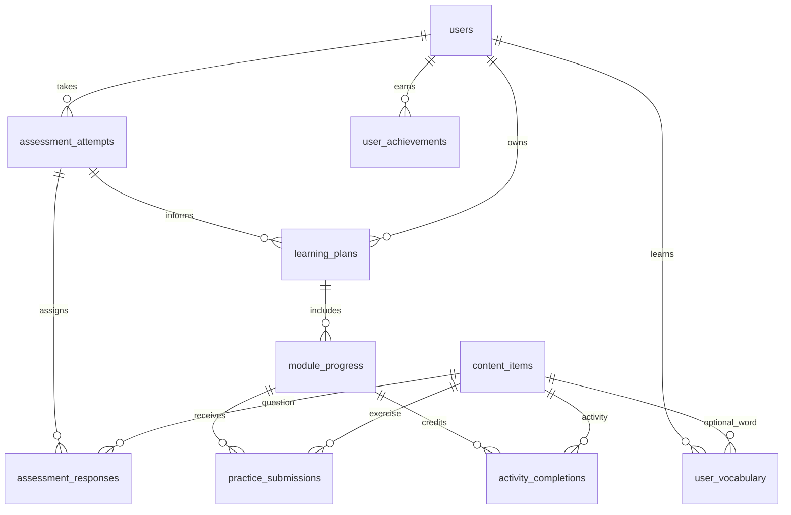
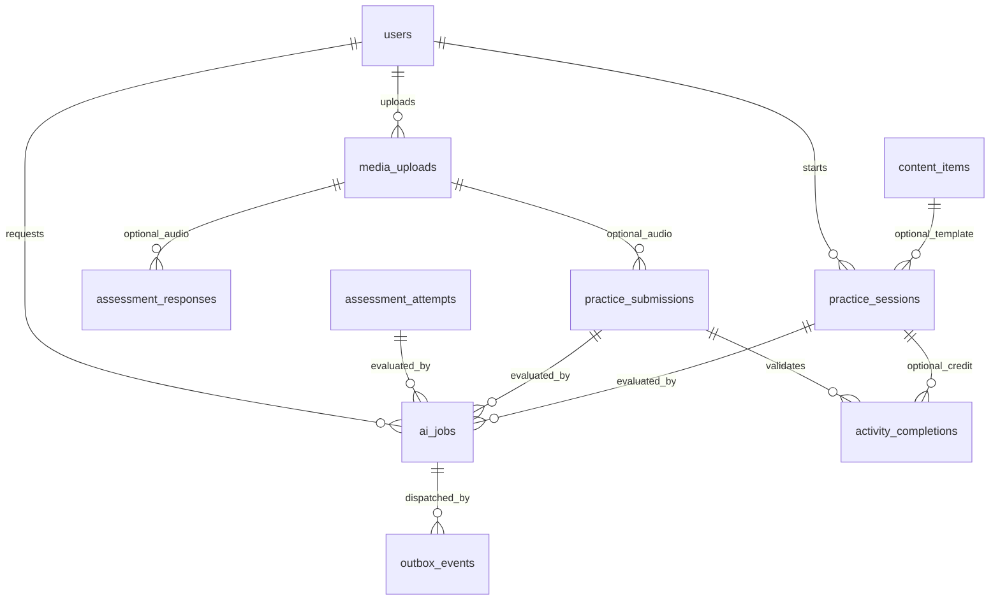

# TalkFiesta — Simplified Database Schema (V4 Proposal)

**Date:** 2026-10-29  
**Status:** **Architecture proposal, not an implemented V3 migration**  
**Stack:** FastAPI · SQLAlchemy 2 · Alembic · PostgreSQL (`JSONB`) · Redis/Celery · S3 · OpenAI/LangChain/LangGraph/LangSmith

## 0. Executive recommendation

The existing V3 backend **actually implements 16 database tables**. The original product specification includes **23 designed tables**, many still unimplemented. Considering both sets yields **38 distinct named tables**. That is more specialization than the initial TalkFiesta product needs.

**Recommended V4 target: 14 tables total** — 12 application tables plus 2 infrastructure tables. Collapse tables that represent the same lifecycle, but retain separate tables where database constraints, queries, ownership, or event history genuinely matter.

This is a **target design**, not a statement that the tables already exist. The schema must be implemented with new SQLAlchemy models, a deliberate Alembic migration, and data backfill if any V3 data must be retained.

### All 14 models

| # | Table | Area | Core purpose |
|---|---|---|---|
| 1 | `users` | Identity / onboarding | Account, verified Google subject, profile, preferences, onboarding status |
| 2 | `assessment_attempts` | Assessment | Lifecycle and provisional CEFR result |
| 3 | `assessment_responses` | Assessment | Persist question assignments, responses, skips, objective grading |
| 4 | `content_items` | Content / curriculum | One reviewed/versioned bank for questions, lessons, words, interview questions |
| 5 | `learning_plans` | Curriculum | Active and historical 21-day cycle plans |
| 6 | `module_progress` | Progress | Independent Speaking/Vocabulary/Writing day positions |
| 7 | `practice_submissions` | Practice | Recorded responses, written drafts/revisions, vocabulary quizzes/reviews |
| 8 | `practice_sessions` | Live sessions | AI conversations, mock interviews, multi-agent interview rounds |
| 9 | `user_vocabulary` | Vocabulary | Per-word mastery, spaced repetition, personalized suggestions |
| 10 | `activity_completions` | Progress | Durable activity credits, streaks, practice-time evidence |
| 11 | `media_uploads` | Media | Secure, owner-scoped uploaded audio records |
| 12 | `user_achievements` | Gamification | Awarded badges with uniqueness and earned timestamps |
| 13 | `ai_jobs` | Operations | Async OpenAI/LangGraph job attempts, tracing metadata, costs |
| 14 | `outbox_events` | Operations | Atomically recorded background events for reliable delivery |

### Why not fewer?

- **Don't merge `users` and `learning_plans`:** users can complete multiple cycles and retake assessments.
- **Don't merge `assessment_responses` into one huge `assessment_attempts.answers` JSON:** need resumable question assignment, concurrency, and answer-level status.
- **Don't merge `user_vocabulary` into one user JSON:** due-review queries, uniqueness, and per-word scheduling are important.
- **Don't derive completion solely from scores:** an accepted speaking submission should count even if AI scoring is still pending.
- **Don't drop `media_uploads`:** verify S3 objects before accepting arbitrary client-supplied keys.
- **Keep `ai_jobs` and `outbox_events`:** a database commit must not lose a Celery task.

## 1. Proposed ERD

### 1A. Core learning and assessment



### 1B. Sessions, media, workers



The arrows express logical relationships. `content_items` is intentionally polymorphic via a **validated `kind` discriminator**, while all user-owned transactional entities retain explicit FK relations. In implementation, create only the FKs that truly exist (e.g., content references inside JSON arrays need application validation).

## 2. Full model contracts

**Conventions:** UUID PKs, `created_at TIMESTAMPTZ` (UTC), `updated_at` where mutable, `JSONB` for bounded flexible data, and `CHECK`/indexes for frequently queried invariants. Fields listed as nullable can be absent. All API writes and reads must check authorization.

### 2.1 `users`

| Field | Type | Notes |
|---|---|---|
| `id` | UUID PK | |
| `email` | CITEXT UNIQUE NOT NULL | Or `lower(email)` unique index; normalized email |
| `password_hash` | TEXT NULL | Null for Google-only accounts |
| `google_sub` | VARCHAR UNIQUE NULL | Verify Google identity token before linking; never trust email alone |
| `role` | VARCHAR NOT NULL | `LEARNER`, `ADMIN`; default `LEARNER` |
| `display_name` | VARCHAR NULL | Name; avatar can live in `profile` |
| `profile` | JSONB NOT NULL | Avatar, optional native language, account preferences |
| `preferences` | JSONB NOT NULL | Goals[], focus_areas[], daily_minutes, topics[], comfort, reminders |
| `timezone` | VARCHAR NOT NULL | IANA timezone, e.g. `Asia/Riyadh` |
| `onboarding_status` | VARCHAR NOT NULL | `NOT_STARTED`, `PREFERENCES_SAVED`, `ASSESSING`, `RESULT_READY`, `COMPLETED` |
| `current_cefr` | VARCHAR NULL | Current provisional placement, not historical source |
| `is_active` | BOOLEAN NOT NULL | |
| `created_at`, `updated_at` | TIMESTAMPTZ | |

**Reasons for consolidation:** incorporates V3 `user_learning_preferences` and `onboarding_sessions` and the original `user_learning_profiles` basic preference data. To resume, fetch the user's `onboarding_status` and their existing active `assessment_attempts` record. If multi-provider identities or refresh-token management become extensive, add an `auth_identities` table later.

### 2.2 `assessment_attempts`

| Field | Type | Notes |
|---|---|---|
| `id` | UUID PK | |
| `user_id` | UUID FK → users | indexed |
| `kind` | VARCHAR | `INITIAL` or `REASSESSMENT` |
| `status` | VARCHAR | `IN_PROGRESS`, `SUBMITTED`, `PROCESSING`, `COMPLETED`, `FAILED_RETRYABLE`, `FAILED_FINAL` |
| `content_release` | VARCHAR | Pinned assessment question-bank release |
| `result` | JSONB NULL | Skill evidence, strengths, confidence reasoning, rubric version |
| `placement_cefr` | VARCHAR NULL | A1–C2 or unavailable |
| `confidence` | VARCHAR NULL | `LOW` / `MEDIUM` / `HIGH` |
| `started_at`, `submitted_at`, `completed_at` | TIMESTAMPTZ | Later timestamps nullable |

**Rules:** one active `INITIAL` attempt per user (partial unique index); immutable responses once submitted; result updated idempotently. The result is **provisional**, never presented as a formal CEFR certification.

### 2.3 `assessment_responses`

| Field | Type | Notes |
|---|---|---|
| `id` | UUID PK | |
| `assessment_attempt_id` | UUID FK → assessment_attempts | |
| `question_content_id` | UUID FK → content_items | Must be type `ASSESSMENT_QUESTION` |
| `position` | SMALLINT | Selected sequence number, fixed when assigned |
| `status` | VARCHAR | `ASSIGNED`, `ANSWERED`, `SKIPPED` |
| `answer` | JSONB NULL | Choice or text; not copied into public question objects |
| `media_upload_id` | UUID FK → media_uploads NULL | Optional speaking audio |
| `grading` | JSONB NULL | Objective correctness, transcription/subjective evidence |
| `revision` | INTEGER NOT NULL | Optimistic concurrency token |
| `assigned_at`, `answered_at` | TIMESTAMPTZ | |

**Constraints:** unique `(assessment_attempt_id, position)` and `(assessment_attempt_id, question_content_id)`. An `ASSIGNED` row exists **before** the learner answers, eliminating the need for a separate assessment item-assignment table.

### 2.4 `content_items` — central content bank

| Field | Type | Notes |
|---|---|---|
| `id` | UUID PK | |
| `kind` | VARCHAR | See kinds below |
| `module` | VARCHAR NULL | `SPEAKING`, `VOCABULARY`, `WRITING`; null for general assessment / interview items |
| `release_key` | VARCHAR NOT NULL | Pinned immutable content release identifier |
| `cycle` | SMALLINT NULL | 1–5 for day-based content |
| `day` | SMALLINT NULL | 1–21; null for word/question banks |
| `cefr_level` | VARCHAR NULL | A1–C2 / selected range |
| `goal_variant` | VARCHAR NULL | `GENERAL`, `BUSINESS`, `TRAVEL`, etc. |
| `slot` | VARCHAR NULL | `CORE`, `EXTRA` — if more than one lesson/day |
| `domain` | VARCHAR NULL | Interview domain, e.g. SOFTWARE_TECH |
| `agent_type` | VARCHAR NULL | `HR`, `TECHNICAL`, `MANAGER`, or `WILDCARD` |
| `title` | VARCHAR NOT NULL | |
| `body` | JSONB NOT NULL | Type-specific validated content, quiz answers, words, rubrics |
| `status` | VARCHAR NOT NULL | `DRAFT`, `REVIEW`, `PUBLISHED`, `ARCHIVED` |
| `origin` | VARCHAR NOT NULL | `HUMAN`, `AI` |
| `generation_batch_key` | VARCHAR NULL | Audit grouping without batch table |
| `content_version` | INTEGER NOT NULL | Version inside release |
| `reviewed_by` | UUID FK → users NULL | |
| `created_at`, `published_at` | TIMESTAMPTZ | |

**Supported kinds:** `ASSESSMENT_QUESTION`, `SPEAKING_LESSON`, `VOCABULARY_LESSON`, `WRITING_LESSON`, `VOCAB_WORD`, `INTERVIEW_QUESTION`, `LIVE_TOPIC`.

**Publishing rules:** published rows are immutable; a replacement gets a new `id` / `release_key`. Publish only after verifying the entire release is complete (21 CORE lessons for each selected module/cycle/level/goal variant, and 10 word references per vocabulary lesson). The `body.word_content_ids` list is **not automatically an FK**; verify its members and their types at publication. Never expose answer keys or expected interview answers in learner-facing APIs.

**Recommended indexes:** `(kind, status, cefr_level)`, `(release_key, module, cycle, day, goal_variant, slot)`, `(kind, domain, agent_type)`. Add a partial unique index preventing two published `CORE` lessons for the same release/module/cycle/day/level/goal. `body` must be validated by kind-specific Pydantic schemas; do not accept arbitrary unknown JSON.

**Example bodies:**

```json
{
  "kind": "VOCABULARY_LESSON",
  "body": {
    "word_content_ids": ["word-uuid-1", "word-uuid-2"],
    "exercise_types": ["FILL_BLANK", "MATCH", "CONTEXT", "PRONUNCIATION"],
    "instructions": "Learn ten words, then practice"
  }
}
```

```json
{
  "kind": "INTERVIEW_QUESTION",
  "domain": "SOFTWARE_TECH",
  "agent_type": "TECHNICAL",
  "body": {
    "level": "MID",
    "question": "How would you debug a slow API?",
    "expected_answer_notes": "Private evaluator guidance",
    "is_wildcard": false
  }
}
```

The example has two shortened word IDs to illustrate shape; a published day requires **10 real existing word IDs**.

### 2.5 `learning_plans`

| Field | Type | Notes |
|---|---|---|
| `id` | UUID PK | |
| `user_id` | UUID FK → users | |
| `source_assessment_id` | UUID FK → assessment_attempts NULL | Placement provenance |
| `cycle` | SMALLINT NOT NULL | 1–5 |
| `status` | VARCHAR NOT NULL | `ACTIVE`, `COMPLETED`, `PAUSED`, `SUPERSEDED` |
| `placement_cefr` | VARCHAR NOT NULL | Snapshot at plan creation |
| `plan_config` | JSONB NOT NULL | Goals, priority skills, chosen module roster, minutes/day |
| `created_at`, `completed_at` | TIMESTAMPTZ | |

**Constraint:** partial unique `(user_id) WHERE status='ACTIVE'`; check cycle 1–5. This is the **cycle** aggregate, not every daily task row. New cycles are new plans.

### 2.6 `module_progress`

| Field | Type | Notes |
|---|---|---|
| `id` | UUID PK | |
| `learning_plan_id` | UUID FK → learning_plans | |
| `module` | VARCHAR NOT NULL | `SPEAKING`, `VOCABULARY`, `WRITING` |
| `content_release` | VARCHAR NOT NULL | Pinned curriculum release, module-specific if necessary |
| `cefr_level` | VARCHAR NOT NULL | Target lesson difficulty |
| `goal_variant` | VARCHAR NOT NULL | E.g. BUSINESS |
| `current_day` | SMALLINT NOT NULL | 1–21, never 22 |
| `status` | VARCHAR NOT NULL | `ACTIVE`, `AWAITING_CONTENT`, `COMPLETED` |
| `prioritized` | BOOLEAN NOT NULL | Personalization |
| `updated_at`, `completed_at` | TIMESTAMPTZ | |

**Constraint:** unique `(learning_plan_id, module)`, check day 1–21. **Meaning:** `current_day` is the day to do next; if Day 21 completes, mark status `COMPLETED` and keep day at 21. Lock enrollment row when crediting a day to avoid double advancement.

### 2.7 `practice_submissions` — all ordinary exercise submissions

| Field | Type | Notes |
|---|---|---|
| `id` | UUID PK | |
| `user_id` | UUID FK → users | indexed |
| `module_progress_id` | UUID FK → module_progress NULL | Null for optional practice |
| `content_item_id` | UUID FK → content_items | Assigned daily exercise or word |
| `mode` | VARCHAR | `RECORDED_SPEAKING`, `WRITING`, `VOCAB_QUIZ`, `VOCAB_REVIEW`, `PRONUNCIATION` |
| `status` | VARCHAR | `DRAFT`, `SUBMITTED`, `ACCEPTED`, `REJECTED` |
| `evaluation_status` | VARCHAR | `NOT_REQUIRED`, `PENDING`, `PROCESSING`, `COMPLETED`, `FAILED` |
| `input` | JSONB NOT NULL | Learner answers, draft text; typed by `mode` |
| `media_upload_id` | UUID FK → media_uploads NULL | Recorded speech or pronunciation |
| `transcript` | TEXT NULL | Raw recognized text, distinct from corrected version |
| `feedback` | JSONB NULL | AI feedback/corrections, scores, recommendations |
| `score` | NUMERIC NULL | Summary score, rubric-specific |
| `revision_group_id` | UUID NULL | Stable group shared by original writing submission and revisions |
| `revision_number` | SMALLINT NOT NULL | 1–4 for writing; 1 otherwise |
| `created_at`, `submitted_at` | TIMESTAMPTZ | |

**Constraints:** unique `(revision_group_id, revision_number)` when group is non-null; 1–4 revision number; only accepted, validated submissions can create an activity credit. **Original and revised writing drafts are separate rows**, not an overwritten JSON array. Vocabulary review answers are preserved in separate `VOCAB_REVIEW` submission records; mastery state lives in `user_vocabulary`.

### 2.8 `practice_sessions` — live conversations and multi-agent panels

| Field | Type | Notes |
|---|---|---|
| `id` | UUID PK | |
| `user_id` | UUID FK → users | |
| `content_item_id` | UUID FK → content_items NULL | Topic/template if applicable |
| `session_type` | VARCHAR NOT NULL | `LIVE_CONVERSATION`, `MOCK_INTERVIEW`, `INTERVIEW_PANEL` |
| `status` | VARCHAR NOT NULL | `ACTIVE`, `ENDED`, `ABANDONED`, `ERROR` |
| `config` | JSONB NOT NULL | Persona, topic, domain, role, seniority, duration, panel mode |
| `transcript` | JSONB NOT NULL | Ordered speaker/agent turns, timestamps, question refs, rounds |
| `feedback` | JSONB NULL | Per-agent verdicts + panel summary or conversation feedback |
| `started_at`, `ended_at` | TIMESTAMPTZ | |

**Interview design:** retain `round`, `agent_type`, question IDs and `is_wildcard` in each transcript turn; preserve HR/Technical/Manager verdicts in `feedback.agent_reports` and the merged report in `feedback.summary`. Domain-specific and wildcard banks are `content_items` records. Conversation persona and topic come from `config`. For large-scale turn analytics, split into `session_turns` **later**, not at MVP launch.

### 2.9 `user_vocabulary`

| Field | Type | Notes |
|---|---|---|
| `id` | UUID PK | |
| `user_id` | UUID FK → users | |
| `word_content_id` | UUID FK → content_items NULL | Null for suggestion not yet in approved bank |
| `word_key` | VARCHAR NOT NULL | Normalized word / phrase identity |
| `status` | VARCHAR NOT NULL | `SUGGESTED`, `LEARNING`, `REVIEWING`, `MASTERED`, `DISMISSED` |
| `mastery_level` | SMALLINT NOT NULL | 1–5 |
| `review_interval_days` | SMALLINT NULL | Fixed schedule initially |
| `next_review_at` | TIMESTAMPTZ NULL | Indexed; due review queries |
| `times_practiced` | INTEGER NOT NULL | |
| `source_details` | JSONB NULL | Extracted weak word, original sentence, suggested replacement, source submission |
| `learned_at`, `last_reviewed_at`, `mastered_at` | TIMESTAMPTZ NULL | |

**Constraints:** unique `(user_id, word_key)`; index `(user_id, next_review_at)` for non-dismissed reviewable words. Review attempts go into `practice_submissions`, not a continuously growing JSON array.

### 2.10 `activity_completions`

| Field | Type | Notes |
|---|---|---|
| `id` | UUID PK | |
| `user_id` | UUID FK → users | For efficient user-day activity queries |
| `module_progress_id` | UUID FK → module_progress | |
| `content_item_id` | UUID FK → content_items | Required activity credited |
| `source_submission_id` | UUID FK → practice_submissions NULL | Valid accepted exercise |
| `source_session_id` | UUID FK → practice_sessions NULL | Optional eligible live-session completion |
| `local_practice_date` | DATE NOT NULL | Computed using user's saved timezone at credit time |
| `duration_seconds` | INTEGER NOT NULL | Verified/validated activity time |
| `completed_at` | TIMESTAMPTZ NOT NULL | |

**Constraints:** unique `(module_progress_id, content_item_id)`; exactly one of source submission/session must be present; unique source ID for each type where non-null. Create the credit and update module day **in one DB transaction**. Streaks, total time and daily completions are aggregated from this ledger (no mandatory `daily_progress` table).

### 2.11 `media_uploads`

| Field | Type | Notes |
|---|---|---|
| `id` | UUID PK | |
| `user_id` | UUID FK → users | Owner |
| `purpose` | VARCHAR NOT NULL | `ASSESSMENT`, `SPEAKING`, `PRONUNCIATION`, `INTERVIEW` |
| `object_key` | VARCHAR UNIQUE NOT NULL | Opaque S3 path; no PII |
| `content_type` | VARCHAR NOT NULL | Allowlisted audio types |
| `size_bytes` | INTEGER NULL | Verified after upload |
| `duration_seconds` | NUMERIC NULL | Server-verified when practicable |
| `status` | VARCHAR NOT NULL | `INITIATED`, `VERIFIED`, `REJECTED`, `DELETED` |
| `created_at`, `verified_at`, `delete_after` | TIMESTAMPTZ | Retention rules |

Only verified, owner-scoped uploads may be submitted to AI jobs. Audio data stays in private S3, not inside PostgreSQL or LangSmith traces.

### 2.12 `user_achievements`

| Field | Type | Notes |
|---|---|---|
| `id` | UUID PK | |
| `user_id` | UUID FK → users | |
| `achievement_key` | VARCHAR NOT NULL | E.g. `SEVEN_DAY_STREAK`, `CYCLE_COMPLETE` |
| `context` | JSONB NOT NULL | Evidence/version at award time |
| `earned_at` | TIMESTAMPTZ NOT NULL | |

**Constraint:** unique `(user_id, achievement_key)` (or include a cycle if an award is intentionally repeatable). Achievement definitions live in versioned application configuration, not a separate CRUD table, unless admins must edit badges dynamically.

### 2.13 `ai_jobs`

| Field | Type | Notes |
|---|---|---|
| `id` | UUID PK | |
| `user_id` | UUID FK → users NULL | Null for admin content-generation jobs if permitted |
| `job_type` | VARCHAR NOT NULL | `TRANSCRIBE`, `ASSESSMENT`, `SPEAKING_FEEDBACK`, `WRITING_FEEDBACK`, `VOCAB_CONTEXT`, `CONTENT_AUTHORING`, `SESSION_FEEDBACK` |
| `assessment_attempt_id` | UUID FK → assessment_attempts NULL | Optional target |
| `practice_submission_id` | UUID FK → practice_submissions NULL | Optional target |
| `practice_session_id` | UUID FK → practice_sessions NULL | Optional target |
| `status` | VARCHAR NOT NULL | `PENDING`, `RUNNING`, `SUCCEEDED`, `RETRYABLE`, `FAILED` |
| `idempotency_key` | VARCHAR UNIQUE NOT NULL | Prevent duplicate work |
| `attempts` | SMALLINT NOT NULL | Bounded retry count |
| `model` | VARCHAR NULL | OpenAI model used |
| `prompt_version`, `rubric_version` | VARCHAR NULL | Evaluator provenance |
| `langsmith_run_id` | VARCHAR NULL | Trace reference only; sanitize learner data |
| `metrics` | JSONB NULL | Token usage, latency, estimated cost, error codes |
| `created_at`, `started_at`, `finished_at` | TIMESTAMPTZ | |

Evaluation jobs should reference **exactly one** target among assessment, submission and session. `CONTENT_AUTHORING` may have no target when creating new content. Avoid repeated writes to user-owned results by using a single idempotent result persistence step.

### 2.14 `outbox_events`

| Field | Type | Notes |
|---|---|---|
| `id` | UUID PK | |
| `ai_job_id` | UUID FK → ai_jobs NULL | May carry non-AI progress events later |
| `event_type` | VARCHAR NOT NULL | E.g. `EVALUATION_REQUESTED`, `ACTIVITY_ACCEPTED` |
| `payload` | JSONB NOT NULL | Stable IDs and minimal non-sensitive metadata |
| `attempt_count` | INTEGER NOT NULL | |
| `created_at`, `published_at` | TIMESTAMPTZ | |

Created in the **same PostgreSQL transaction** as the action that requires worker execution. Dispatcher polls unpublished events; workers use `ai_jobs.idempotency_key` to tolerate redelivery. Broker/cache remains Redis; no per-event RabbitMQ/Kafka infrastructure required.

## 3. Feature coverage proof

| Product feature | Where it lives |
|---|---|
| Email login, Google login, roles | `users` (password hash, verified Google subject, role) |
| First-time onboarding, multiple goals, preferences, daily minutes | `users.preferences`, `users.onboarding_status` |
| Resume onboarding | `users.onboarding_status`, active `assessment_attempts` |
| Assessment question bank, adaptive questions | `content_items(kind=ASSESSMENT_QUESTION)` + `assessment_responses` assigned state |
| Grammar/vocab objective answers | `assessment_responses.answer`, `grading` |
| Writing and recorded speaking assessment | `assessment_responses`, `media_uploads`, `ai_jobs` |
| Provisional CEFR and reassessments | `assessment_attempts.result`, `placement_cefr`, attempt history |
| Personalized 21-day cycles (1–5) | `learning_plans`, `module_progress`, `content_items` |
| CEFR, goal-specific, versioned curriculum | `content_items.cefr_level`, `goal_variant`, `release_key`, `cycle`, `day` |
| Public speaking, conversational and impromptu recorded lessons | `content_items(kind=SPEAKING_LESSON)` + `practice_submissions(mode=RECORDED_SPEAKING)` |
| Audio, transcripts, feedback, WPM/pauses when measurable | `media_uploads`, `practice_submissions.transcript/feedback`, `ai_jobs` |
| Vocabulary 10 words/day, meanings, IPA, audio | `content_items(kind=VOCABULARY_LESSON/VOCAB_WORD)` |
| Fill blank / matching / contextual sentence / pronunciation | `content_items.body` + typed `practice_submissions` |
| Spaced repetition and vocabulary bank | `user_vocabulary` + review submissions |
| Personalized weak-word suggestions from mistakes | `user_vocabulary(status=SUGGESTED, source_details)` |
| Writing prompts, grammar/structure/coherence | `content_items(kind=WRITING_LESSON)` + feedback on `practice_submissions` |
| Writing original + up to three revisions and portfolio | `practice_submissions` with shared `revision_group_id`, versions 1–4 |
| Daily progress, streaks, time, score trends | `activity_completions` + historical `practice_submissions` |
| 21-day per-module independent progress | `module_progress.current_day/status` |
| Badges / achievements | `user_achievements` + achievement definitions in code |
| Real-time voice conversation, personas, transcripts | `practice_sessions(session_type=LIVE_CONVERSATION)` |
| Mock interview; HR, technical, manager panel; wildcard questions | `practice_sessions(session_type=INTERVIEW_PANEL)` + `content_items(kind=INTERVIEW_QUESTION)` |
| Multi-agent round history and verdicts | `practice_sessions.transcript/feedback` structured JSONB |
| Offline AI content generation and approval | `content_items.status/origin/generation_batch_key`, `ai_jobs` |
| OpenAI transcription/evaluation, LangGraph, LangSmith tracing | `ai_jobs`, `practice_submissions`, `assessment_attempts`, `practice_sessions` |
| Durable background processing | `ai_jobs`, `outbox_events` |
| Social achievement sharing / emailed progress reports (Phase 2) | Render from `user_achievements` and analytics; email transport external; add delivery log later only if required |

No learner/community, human tutoring, certification, or mobile-native models are included because those are explicitly out of scope in the original product plan.

## 4. Why JSONB here, and where not to use it

**Good JSONB uses:**
- learner preferences and profile metadata (small, whole-document updates)
- typed content `body` (`SPEAKING_LESSON` vs `VOCAB_WORD` etc.)
- bounded assessment evidence and feedback
- writing input and structured corrections
- live conversation / interview turns for modest MVP sessions
- per-job token/latency/error metrics

**Keep real typed columns for:**
- IDs, foreign keys, user ownership
- release key, content kind, module, CEFR, cycle, day
- job/evaluation status and timestamps
- `current_day`, `next_review_at`, `completed_at`, `local_practice_date`
- revision number and attempt uniqueness

**Validation:** implement a Pydantic **discriminated union** for `content_items.body`, `practice_submissions.input`, and `practice_sessions.config/feedback`; return redacted public schemas to clients. PostgreSQL JSONB alone doesn't guarantee content structure.

**Avoid unbounded JSON arrays:** at MVP, a single 3–20-minute session's transcript is reasonable to store in one JSONB row. Once sessions become large or require query-level transcript search or turn-by-turn analytics, extract `session_turns` as a justified 15th table.

## 5. Suggested simplified model folder layout

```text
app/
  modules/
    auth/models.py                  # User
    assessment/models.py            # AssessmentAttempt, AssessmentResponse
    content/models.py               # ContentItem
    learning/models.py              # LearningPlan, ModuleProgress, ActivityCompletion
    practice/models.py              # PracticeSubmission, PracticeSession
    vocabulary/models.py            # UserVocabulary
    media/models.py                 # MediaUpload
    gamification/models.py          # UserAchievement
    jobs/models.py                  # AIJob, OutboxEvent
  infrastructure/database/
    base.py
    model_registry.py
  core/
    config.py
    security.py
  workers/
    assessment.py
    speaking.py
    writing.py
    content.py
```

This is a **proposed refactor** of the V3 `app/modules/` tree, not a claim that these source files already exist.

## 6. V3 → V4 consolidation map

| Old tables / groups | Consolidate into | Notes |
|---|---|---|
| `users`, `user_learning_preferences`, `onboarding_sessions`, original `user_learning_profiles` | `users` | Keep accounts and onboarding; learning cycle moves to plan models |
| `assessment_questions`, `assessment_items` | `content_items`, `assessment_responses` | Assignment is an `ASSIGNED` response with immutable content FK |
| `assessment_attempts`, `assessment_results` | `assessment_attempts` | Historical result in typed column + JSONB |
| `curriculum_versions`, `curriculum_activities`, speaking exercises, writing prompts, vocab words/exercise bank | `content_items` | Release key + day + kind + Pydantic payload validation |
| `learning_plans`, `module_enrollments` | `learning_plans`, `module_progress` | Keep plan + module separation |
| `speaking_submissions`, `writing_submissions`, `writing_submission_versions`, `vocabulary_practice_sessions` | `practice_submissions` | Revision rows and typed mode |
| `live_conversation_sessions`, `interview_panel_sessions`, `panel_rounds`, `panel_responses`, `panel_agent_feedback` | `practice_sessions` | Session transcript/report JSONB (bounded MVP) |
| `domain_question_bank`, `wildcard_question_bank` | `content_items` | Kind=INTERVIEW_QUESTION; agent/domain attributes |
| `user_vocabulary`, `personalized_vocab_suggestions` | `user_vocabulary` | Suggested state + source details |
| `daily_progress`, `activity_completions` | `activity_completions` | Compute daily aggregates; avoid duplicate counters |
| `achievements`, `user_achievements` | `user_achievements` | Badge catalogue in code |
| `media_uploads` | `media_uploads` | Retain; generalize beyond onboarding |
| `content_generation_batches` | `content_items.generation_batch_key`, `ai_jobs` | Keep metadata, omit batch aggregate unless business needs it |
| `ai_jobs`, `outbox_events` | Keep both | Reliability boundary |

## 7. Migration plan — do not drop V3 tables directly

1. **Back up** PostgreSQL and capture current table counts/foreign-key relations.
2. Implement V4 SQLAlchemy models and **new** Alembic revisions (do not edit previously applied V1–V3 migrations).
3. Populate and reconcile `content_items` from `assessment_questions` and `curriculum_versions/curriculum_activities`; preserve old IDs in temporary mapping tables/scripts during transition.
4. Migrate existing `users` preferences/onboarding flags and retain original assessment result evidence.
5. Migrate current module enrollments into `module_progress`, pin content releases, and copy completion records without double-crediting.
6. Switch service reads/writes to V4 behind controlled deployment; if needed, dual-write temporarily, with reconciliation tests.
7. Add essential constraints and indexes; run end-to-end tests for resume, assessment, content selection, submission, streak, SRS and job retry.
8. Only after validating all records and backups, retire old tables in a later migration.

**New development environment with no user data:** resetting the local database and creating a clean V4 baseline is easier. **Production or real learner data:** use the staged migration above.

## 8. Key indexes and DB constraints checklist

- `users`: unique normalized `email`; unique `google_sub` when non-null.
- `assessment_attempts`: partial unique active initial attempt per user; index `(user_id, started_at DESC)`.
- `assessment_responses`: unique `(assessment_attempt_id, position)` and `(assessment_attempt_id, question_content_id)`; optimistic version.
- `content_items`: lookup index `(kind, status, release_key, cefr_level, goal_variant)`; partial uniqueness for published CORE/day content; immutable published rows.
- `learning_plans`: partial unique active plan per user; check cycle 1–5.
- `module_progress`: unique `(learning_plan_id, module)`; day check 1–21.
- `practice_submissions`: index `(user_id, created_at DESC)`; unique `(revision_group_id, revision_number)` when group is set; no double-submit credit.
- `practice_sessions`: index `(user_id, started_at DESC, session_type)`.
- `user_vocabulary`: unique `(user_id, word_key)`; index `(user_id, next_review_at)`.
- `activity_completions`: unique `(module_progress_id, content_item_id)`; unique non-null source references; index `(user_id, local_practice_date)`; credit in same transaction as module progression.
- `media_uploads`: unique `object_key`; verify uploaded object ownership and format.
- `user_achievements`: unique `(user_id, achievement_key)`.
- `ai_jobs`: unique `idempotency_key`; index `(status, created_at)`.
- `outbox_events`: partial index unpublished entries `(created_at) WHERE published_at IS NULL`.

## 9. Scope and tradeoffs

**This schema covers all defined product features** from the TalkFiesta documents, including Phase 2, through a smaller number of generalized persistence models. It does **not** mean all those features are implemented in the backend today.

The tradeoff is that **more meaning lives in type-validated JSONB**. That is acceptable for short assessments, fixed-size daily exercises, writing feedback and modest interview transcripts. It is not a good approach for unbounded message histories, sophisticated per-turn analytics, externally editable dynamic achievements, or complex multi-provider authentication. If any of those becomes a real requirement, extract a dedicated table then—based on measured needs, not speculation.

**Final recommendation:** Adopt this 14-model proposal as the V4 target for the TalkFiesta MVP and foreseeable Phase 2, while keeping the current V3 schema untouched until a migration has been tested.
