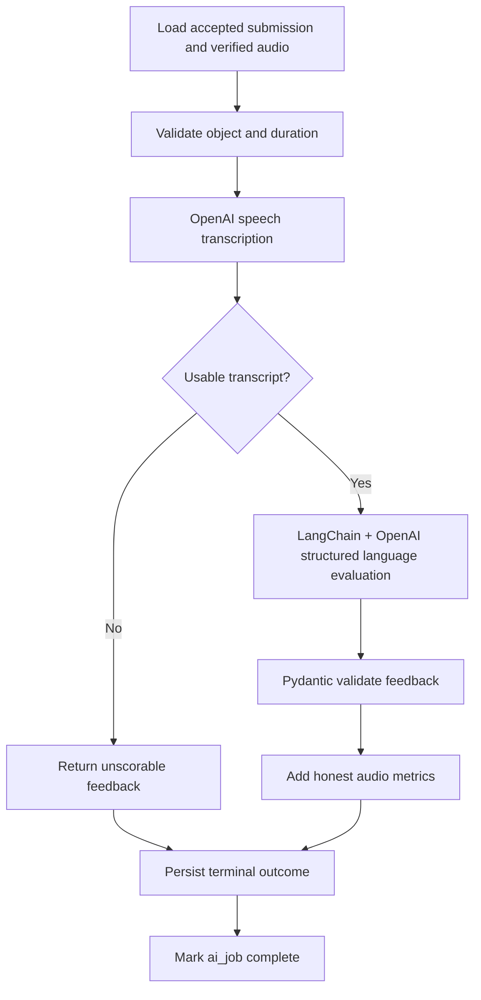

# TalkFiesta — Daily Speaking API Specification (V4)

**Status:** Proposed implementation contract (not confirmation of deployed V4 endpoints)  
**Version:** 1.0 — 2026-11-03  
**Stack:** Next.js microphone UI → FastAPI → private S3 → PostgreSQL/outbox → Celery → LangGraph / LangChain / OpenAI → LangSmith  
**Database baseline:** `TalkFiesta-Simplified-Database-Schema-v4.md` (14-table target)  
**Scope:** MVP **recorded daily speaking** and public-speaking exercises with asynchronous transcription, language feedback and independent curriculum progress. Real-time conversations and interview panels are explicitly Phase 2 (`practice_sessions`), not covered by these recorded-submission endpoints.

---

## 1. User story and business contract

**User journey:**

1. Open the next Speaking activity assigned by the 21-day learning plan.
2. Read the topic, instructions, target duration and exercise type.
3. Start recording; pause/re-record locally if desired; preview audio before upload.
4. Create a draft and obtain a short-lived, user-scoped upload URL.
5. Upload audio directly to private S3 and ask FastAPI to verify it.
6. Submit the verified recording **once**. The server credits the valid activity and advances only the Speaking module.
7. Wait for transcription and feedback (poll a GET endpoint); practice completion remains valid even if AI feedback is delayed.
8. Review original transcript, meaningful corrections, and suggestions, or open an earlier submission from history.

### Critical rules

- **Completion and AI evaluation are separate statuses.** Valid submission acceptance creates activity credit before OpenAI runs.
- **Never trust the browser to mark an activity complete, choose a CEFR grade, or supply arbitrary S3 object keys.**
- **No user-facing `/ai/transcribe` or `/ai/evaluate` endpoints.** The worker orchestrates OpenAI internally.
- **One required credit per `(module_progress_id, content_item_id)`**, regardless of replays, double clicks or retries.
- **Original transcript is immutable evidence** once saved; a corrected example must not overwrite it.
- **Pronunciation is NOT inferred from text.** It stays unassessed/null until validated audio-based analysis exists.
- **The speaking curriculum advances independently** of Vocabulary and Writing; pinned published content releases must be respected.
- **LangSmith handles tracing and evaluation**, not user data persistence or credential distribution.

### Recommended MVP policy (configurable)

- Accept browser-supported audio formats validated end-to-end, initially **WebM/Opus**; add M4A/MP3/WAV only after actual decoders and provider input compatibility are verified.
- Example maximum upload size **15 MiB** and configurable accepted duration **10–180 seconds**. These are proposed product caps, not OpenAI model-specific limits; validate both before accepting a practice submission.
- Limit new daily-credit submissions per assigned required activity to **one**. Allow one active draft at a time and optional re-record before final submit.
- Rate-limit upload allocation, submissions, and retries per authenticated learner to manage storage/AI costs.
- Return **202 Accepted** after durable submission acceptance, not after AI feedback completes.

---

## 2. API catalogue

All endpoints are under `/api/v1`; authenticated endpoints are owner-scoped. FastAPI derives the user from a validated API credential issued via the Auth.js/FastAPI trust boundary.

| Method | Endpoint | Role | Success |
|---|---|---|---|
| `GET` | `/speaking/today` | Next assigned Speaking activity and lesson instructions | `200` |
| `POST` | `/speaking/submissions` | Create/retrieve an active draft for an assigned content item | `201` / `200` |
| `POST` | `/media/audio-uploads` | Allocate owner-scoped S3 presigned upload | `201` |
| `POST` | `/media/audio-uploads/{upload_id}/confirm` | Validate object after direct S3 upload | `200` |
| `POST` | `/speaking/submissions/{submission_id}/submit` | Accept recording, credit day, enqueue evaluation | `202` |
| `GET` | `/speaking/submissions/{submission_id}` | Read evaluation state, transcript and feedback | `200` |
| `GET` | `/speaking/submissions` | Paginated speaking practice history | `200` |

**Optional later:** `GET /speaking/submissions/{submission_id}/audio` for an authorized, short-lived playback URL; `POST /speaking/submissions/{id}/evaluation/retry` only for an explicitly retryable terminal failure. Do not add these unless the UX actually needs them.

Common request requirements:
- `Authorization: Bearer <access_token>` for direct API access. For a browser app, prefer the secure Auth.js BFF and server-managed credentials.
- `Idempotency-Key: <UUID or unique opaque key>` on side-effecting draft creation, submit, and explicit manual retry.
- `Content-Type: application/json` for JSON calls; presigned S3 `PUT` uses the exact signed `Content-Type` and checksum headers.
- All media IDs, submission IDs and lesson IDs are UUIDs. Never accept a client-supplied `user_id`.

### Standard API error shape

```json
{
  "error": {
    "code": "MEDIA_UPLOAD_NOT_VERIFIED",
    "message": "Please upload and confirm your recording before submitting.",
    "details": {},
    "request_id": "req_01HX_example"
  }
}
```

Use codes consistently: `401` auth missing/invalid; `403` disabled user; `404` resource not found or not owned; `409` invalid state/duplicate/conflicting activity; `413` oversize upload; `422` invalid request/recording; `429` quota; `503` temporary infrastructure unavailability.

---

## 3. Full request sequence

```mermaid
sequenceDiagram
    actor Learner
    participant UI as Next.js
    participant API as FastAPI
    participant S3 as Private S3
    participant PG as PostgreSQL
    participant Dispatch as Outbox Dispatcher
    participant Celery as Celery Worker
    participant Graph as LangGraph
    participant OpenAI as OpenAI API
    participant Smith as LangSmith

    Learner->>UI: Open speaking lesson
    UI->>API: GET /speaking/today
    API->>PG: Fetch pinned current content
    API-->>UI: Lesson instructions
    Learner->>UI: Record and preview audio
    UI->>API: POST /speaking/submissions
    API->>PG: Create/reuse DRAFT
    API-->>UI: Draft submission_id
    UI->>API: POST /media/audio-uploads
    API->>PG: Create upload allocation
    API-->>UI: Presigned PUT URL and required headers
    UI->>S3: PUT audio bytes
    UI->>API: POST /media/audio-uploads/{id}/confirm
    API->>S3: Verify size/type/checksum, decode if required
    API->>PG: Mark VERIFIED
    API-->>UI: Verified upload
    Learner->>UI: Submit recording
    UI->>API: POST /speaking/submissions/{id}/submit
    API->>PG: TX: accept + activity credit + advance module + AI job + outbox
    API-->>UI: 202 ACCEPTED; feedback PENDING
    Dispatch->>PG: Claim new outbox event
    Dispatch->>Celery: Publish job id
    Celery->>Graph: Start speaking feedback graph
    Graph->>S3: Download verified recording
    Graph->>OpenAI: Transcribe recorded speech
    OpenAI-->>Graph: Original transcript
    Graph->>OpenAI: Evaluate language with rubric
    OpenAI-->>Graph: Validated feedback
    Graph-.->Smith: Sanitized run metadata
    Celery->>PG: Persist transcript + feedback + job result
    UI->>API: GET /speaking/submissions/{id}
    API-->>UI: COMPLETED feedback or processing state
```

Important: **The outbox publisher, Celery delivery, and OpenAI provider calls may repeat.** The database transaction and worker's idempotent finalization prevent duplicate activity credits and duplicate persisted feedback. Exactly-once provider billing cannot be guaranteed after a crash.

---

## 4. Detailed endpoint contracts

### 4.1 `GET /api/v1/speaking/today`

**Purpose:** Resolve the next `SPEAKING_LESSON` under the user's active plan and module progress. This endpoint **does not change state**.

**200 OK**:

```json
{
  "module": "SPEAKING",
  "plan_id": "11111111-1111-4111-8111-111111111111",
  "module_progress_id": "22222222-2222-4222-8222-222222222222",
  "cycle": 1,
  "day": 4,
  "module_status": "ACTIVE",
  "activity": {
    "id": "33333333-3333-4333-8333-333333333333",
    "kind": "SPEAKING_LESSON",
    "title": "Talk about your professional experience",
    "exercise_type": "CONVERSATIONAL",
    "topic": "Your current role",
    "instructions": "Introduce yourself and describe your daily responsibilities.",
    "target_duration_seconds": 60,
    "target_cefr": "A2",
    "preparation_seconds": 15,
    "tips": ["Use the present simple for routines", "Give one concrete example"]
  },
  "existing_draft_id": null
}
```

**Rules:**
- Verify active plan and Speaking enrollment; use the pinned `content_release`, current day, CEFR and goal variant. Ensure `kind=SPEAKING_LESSON`, `slot=CORE`, and `status=PUBLISHED`.
- `exercise_type` is part of the versioned `content_items.body` (`CONVERSATIONAL`, `PUBLIC_SPEAKING`, later `IMPROMPTU`), not a different database table.
- Project only public content fields. Never return private evaluator notes.
- If already complete at Day 21, return `200` with `module_status=COMPLETED`, `day=21` and `activity=null`.
- If not enrolled or no plan, return appropriate `404` / `409` codes. If published content is missing under a pinned release, return `409 CURRICULUM_CONTENT_UNAVAILABLE`.

### 4.2 `POST /api/v1/speaking/submissions`

**Purpose:** Open a draft bound to the current assigned lesson. Draft does **not** credit progress or invoke AI.

Headers: `Idempotency-Key: 8811a6cc-1ee7-4d59-ae32-55c104ca55c1`

Request:

```json
{
  "content_item_id": "33333333-3333-4333-8333-333333333333"
}
```

**201 Created** (or **200 OK** if the same active draft is returned):

```json
{
  "submission_id": "44444444-4444-4444-8444-444444444444",
  "mode": "RECORDED_SPEAKING",
  "status": "DRAFT",
  "evaluation_status": "NOT_REQUIRED",
  "content_item_id": "33333333-3333-4333-8333-333333333333",
  "media_upload_id": null,
  "created_at": "2026-11-03T10:00:00Z"
}
```

**Service checks:** current user's active plan and Speaking module; `content_item_id` is current pinned published activity; reject unrelated/locked activities. A submission is owned by the authenticated learner and bound to their `module_progress_id`. `mode=RECORDED_SPEAKING`, `revision_number=1`, `input={}`.

If a draft exists for this same learner and activity, reuse it under the documented draft policy. Do not return another learner's record. If the daily activity has already been credited, return `409 ACTIVITY_ALREADY_COMPLETED` for required daily practice. Optional extra practice can be introduced later using the same shared submission table without awarding a second required credit.

### 4.3 `POST /api/v1/media/audio-uploads`

**Purpose:** Authorize a **single recording upload** for a specific owned draft. The media table is shared with onboarding assessment recordings and vocabulary pronunciation.

Request:

```json
{
  "purpose": "SPEAKING",
  "submission_id": "44444444-4444-4444-8444-444444444444",
  "content_type": "audio/webm",
  "size_bytes": 583210,
  "sha256_hex": "aaaaaaaaaaaaaaaaaaaaaaaaaaaaaaaaaaaaaaaaaaaaaaaaaaaaaaaaaaaaaaaa"
}
```

**201 Created**:

```json
{
  "upload_id": "55555555-5555-4555-8555-555555555555",
  "method": "PUT",
  "upload_url": "https://example-bucket.s3.amazonaws.com/opaque-key?...signed-parameters...",
  "required_headers": {
    "Content-Type": "audio/webm"
  },
  "expires_at": "2026-11-03T10:05:00Z",
  "status": "INITIATED"
}
```

**Security and validation:**
- Validate draft ownership, media purpose, permitted MIME/container, declared size cap, and quotas.
- Generate a random opaque object key. Do **not** allow browser-supplied `object_key`, bucket or AWS credentials.
- Use short-lived presigned upload with constrained key, method and headers. Where supported, sign a checksum header and/or use a bucket policy constraint; return all headers that the browser must send.
- Presigned upload URLs are bearer-style access grants until expiration, and may overwrite the same object key. Prefer a fresh random object key for each upload and never reuse a verified key for a later recording.
- Store a `media_uploads` row with `user_id`, `purpose`, `object_key`, `content_type`, `status=INITIATED` and retention metadata; in the same transaction, set the owned **draft `practice_submissions.media_upload_id`** to this newly allocated upload. That existing FK is the draft-to-upload binding (no extra table needed). On re-record, replace this draft pointer with the new upload ID. If checksum comparison is required, add a small `media_uploads.expected_sha256_hex` column in the V4 implementation (or use verified server-controlled S3 metadata with an equally durable expected value); the original 14-table proposal does not include this column.

The browser uploads the exact audio bytes **directly to S3**. No audio bytes are embedded in this JSON API.

### 4.4 `POST /api/v1/media/audio-uploads/{upload_id}/confirm`

**Purpose:** Confirm upload completion by looking up and validating the object server-side. Client assertion alone is insufficient.

Request: `{}`

**200 OK**:

```json
{
  "upload_id": "55555555-5555-4555-8555-555555555555",
  "status": "VERIFIED",
  "content_type": "audio/webm",
  "size_bytes": 583210,
  "duration_seconds": 48.7,
  "verified_at": "2026-11-03T10:01:00Z"
}
```

**Service checks:** owner and currently attached draft (`practice_submissions.media_upload_id == upload_id`); S3 HEAD existence/size/type/checksum, plus a trusted decode/ffprobe step for true audio format and duration before final acceptance (this step may run on a worker if it would block an HTTP latency target; if async, return a validation-processing state and do not permit submit until `VERIFIED`). Reject malformed or truncated files and non-audio payloads even if MIME claims `audio/webm`.

On re-record, issue **a new upload**, confirm that upload, and submit the desired verified `upload_id`. Unattached older uploads are expired by retention jobs.

### 4.5 `POST /api/v1/speaking/submissions/{submission_id}/submit`

**Purpose:** Finalize verified audio, **credit exactly one required activity** and create a durable AI evaluation job. No synchronous call to OpenAI.

Headers: `Idempotency-Key: 6b1d313d-8ad4-4b8d-97a2-629a77555a0a`

Request:

```json
{
  "media_upload_id": "55555555-5555-4555-8555-555555555555"
}
```

**202 Accepted**:

```json
{
  "submission_id": "44444444-4444-4444-8444-444444444444",
  "activity_status": "COMPLETED",
  "evaluation_status": "PENDING",
  "job_id": "66666666-6666-4666-8666-666666666666",
  "credited_day": 4,
  "next_speaking_day": 5,
  "submission_url": "/api/v1/speaking/submissions/44444444-4444-4444-8444-444444444444"
}
```

**Atomic PostgreSQL transaction (recommended sequence):**

1. Lock the owned `practice_submissions` row (`SELECT ... FOR UPDATE`) and assert `status=DRAFT`; if previously accepted with identical request/idempotency key, return existing result.
2. Verify the `media_uploads` row: `VERIFIED`, correct owner/purpose, **exactly matches `practice_submissions.media_upload_id` on this draft**, acceptable duration, and not bound to another accepted submission.
3. Lock the corresponding `module_progress` row; verify active plan, current day, pinned content and published lesson ID.
4. Update submission: `status=ACCEPTED`, `evaluation_status=PENDING`, keep the previously bound `media_upload_id`, save submitted timestamp and basic verified metadata in typed `input`.
5. Insert `activity_completions(user_id, module_progress_id, content_item_id, source_submission_id, local_practice_date, duration_seconds, completed_at)` with unique `(module_progress_id, content_item_id)`.
6. **Only if credit insertion is new**, advance `current_day` 4 → 5; if Day 21 just completed, set module `COMPLETED` while retaining `current_day=21`.
7. Insert `ai_jobs(job_type=SPEAKING_FEEDBACK, practice_submission_id=..., status=PENDING, idempotency_key=...)` and a matching `outbox_events` row.
8. Commit once. The outbox dispatcher later publishes the job ID to Celery.

A transient OpenAI error cannot roll back the learner's already accepted completion. Duplicate POST requests cannot award a second credit. If no new credit is inserted, reuse the existing accepted submission and job when the duplicate request is equivalent; conflicting payloads return `409 IDEMPOTENCY_CONFLICT`.

**Example errors:** `409 MEDIA_UPLOAD_NOT_VERIFIED`, `409 ACTIVITY_ALREADY_COMPLETED`, `409 CURRENT_ACTIVITY_MISMATCH`, `422 RECORDING_DURATION_OUT_OF_RANGE`, `413 AUDIO_TOO_LARGE`, `429 AI_DAILY_LIMIT_REACHED` (when policy forbids new submissions).

### 4.6 `GET /api/v1/speaking/submissions/{submission_id}`

**Purpose:** Poll for AI feedback and view an existing learner-owned submission. This is the canonical speaking evaluation endpoint; no separate public `/ai/evaluate-speaking` route.

**200 OK while processing:**

```json
{
  "submission_id": "44444444-4444-4444-8444-444444444444",
  "content_item_id": "33333333-3333-4333-8333-333333333333",
  "activity_status": "COMPLETED",
  "evaluation": {
    "status": "PROCESSING",
    "stage": "TRANSCRIBING_AUDIO",
    "retry_after_seconds": 3
  },
  "transcript": null,
  "feedback": null
}
```

**200 OK after successful evaluation (illustrative, not real learner grading):**

```json
{
  "submission_id": "44444444-4444-4444-8444-444444444444",
  "activity_status": "COMPLETED",
  "evaluation": {
    "status": "COMPLETED",
    "stage": "DONE",
    "rubric_version": "speaking-feedback-v1"
  },
  "transcript": "Yesterday I go to office and I discuss my project.",
  "feedback": {
    "reviewable": true,
    "scores": {
      "grammar": 72,
      "vocabulary": 75,
      "coherence": 78,
      "task_relevance": 82
    },
    "corrections": [
      {
        "original": "Yesterday I go to office",
        "corrected": "Yesterday I went to the office",
        "explanation": "Use the past tense for a completed action yesterday."
      }
    ],
    "strengths": ["Your message is easy to follow"],
    "next_steps": ["Practice past-tense verbs"],
    "improved_answer": "Yesterday I went to the office and discussed my project.",
    "audio_metrics": {
      "recording_duration_seconds": 48.7,
      "approx_recording_wpm": 12.3,
      "pause_count": null
    },
    "pronunciation_score": null
  }
}
```

The example scores are arbitrary illustrative values and not a calibrated CEFR scoring system. `approx_recording_wpm` is based on total audio duration, including silence; it should not be called articulatory speech rate. `pronunciation_score=null` means no validated pronunciation measurement exists.

**Unscorable audio:** If transcription/evaluation concludes successfully but speech is not intelligible, keep `evaluation.status=COMPLETED` and set `feedback={"reviewable":false,"reason":"NO_USABLE_SPEECH","retry_suggestion":"Record again in a quiet environment"}`. Do not fabricate scores. Retake as a separate optional practice attempt under a documented policy; do not automatically revoke an already credited activity.

**Provider failure:** If the worker exhausts retries, return `evaluation.status=FAILED` and a safe error `{code,message,retry_allowed}`. Original audio remains available for a controlled retry; the completion ledger is not reversed.

### 4.7 `GET /api/v1/speaking/submissions`

**Purpose:** Learner-owned speaking practice history. Cursor pagination avoids large offset scans.

Query parameters: `limit` default 20, max 100; optional opaque `cursor`; optional `evaluation_status` from the documented enum.

**200 OK:**

```json
{
  "items": [
    {
      "submission_id": "44444444-4444-4444-8444-444444444444",
      "content_item_id": "33333333-3333-4333-8333-333333333333",
      "title": "Talk about your professional experience",
      "submitted_at": "2026-11-03T10:02:00Z",
      "activity_status": "COMPLETED",
      "evaluation_status": "COMPLETED",
      "grammar_score": 72
    }
  ],
  "next_cursor": null
}
```

**Rules:** Filter `user_id` + `mode=RECORDED_SPEAKING`, order by `(submitted_at DESC, id DESC)` and use an opaque signed cursor. Include a short summary only. Full transcript/feedback is returned by the detail endpoint, not the history list.

---

## 5. LangGraph, OpenAI and LangSmith execution contract

The FastAPI endpoint enqueues exactly one logical job. Worker-only operations are **not** public HTTP endpoints.



| Operation | Owner | Output |
|---|---|---|
| `process_speaking_feedback(job_id)` | Celery worker | Executes a job by persisted ID |
| `load_accepted_submission()` | Speaking repository | Safe prompt, recording metadata and owner check |
| `download_verified_audio()` | S3 client | Audio bytes/temporary file inside worker |
| `transcribe_recording()` | OpenAI SDK | Uncorrected transcript |
| `evaluate_spoken_language()` | LangChain structured output | Typed grammar/vocabulary/coherence/relevance feedback |
| `validate_feedback()` | Pydantic | Bounded fields and corrections |
| `persist_feedback()` | Speaking service/SQLAlchemy | Transcript and feedback JSONB, job state |
| `record_ai_trace()` | LangSmith integration | Redacted run metadata and quality evaluation hooks |

### Structured output contract (illustrative Pydantic)

```python
from pydantic import BaseModel, Field

class Correction(BaseModel):
    original: str
    corrected: str
    explanation: str

class LanguageScores(BaseModel):
    grammar: int = Field(ge=0, le=100)
    vocabulary: int = Field(ge=0, le=100)
    coherence: int = Field(ge=0, le=100)
    task_relevance: int = Field(ge=0, le=100)

class SpeakingReview(BaseModel):
    reviewable: bool
    scores: LanguageScores | None
    corrections: list[Correction] = Field(default_factory=list)
    strengths: list[str] = Field(default_factory=list)
    next_steps: list[str] = Field(default_factory=list)
    improved_answer: str | None = None
    pronunciation_score: None = None  # no transcript-only pronunciation grade
```

The model scores must follow a **versioned rubric**, and the application must establish calibration against expert-reviewed examples before advertising any scores as measurement-grade CEFR placement. Passing a Pydantic schema alone does not guarantee educational validity.

### Worker retries and failure behavior

1. Claim a pending `ai_jobs` record by ID; use a state transition/lock that prevents concurrent *persisted* completion.
2. Retry transient provider/network failures with exponential backoff and a finite attempt limit.
3. If the same job is redelivered after completion, detect `SUCCEEDED` and return without overwriting feedback.
4. Record `model`, `prompt_version`, `rubric_version`, duration, token/cost metrics and sanitized `langsmith_run_id` in `ai_jobs` (never return trace IDs to learner API clients).
5. Store the raw transcript in `practice_submissions.transcript` and a typed, sanitized result in `practice_submissions.feedback`.
6. Do not expose OpenAI credentials, prompts, file internals, storage locations or LangSmith trace payloads to the browser.
7. Avoid logging full learner audio/transcripts by default; apply storage lifecycle/retention and explicit user-consent policies.

**Operational note:** Celery late-ack / worker redelivery can cause task re-execution; tasks must be idempotent. S3 presigned URLs can be reused or overwrite an object at the same key before expiry; use short expirations and one key per upload. Relevant provider guidance:  
- AWS presigned URL documentation: https://docs.aws.amazon.com/AmazonS3/latest/userguide/using-presigned-url.html  
- Celery task idempotency guidance: https://docs.celeryq.dev/en/stable/userguide/tasks.html

---

## 6. V4 database mapping (no new tables)

| Entity | Relevant fields and usage |
|---|---|
| `users` | `id`, `timezone`, `current_cefr`, `preferences` |
| `learning_plans` | Active cycle, curriculum provenance, `plan_config` |
| `module_progress` | Speaking enrollment, pinned release, `current_day`, `status` |
| `content_items` | `kind=SPEAKING_LESSON`, published instructions under versioned body |
| `practice_submissions` | `mode=RECORDED_SPEAKING`, `status`, `evaluation_status`, `input`, `media_upload_id`, `transcript`, `feedback`, summary score |
| `activity_completions` | Unique accepted-credit evidence and practice duration |
| `media_uploads` | Opaque S3 object reference, ownership, purpose, verified metadata, retention |
| `ai_jobs` | Evaluation job status, OpenAI model and rubric versions, LangSmith trace reference |
| `outbox_events` | Durable evaluation dispatch tied to accepted submission |

This maps to the **proposed** V4 schema. The upload-to-draft binding is represented by the existing `practice_submissions.media_upload_id` foreign key, set when the URL is allocated and checked again on confirm/submit; **no separate upload-binding table** is needed. If enforcing upload checksum matching, add a narrowly scoped `expected_sha256_hex` column to `media_uploads` rather than storing an important integrity invariant only in arbitrary JSON. For idempotency replay, persist a deterministic unique logical-operation key on `ai_jobs` or a dedicated existing request ledger if adopted; do not rely on an in-memory cache. If the requirements grow, adding a narrowly scoped column/constraint is preferable to burying ownership or concurrency rules in JSON.

**Suggested indexes / constraints:**
- `practice_submissions(user_id, mode, submitted_at DESC, id DESC)` for history.
- `practice_submissions(module_progress_id, content_item_id)` for draft/credit lookups.
- Partial unique index for one active daily draft if the implementation chooses to enforce it at DB level (condition `status='DRAFT'` for `mode='RECORDED_SPEAKING'`).
- `activity_completions UNIQUE(module_progress_id, content_item_id)` and unique non-null `source_submission_id`.
- `media_uploads UNIQUE(object_key)`; verify ownership and purpose at every transition.
- `ai_jobs UNIQUE(idempotency_key)` and unique logical job target for an active `SPEAKING_FEEDBACK` operation.
- `outbox_events(published_at, created_at)` to dispatch pending events efficiently.

---

## 7. State machines

### Submission and evaluation

```text
practice_submissions.status:
  DRAFT -> ACCEPTED
            \-> (no automatic reversal on AI failure)
  DRAFT -> REJECTED  # invalid / abandoned according to policy

practice_submissions.evaluation_status:
  NOT_REQUIRED (draft)
       -> PENDING
       -> PROCESSING
       -> COMPLETED
       -> FAILED  # terminal processing failure, with retry policy
```

`ai_jobs.status`: `PENDING → RUNNING → SUCCEEDED` or `RETRYABLE → RUNNING` until retry budget exhausted, then `FAILED`. The HTTP response's `stage` is a presentation field derived from the current safe worker stage, not a separate required SQL table.

### Speaking module progression

```text
module_progress.current_day: 1..21

Valid accepted Day N submission
  -> insert one activity_completions row
  -> if N < 21: current_day = N + 1
  -> if N == 21: status = COMPLETED, current_day = 21

AI feedback can remain PENDING after day progression.
```

---

## 8. Suggested FastAPI feature structure

```text
app/
├── modules/
│   ├── speaking/
│   │   ├── router.py                 # today, drafts, submit, detail, history
│   │   ├── schemas.py                # request/response DTOs
│   │   ├── models.py                 # reuses shared practice_submissions mapping
│   │   ├── repository.py             # owner-scoped queries
│   │   ├── service.py                # speaking business rules
│   │   └── ai/
│   │       ├── graph.py
│   │       ├── state.py
│   │       ├── nodes.py
│   │       ├── evaluators.py
│   │       ├── prompts/
│   │       └── rubrics/
│   ├── media/
│   │   ├── router.py
│   │   ├── schemas.py
│   │   ├── service.py
│   │   └── repository.py
│   ├── practice/
│   │   └── models.py                 # shared submission ORM model ownership
│   ├── progress/
│   │   └── completion_service.py     # transactional day credit and advancement
│   ├── learning_plans/
│   │   └── selectors.py              # pinned curriculum activity selection
│   └── jobs/
│       ├── service.py
│       └── outbox_repository.py
├── infrastructure/
│   ├── ai/openai_client.py
│   ├── storage/s3_client.py
│   └── database/session.py
└── workers/
    ├── celery_app.py
    ├── speaking_tasks.py
    └── outbox_dispatcher.py
```

Have **one canonical ORM mapping** for `practice_submissions`; do not declare the same SQLAlchemy table in both `practice/models.py` and `speaking/models.py`. The speaking feature depends on that shared model and adds typed Pydantic inputs/results.

### Service interfaces

```python
class SpeakingService:
    async def get_today(self, *, user_id): ...
    async def create_draft(self, *, user_id, content_item_id, idempotency_key): ...
    async def submit(self, *, user_id, submission_id, media_upload_id, idempotency_key): ...
    async def get_submission(self, *, user_id, submission_id): ...
    async def list_history(self, *, user_id, limit, cursor): ...

class MediaService:
    async def allocate_speaking_upload(self, *, user_id, submission_id, content_type, size_bytes, checksum): ...
    async def confirm_upload(self, *, user_id, upload_id): ...

class SpeakingEvaluationWorker:
    def evaluate(self, *, job_id): ...
```

**Transaction ownership:** `SpeakingService.submit` owns the commit that accepts a submission, records one credit, advances the module, creates a logical AI job and writes an outbox event. Repositories flush but do not independently commit portions of that transaction. The worker persists final evaluation in its own transaction.

---

## 9. Acceptance and security tests

### Happy path

- [ ] Learner receives their own active Speaking lesson from a pinned published release.
- [ ] Creating a draft does not count toward streak or module completion.
- [ ] Upload presign is valid only for the intended owned draft, approved key and short expiry.
- [ ] Confirm checks actual uploaded object rather than trusting browser metadata.
- [ ] First valid submit returns `202`, saves `ACCEPTED`, creates exactly one credit and advances only Speaking.
- [ ] Background worker stores the original transcript plus typed feedback.
- [ ] `GET /speaking/submissions/{id}` returns pending state first and final feedback later.
- [ ] History returns owned submissions only and uses stable cursor pagination.

### Robustness and failures

- [ ] Invalid or missing token returns `401`; another learner's submission/upload returns `404`.
- [ ] Invalid MIME, corrupted file, excessive size or duration is rejected before accepted credit.
- [ ] Confirming an unuploaded object fails safely.
- [ ] Re-record allocates a fresh object; the previous unbound audio cannot be accidentally submitted.
- [ ] Double-click submit with same idempotency key returns same result without a second credit or new active job.
- [ ] Different payload reusing an idempotency key returns `409 IDEMPOTENCY_CONFLICT`.
- [ ] Concurrent submits are serialized by row locks/uniqueness constraints.
- [ ] Day 21 completion results in `COMPLETED` module, not day 22.
- [ ] OpenAI outage does not remove accepted activity credit or lose recorded audio.
- [ ] Redelivered Celery job does not overwrite completed feedback or double-credit progress.
- [ ] Unscorable transcript does not fabricate pronunciation, fluency or grammar measurements.
- [ ] No public response leaks storage credentials, S3 object keys, private prompt bodies, traces or internal error stacks.
- [ ] Media retention and deletion rules are enforced; orphan uploads are reclaimed.

---

## 10. Implementation order

1. Implement `/speaking/today` using the existing learning-plan selector.
2. Add the shared `practice_submissions` speaking DTOs and `POST /speaking/submissions` draft creation.
3. Implement `media_uploads` allocation and server-confirmed verification; test formats in Docker.
4. Add transactional `SpeakingService.submit` with row locks, activity credit, progress advancement and outbox event.
5. Implement Celery speaking worker + LangGraph nodes + configurable OpenAI transcription/evaluation providers.
6. Implement `GET /speaking/submissions/{id}` and history pagination; connect Next.js polling.
7. Configure LangSmith redacted traces and golden-set speaking evaluation tests.
8. Run concurrency, idempotency, storage security, and simulated-provider-failure integration tests.

---

## 11. References and status

Project references:
- `TalkFiesta-Simplified-Database-Schema-v4.md`
- `TalkFiesta-Auth-to-Assessment-API-Flow-V4.md`
- `TalkFiesta-AI-Assessment-API-Flow-V4.md`
- `TalkFiesta-Dashboard-and-Learning-Plan-APIs-V4.md`

External documentation relevant to the proposed design:
- AWS presigned URLs: https://docs.aws.amazon.com/AmazonS3/latest/userguide/using-presigned-url.html
- Celery task reliability: https://docs.celeryq.dev/en/stable/userguide/tasks.html

**Status note:** V4 is a proposed simplified data/API contract. The previously generated V3 FastAPI project does not automatically contain this exact V4 route set, its migration or transaction logic. Implement and test the V4 migration and these contracts together.
