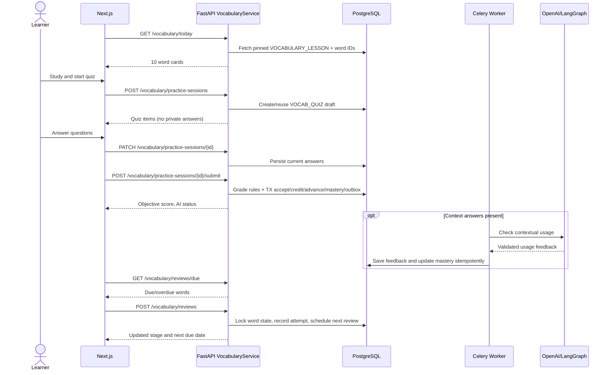
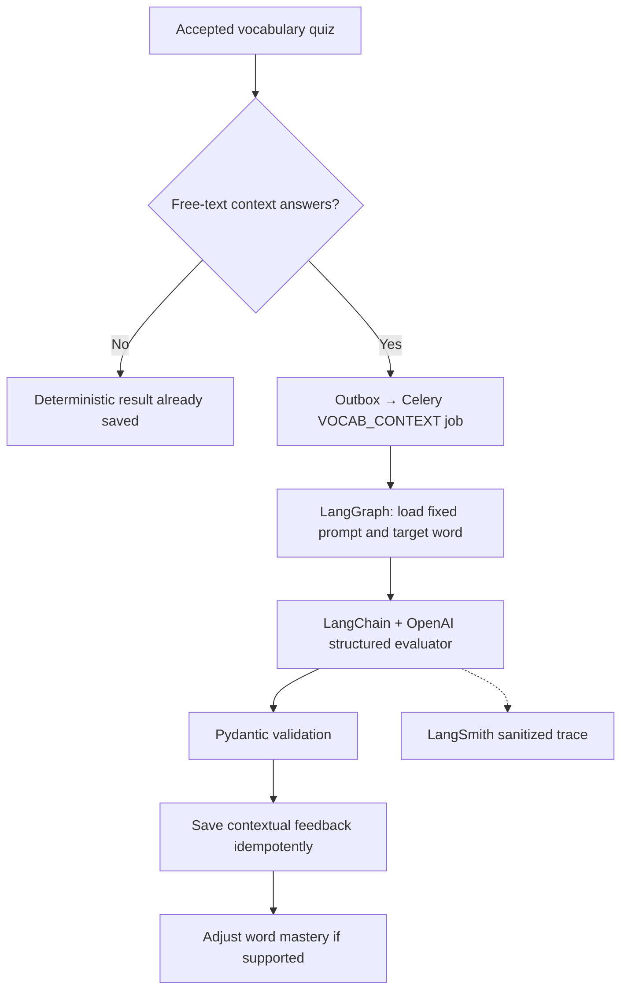
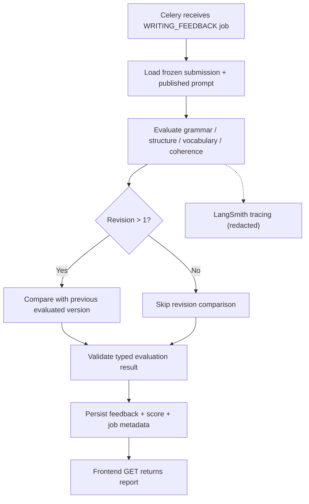

# TalkFiesta — Vocabulary & Writing API Specifications (V4)

**Status:** Proposed backend implementation contract — **not deployed**  
**Version:** 1.0 · 2026-11-05  
**Stack:** Next.js / Auth.js BFF · FastAPI · Pydantic v2 · SQLAlchemy / PostgreSQL · Redis / Celery · OpenAI · LangChain · LangGraph · LangSmith · private S3 for optional audio  
**Database baseline:** `TalkFiesta-Simplified-Database-Schema-v4.md` (**14-table proposal**)  
**Related specs:** `TalkFiesta-Dashboard-and-Learning-Plan-APIs-V4.md`, `TalkFiesta-Speaking-APIs-V4.md`

> **Architecture constraint:** Vocabulary and Writing are separate _FastAPI feature modules_ with distinct rules and typed schemas. Both reuse `content_items`, `practice_submissions`, `module_progress`, `activity_completions`, `ai_jobs`, and `outbox_events`. No extra domain tables are required for the APIs below. Some recommended API features require one **additional column** (`practice_submissions.edit_version`) for safe draft updates; this does not increase the table count.

---

## 1. Scope, responsibilities, and non-goals

### Vocabulary Service

- Deliver **10 approved, CEFR-appropriate words per curriculum day** with definitions, IPA when available, example sentences, synonyms/antonyms, and pronunciation audio when available.
- Provide **fill-in-the-blank**, **definition matching**, and **use-in-context** practice. Optional pronunciation practice uses a recorded-audio pathway, not transcript-only grading.
- Grade deterministic questions in Python; use OpenAI only for semantic sentence evaluation or optional audio-based evaluation.
- Maintain per-user word mastery and a **fixed-interval** review queue, including overdue reviews.
- Expose the personal vocabulary bank, mastery statistics, and (later) weak-word suggestions extracted from Speaking/Writing.

### Writing Service

- Deliver a published daily prompt: **descriptive, narrative, or argumentative/opinion**.
- Create and autosave a draft; support configurable **50–200 words** in Cycle 1, with increasing expectations in later cycles.
- Accept a finished submission, **credit the curriculum day immediately after valid acceptance**, and asynchronously evaluate using OpenAI.
- Return feedback on **grammar, structure, vocabulary, and coherence**; preserve original text and corrections separately.
- Support **up to three revisions after the original** (version numbers 1–4), each as a separate `practice_submissions` row with its own feedback.
- Expose writing history/portfolio and compare a revision with the previous version.

### Explicitly out of scope for these APIs

- Authentication, CEFR onboarding, generic dashboard, and published-content authoring endpoints already have their own specifications.
- Real-time AI voice conversation and interview panels use `practice_sessions` in Phase 2.
- Direct public `/ai/grade`, `/ai/evaluate-writing`, or `/ai/pronounce` endpoints are **not** needed. AI calls occur internally after an authenticated domain submission.
- No learner can directly call a `mark-day-completed` API.

---

## 2. Shared API conventions

All routes below use the prefix **`/api/v1`**.

| Convention         | Contract                                                                                                                 |
| ------------------ | ------------------------------------------------------------------------------------------------------------------------ |
| Authentication     | FastAPI validates the app access token. Browser credentials should be managed via Auth.js / a thin BFF.                  |
| Authorization      | Every user-owned resource is scoped to the authenticated learner; never accept `user_id` in request bodies.              |
| IDs                | UUID strings for users, content, submissions, media, and jobs. Examples below use UUID-shaped placeholders.              |
| Pagination         | `limit` (default 20, max 50) + opaque `cursor` for history/bank APIs.                                                    |
| Idempotency        | `Idempotency-Key` header for creates, submits, review writes, and retries; same key + different payload → `409`.         |
| Content versioning | Read from the learner's **pinned, published** `module_progress.content_release`; never silently swap releases.           |
| AI submission      | For async work return `202 Accepted`, then poll the relevant domain `GET` endpoint.                                      |
| JSONB              | Parse via **mode-specific Pydantic schemas**; never allow arbitrary schema-less client JSON.                             |
| Sensitive answers  | Do **not** include correct quiz answers, distractor grading rules, or private evaluator rubrics in pre-submit responses. |
| Timestamps         | ISO 8601 with timezone offsets; store instants in UTC; calculate learning dates using the user's IANA timezone.          |
| Completion         | The accepted required activity creates one `activity_completions` credit, regardless of feedback job status.             |

### Standard errors

```json
{
  "error": {
    "code": "PRACTICE_NOT_SUBMITTABLE",
    "message": "This practice attempt cannot be submitted in its current state.",
    "details": {},
    "request_id": "req_example_01"
  }
}
```

| HTTP code | When                                                                                                            |
| --------- | --------------------------------------------------------------------------------------------------------------- |
| `400`     | Malformed workflow request not covered by field validation.                                                     |
| `401`     | Missing/invalid authentication.                                                                                 |
| `403`     | Disabled user or admin-only operation.                                                                          |
| `404`     | Resource does not exist **or is not owned** by the caller.                                                      |
| `409`     | Incompatible state, stale edit version, conflicting idempotency key, stale curriculum activity, revision limit. |
| `413`     | Oversize audio upload, when applicable.                                                                         |
| `422`     | Invalid field, unacceptable answer, too-short draft or unsupported content.                                     |
| `429`     | Practice/AI consumption limits.                                                                                 |
| `503`     | Required dependencies temporarily unavailable; accepted jobs remain persisted if already acknowledged.          |

---

# Part A — Vocabulary Service

## 3. Vocabulary endpoint catalogue

| Method  | Endpoint                                    | Purpose                                                                                       | Normal success |
| ------- | ------------------------------------------- | --------------------------------------------------------------------------------------------- | -------------- |
| `GET`   | `/vocabulary/today`                         | Current **10-word** lesson and current learning-day position                                  | `200`          |
| `GET`   | `/vocabulary/words/{word_id}`               | Published word details and learner mastery, if accessible                                     | `200`          |
| `POST`  | `/vocabulary/practice-sessions`             | Start or resume one daily quiz draft                                                          | `201` / `200`  |
| `GET`   | `/vocabulary/practice-sessions/{id}`        | Resume quiz; return answer state without exposing keys                                        | `200`          |
| `PATCH` | `/vocabulary/practice-sessions/{id}`        | Autosave quiz responses (optional but recommended)                                            | `200`          |
| `POST`  | `/vocabulary/practice-sessions/{id}/submit` | Grade objective answers and accept daily practice; enqueue contextual AI evaluation if needed | `200` / `202`  |
| `GET`   | `/vocabulary/reviews/due`                   | Paginated due and overdue reviews                                                             | `200`          |
| `POST`  | `/vocabulary/reviews`                       | Submit one due-word review and update mastery                                                 | `200`          |
| `GET`   | `/vocabulary/bank`                          | Personal saved/learned words, search and filter                                               | `200`          |
| `GET`   | `/vocabulary/progress`                      | Mastery and retention stats                                                                   | `200`          |

**Phase 1.5/optional:**

| Method | Endpoint                                            | Purpose                                                      |
| ------ | --------------------------------------------------- | ------------------------------------------------------------ |
| `GET`  | `/vocabulary/suggestions`                           | Suggested weak words extracted from other learning modules   |
| `POST` | `/vocabulary/suggestions/{word_id}/decision`        | Add to bank or dismiss suggested word                        |
| `POST` | `/vocabulary/pronunciation/submissions`             | Start optional pronunciation practice (`mode=PRONUNCIATION`) |
| `POST` | `/vocabulary/pronunciation/submissions/{id}/submit` | Accept verified audio and queue separate audio evaluation    |
| `GET`  | `/vocabulary/pronunciation/submissions/{id}`        | Get feedback or unscorable reason                            |

## 4. Vocabulary flow



## 5. Vocabulary detailed contracts

### 5.1 `GET /api/v1/vocabulary/today`

Pure read, based on active `module_progress(module=VOCABULARY)`, `current_day`, `content_release`, `cefr_level`, and `goal_variant`.

**200 OK** (truncated to **two** words for readability; actual published lesson must contain **exactly ten**):

```json
{
  "module": "VOCABULARY",
  "plan_id": "11111111-1111-4111-8111-111111111111",
  "module_progress_id": "22222222-2222-4222-8222-222222222222",
  "cycle": 1,
  "day": 4,
  "module_status": "ACTIVE",
  "lesson": {
    "id": "33333333-3333-4333-8333-333333333333",
    "title": "Workplace Communication",
    "target_cefr": "A2",
    "target_word_count": 10,
    "words": [
      {
        "id": "44444444-4444-4444-8444-444444444444",
        "word": "reschedule",
        "part_of_speech": "verb",
        "definition": "Arrange an event for a different time.",
        "ipa": "/ˌriːˈskedʒuːl/",
        "examples": ["Could we reschedule our meeting?"],
        "synonyms": ["rearrange"],
        "antonyms": [],
        "pronunciation_audio_url": null,
        "mastery_status": "NEW"
      },
      {
        "id": "55555555-5555-4555-8555-555555555555",
        "word": "deadline",
        "part_of_speech": "noun",
        "definition": "The latest time by which something must be completed.",
        "ipa": "/ˈdedlaɪn/",
        "examples": ["The deadline is Friday."],
        "synonyms": ["due date"],
        "antonyms": [],
        "pronunciation_audio_url": null,
        "mastery_status": "NEW"
      }
    ]
  },
  "existing_practice_session_id": null,
  "due_review_count": 3
}
```

Rules:

- Published vocabulary lesson uses `content_items(kind=VOCABULARY_LESSON)` with `body.word_content_ids` referencing ten distinct `VOCAB_WORD` items. Validate integrity **on publication** and **on read**.
- When `module_progress.status=COMPLETED`, return `lesson=null`, `day=21`, `module_status=COMPLETED`, and a link to the bank/reviews.
- Do not invent ten new model-generated words on every request. Word and lesson content must be published before assignment.
- Cached public word definitions may be reused; user-specific mastery state must be scoped by the authenticated user.

### 5.2 `GET /api/v1/vocabulary/words/{word_id}`

Returns one published `VOCAB_WORD` from the assigned curriculum or personal bank and any `user_vocabulary` state. No private answer bank or content review notes. `404` if not authorized to access the word (e.g. unpublished and not a reviewer).

### 5.3 `POST /api/v1/vocabulary/practice-sessions`

**Header:** `Idempotency-Key: 6fdaab74-33f0-4edb-bc2a-c8d83c119a01`

**Request:**

```json
{
  "lesson_content_id": "33333333-3333-4333-8333-333333333333"
}
```

**201 Created** (question IDs are stable identifiers inside published `content_items.body.exercises`):

```json
{
  "id": "66666666-6666-4666-8666-666666666666",
  "status": "DRAFT",
  "mode": "VOCAB_QUIZ",
  "edit_version": 0,
  "questions": [
    {
      "item_id": "fill_01",
      "type": "FILL_BLANK",
      "prompt": "We need to ____ the meeting for tomorrow.",
      "choices": ["reschedule", "ignore", "deliver"]
    },
    {
      "item_id": "match_01",
      "type": "MATCH_DEFINITION",
      "prompt": "Match 'deadline' to its meaning.",
      "choices": [
        { "id": "a", "text": "The final date for completing a task" },
        { "id": "b", "text": "A meeting with a client" }
      ]
    },
    {
      "item_id": "context_01",
      "type": "USE_IN_CONTEXT",
      "word_id": "44444444-4444-4444-8444-444444444444",
      "prompt": "Write a sentence using 'reschedule'."
    }
  ],
  "saved_answers": {}
}
```

Rules:

- Require active enrollment, correct day, pinned published lesson, no already credited completion.
- Repeated create returns an existing `DRAFT` submission (`200`) instead of opening duplicates.
- Save `practice_submissions` with `mode=VOCAB_QUIZ`, `content_item_id=lesson_content_id`, `module_progress_id` from the active plan, and typed `input` JSONB.
- Do not expose `body.answer_key` or correctness before final submission.

### 5.4 `GET /api/v1/vocabulary/practice-sessions/{id}`

Return exactly the assigned quiz items, saved answers, edit version, and lifecycle status. Owner-scoped. If accepted, include objective results and any pending/finished contextual AI review, but not unattempted private answers.

### 5.5 `PATCH /api/v1/vocabulary/practice-sessions/{id}`

**Request:**

```json
{
  "expected_edit_version": 0,
  "answers": [
    { "item_id": "fill_01", "choice_id": "reschedule" },
    { "item_id": "match_01", "choice_id": "a" },
    { "item_id": "context_01", "text": "Can we reschedule our call?" }
  ]
}
```

**200 OK:**

```json
{
  "id": "66666666-6666-4666-8666-666666666666",
  "status": "DRAFT",
  "edit_version": 1,
  "saved_answer_count": 3
}
```

Rules: allow only drafts, whitelist assigned `item_id` values, enforce maximum response sizes; stale `expected_edit_version` returns `409 STALE_EDIT_VERSION`. Implement by conditionally updating the row or locking it inside a transaction. This requires the proposed `practice_submissions.edit_version INTEGER NOT NULL DEFAULT 0` column.

### 5.6 `POST /api/v1/vocabulary/practice-sessions/{id}/submit`

**Header:** `Idempotency-Key: 36fbe20d-61f3-401c-8d82-a1e77636db49`  
**Request:** `{}` (answers already autosaved; if PATCH is omitted, a typed full-answer payload may be accepted here instead).

**202 Accepted** when contextual AI evaluation is needed:

```json
{
  "id": "66666666-6666-4666-8666-666666666666",
  "activity_status": "COMPLETED",
  "evaluation_status": "PENDING",
  "objective_result": { "correct": 2, "total": 2 },
  "context_result": null,
  "job_id": "77777777-7777-4777-8777-777777777777",
  "next_module_day": 5
}
```

If no AI evaluation is needed, return **`200 OK`** with `evaluation_status=NOT_REQUIRED` (or `COMPLETED` when all grading is synchronous).

**Atomic transaction — required:**

1. Lock the `practice_submissions` draft and current `module_progress` row.
2. Verify assigned lesson, correct module/day, required answers, and no previous accepted credit.
3. Grade deterministic questions against server-only correct answers; record objective score in `feedback` and `score`.
4. Transition submission to `ACCEPTED`; upsert current `user_vocabulary` states for newly studied words (without making them mastered just for seeing them).
5. Insert one `activity_completions` credit; advance only Vocabulary module day, capped at 21.
6. If free-form contextual evaluation exists, insert `ai_jobs(job_type=VOCAB_CONTEXT)` and `outbox_events`.
7. Commit once; repeat submit returns original outcome without duplicate credit or job.

**Design decision:** Acceptance is based on completing the required activities, not a perfect quiz score. The AI feedback may be pending, but the lesson is already complete. Mastery updates that depend on contextual AI judgment occur later in an idempotent worker transaction.

### 5.7 `GET /api/v1/vocabulary/reviews/due`

**Query:** `?limit=20&cursor=...` (cursor optional).

**200 OK:**

```json
{
  "as_of": "2026-11-05T00:00:00+03:00",
  "items": [
    {
      "user_vocabulary_id": "88888888-8888-4888-8888-888888888888",
      "word": "reschedule",
      "mastery_level": 2,
      "status": "REVIEWING",
      "next_review_at": "2026-11-03T21:00:00Z",
      "is_overdue": true,
      "exercise": { "type": "RECALL", "prompt": "What does 'reschedule' mean?" }
    }
  ],
  "next_cursor": null
}
```

Query `user_vocabulary` for this owner where `next_review_at <= now`, excluding dismissed or already completed states that no longer need review. Index `(user_id, next_review_at)`. Return no hidden correct answer in the prompt.

### 5.8 `POST /api/v1/vocabulary/reviews`

**Header:** `Idempotency-Key: 3f5cc9df-4e63-495b-bd4a-0796a0bcf68e`

**Request:**

```json
{
  "user_vocabulary_id": "88888888-8888-4888-8888-888888888888",
  "answer": { "type": "RECALL", "selected_choice_id": "correct_choice" }
}
```

**200 OK:**

```json
{
  "user_vocabulary_id": "88888888-8888-4888-8888-888888888888",
  "correct": true,
  "previous_mastery_level": 2,
  "mastery_level": 3,
  "status": "REVIEWING",
  "next_review_at": "2026-11-09T21:00:00Z",
  "times_reviewed": 2
}
```

**Transaction contract:**

- Verify `user_vocabulary` belongs to caller and is due/eligible; lock it (`SELECT ... FOR UPDATE`).
- Determine correctness using server-held content; save an immutable `practice_submissions(mode=VOCAB_REVIEW)` row linked to the word content item.
- Update mastery, last-review time, interval, and next due date **once**; duplicate idempotency keys return the same result.
- A review is a **separate practice event**. It does **not** advance the daily vocabulary lesson or create a duplicate daily `activity_completions` credit. Review practice can be included in overall minutes/analytics using submission history without double-counting completion credits.
- If incorrect, use a shorter repeat interval and keep the word in `LEARNING`/`REVIEWING`, rather than declaring it mastered.

### 5.9 `GET /api/v1/vocabulary/bank`

**Query:** `?status=MASTERED&search=resched&limit=20&cursor=...`

**200 OK:**

```json
{
  "items": [
    {
      "word_key": "reschedule",
      "word_content_id": "44444444-4444-4444-8444-444444444444",
      "status": "MASTERED",
      "mastery_level": 5,
      "times_practiced": 6,
      "next_review_at": null
    }
  ],
  "next_cursor": null
}
```

The bank includes approved curriculum words and later accepted personalized suggestions, all scoped to the authenticated learner.

### 5.10 `GET /api/v1/vocabulary/progress`

**200 OK:**

```json
{
  "learned_distinct": 120,
  "mastered": 45,
  "learning": 50,
  "reviewing": 25,
  "due_reviews": 14,
  "overdue_reviews": 6,
  "current_module_day": 8,
  "completed_curriculum_days": 7
}
```

Calculate learner-specific stats from `user_vocabulary`, `activity_completions`, and `module_progress`; don't increment isolated counters that can drift out of sync.

## 6. Vocabulary spaced-repetition policy

The original TalkFiesta specification describes review at **Day 2, 4, 8, and 15** after introducing words on Day 1. Use a fixed-interval policy rather than SM-2 for the MVP:

| Stage        | Target if first learned on Day 1 | Gap after previous successful review |
| ------------ | -------------------------------- | ------------------------------------ |
| Introduction | Day 1                            | —                                    |
| Review 1     | Day 2                            | +1 day                               |
| Review 2     | Day 4                            | +2 days                              |
| Review 3     | Day 8                            | +4 days                              |
| Review 4     | Day 15                           | +7 days                              |

**Interpretation:** These are **learner-local calendar review dates**, not progress through the 21-day module. If the learner misses a date, the word stays overdue. After a successful late review, schedule the next interval from the actual successful review date to avoid multiple immediate backlogged stages. After a failed review, schedule an earlier retry (e.g. next day). Set `MASTERED` once the configured success requirements have been met; the four reviews are the initial policy, not a promise of permanent retention.

`user_vocabulary.review_interval_days`, `next_review_at`, `mastery_level`, and timestamps hold the latest state; `practice_submissions(mode=VOCAB_REVIEW)` preserve review history. New custom vocabulary can use the same review policy after introduction.

## 7. Vocabulary AI workflow (only when needed)



**Evaluation fields (suggested):** `word_id`, `sentence`, `meaning_used_correctly` (`true`/`false`/`null`), `grammar_acceptable`, `explanation`, `suggested_revision`, `evidence_quality`. Do not let the LLM alter a learner's scheduled review or CEFR placement without a deterministic policy and validated output. Evaluate one _batch_ of contextual answers in a single call where practical; enforce limits to control cost.

**Pronunciation:** A future audio-based evaluator must inspect audio features, not just an OpenAI transcript. The optional `PRONUNCIATION` mode reuses private S3 media, `practice_submissions`, and `ai_jobs`; score fields remain null until a validated audio-based method exists.

---

# Part B — Writing Service

## 8. Writing endpoint catalogue

| Method  | Endpoint                              | Purpose                                              | Normal success |
| ------- | ------------------------------------- | ---------------------------------------------------- | -------------- |
| `GET`   | `/writing/today`                      | Current assigned writing prompt and completion state | `200`          |
| `POST`  | `/writing/submissions`                | Start or resume original draft for current prompt    | `201` / `200`  |
| `PATCH` | `/writing/submissions/{id}`           | Autosave an unfinished draft                         | `200`          |
| `POST`  | `/writing/submissions/{id}/submit`    | Accept text, credit day once, enqueue AI evaluation  | `202`          |
| `GET`   | `/writing/submissions/{id}`           | View submitted text, status, feedback, or draft      | `200`          |
| `POST`  | `/writing/submissions/{id}/revisions` | Create a new revision draft after feedback           | `201` / `200`  |
| `GET`   | `/writing/submissions/{id}/revisions` | Retrieve versions and compare improvements           | `200`          |
| `GET`   | `/writing/portfolio`                  | Cursor-paginated writing history                     | `200`          |

## 9. Writing request and AI processing flow

```mermaid
sequenceDiagram
    actor Learner
    participant UI as Next.js
    participant API as FastAPI WritingService
    participant DB as PostgreSQL
    participant D as Outbox Dispatcher
    participant W as Celery
    participant G as LangGraph
    participant O as OpenAI
    participant L as LangSmith

    UI->>API: GET /writing/today
    API-->>UI: Assigned published prompt
    UI->>API: POST /writing/submissions
    API->>DB: Create or reuse DRAFT (version 1)
    API-->>UI: draft_id
    Learner->>UI: Write and edit
    UI->>API: PATCH /writing/submissions/{id}
    API->>DB: Optimistic draft autosave
    Learner->>UI: Submit
    UI->>API: POST /writing/submissions/{id}/submit
    API->>DB: TX accept + credit + advance day + AI job + outbox
    API-->>UI: 202 Accepted; evaluation PENDING
    D->>W: Dispatch committed job
    W->>G: Execute writing evaluation graph
    G->>O: Structured rubric evaluation
    O-->>G: Scores and corrections
    opt Revision 2-4
        G->>O: Compare with previous submitted version
    end
    G-->>W: Validated feedback
    G-.->L: Privacy-safe trace metadata
    W->>DB: Persist feedback and mark job SUCCEEDED
    UI->>API: GET /writing/submissions/{id}
    API-->>UI: Completed report or processing state
    Learner->>UI: Request revision
    UI->>API: POST /writing/submissions/{id}/revisions
    API-->>UI: New DRAFT version
```

## 10. Writing detailed contracts

### 10.1 `GET /api/v1/writing/today`

**200 OK:**

```json
{
  "module": "WRITING",
  "cycle": 1,
  "day": 3,
  "module_progress_id": "22222222-2222-4222-8222-222222222222",
  "module_status": "ACTIVE",
  "prompt": {
    "id": "99999999-9999-4999-8999-999999999999",
    "kind": "WRITING_LESSON",
    "title": "A memorable journey",
    "writing_type": "NARRATIVE",
    "instructions": "Describe a trip you remember and explain why it mattered.",
    "target_word_count": 100,
    "minimum_word_count": 50,
    "maximum_word_count": 200,
    "time_limit_minutes": null,
    "tips": ["Organize the story in time order", "Use past-tense verbs"]
  },
  "existing_draft_id": null
}
```

Rules:

- Read from `content_items(kind=WRITING_LESSON)` pinned to the current Writing module release; filter only `PUBLISHED` `CORE` content.
- Do not create a draft, increment progress, or call OpenAI on this GET.
- If Writing is complete, return `prompt=null`, `module_status=COMPLETED`, `day=21`.

### 10.2 `POST /api/v1/writing/submissions`

**Header:** `Idempotency-Key: 8541c71c-94ae-45cb-9fc8-bf6c631d602f`

**Request:**

```json
{
  "content_item_id": "99999999-9999-4999-8999-999999999999"
}
```

**201 Created:**

```json
{
  "id": "aaaaaaaa-aaaa-4aaa-8aaa-aaaaaaaaaaaa",
  "revision_group_id": "bbbbbbbb-bbbb-4bbb-8bbb-bbbbbbbbbbbb",
  "revision_number": 1,
  "status": "DRAFT",
  "edit_version": 0,
  "text": "",
  "word_count": 0
}
```

Rules: must be current assigned prompt for active Writing enrollment; reuse existing draft when repeated. Create an initial row with `mode=WRITING`, `input={"text":""}`, and a generated `revision_group_id`. One active draft per user + assigned activity. Drafts do not count as activity completions.

### 10.3 `PATCH /api/v1/writing/submissions/{id}`

**Request:**

```json
{
  "expected_edit_version": 0,
  "text": "Last summer, I visited a coastal town with my family. We explored the market..."
}
```

**200 OK:**

```json
{
  "id": "aaaaaaaa-aaaa-4aaa-8aaa-aaaaaaaaaaaa",
  "status": "DRAFT",
  "edit_version": 1,
  "word_count": 14,
  "saved_at": "2026-11-05T18:00:00Z"
}
```

Rules:

- Only the owner can edit a `DRAFT`. A submitted/accepted version is **immutable**.
- `edit_version` increments atomically and prevents two devices or stale browser requests from silently overwriting new text. A mismatch returns `409 STALE_EDIT_VERSION`.
- Limit payload size and reject unsupported HTML. Store plain text for evaluation, preserving line breaks. Validate word limits on **submit**, not while the learner is drafting.
- This endpoint requires the single proposed `practice_submissions.edit_version` column in V4.

### 10.4 `POST /api/v1/writing/submissions/{id}/submit`

**Header:** `Idempotency-Key: 36b39c29-f551-4b1a-abd6-b137b7b35e1b`  
**Request:** `{}` (the latest saved draft is submitted).

**202 Accepted:**

```json
{
  "id": "aaaaaaaa-aaaa-4aaa-8aaa-aaaaaaaaaaaa",
  "revision_group_id": "bbbbbbbb-bbbb-4bbb-8bbb-bbbbbbbbbbbb",
  "revision_number": 1,
  "activity_status": "COMPLETED",
  "evaluation_status": "PENDING",
  "job_id": "cccccccc-cccc-4ccc-8ccc-cccccccccccc",
  "feedback_url": "/api/v1/writing/submissions/aaaaaaaa-aaaa-4aaa-8aaa-aaaaaaaaaaaa",
  "next_module_day": 4
}
```

**Atomic transaction — original version:**

1. Lock draft and Writing enrollment; check ownership, current assigned prompt, content release and word limits.
2. Freeze text in `practice_submissions.input.text`, set `status=ACCEPTED`, `evaluation_status=PENDING`.
3. Insert `activity_completions` **once** for the original required writing activity; advance only Writing module day (cap at Day 21).
4. Insert `ai_jobs(job_type=WRITING_FEEDBACK)` and `outbox_events` inside the same transaction.
5. Commit. An idempotent repeat returns the original job, does not credit progress again, and does not call OpenAI twice intentionally.

**For revisions:** accept and queue evaluation but **do not create an additional day credit** or advance the module again. The original submission already credited this curriculum activity.

**Why completion is immediate:** A valid written submission counts as practiced even if OpenAI is delayed; AI scoring is not the same as whether the learner completed the writing activity.

### 10.5 `GET /api/v1/writing/submissions/{id}`

**200 OK**, after evaluation:

```json
{
  "id": "aaaaaaaa-aaaa-4aaa-8aaa-aaaaaaaaaaaa",
  "revision_number": 1,
  "status": "ACCEPTED",
  "evaluation_status": "COMPLETED",
  "content_item_id": "99999999-9999-4999-8999-999999999999",
  "submitted_text": "Last summer I visit a coastal town with my family. We stayed near the beach for four days. On the first morning, I walked through the busy market and bought fresh fruit. Later, we took a boat to a small island. I enjoyed the views, but I was nervous because it was my first time on a boat. At night, we shared stories about the trip.",
  "word_count": 66,
  "feedback": {
    "rubric_version": "writing-rubric-v1",
    "scores": {
      "grammar": 62,
      "structure": 75,
      "vocabulary": 70,
      "coherence": 74,
      "overall": 70
    },
    "corrections": [
      {
        "original": "Last summer I visit a coastal town",
        "suggestion": "Last summer I visited a coastal town",
        "reason": "Past events normally use the past tense."
      }
    ],
    "strengths": ["Clear main idea"],
    "improvements": ["Practice past-tense verbs"],
    "revised_example": "Last summer I visited a coastal town. I really enjoyed the trip."
  },
  "job": { "status": "SUCCEEDED", "stage": "DONE" }
}
```

The accepted example contains **66 words**, meeting the sample prompt's minimum. Scores are illustrative, not measured outcomes. The original submitted text must never be overwritten with the AI's revised example.

While processing, return `200` with `evaluation_status=PENDING`/`PROCESSING`, `feedback=null` and a retry hint. For terminal AI failure return the accepted submission with `evaluation_status=FAILED` and an actionable retry/support policy; the learner's completion credit remains intact.

### 10.6 `POST /api/v1/writing/submissions/{id}/revisions`

**Header:** `Idempotency-Key: f15975b3-e1bd-4245-b84b-f72846a88488`  
**Request:**

```json
{
  "base_submission_id": "aaaaaaaa-aaaa-4aaa-8aaa-aaaaaaaaaaaa"
}
```

**201 Created:**

```json
{
  "id": "dddddddd-dddd-4ddd-8ddd-dddddddddddd",
  "revision_group_id": "bbbbbbbb-bbbb-4bbb-8bbb-bbbbbbbbbbbb",
  "revision_number": 2,
  "status": "DRAFT",
  "edit_version": 0,
  "text": "Last summer I visit a coastal town. The trip was very enjoy."
}
```

Rules:

- Only after the base version has completed evaluation, to ensure feedback exists to revise against.
- Same `revision_group_id`; create at most **revision_number=4** (three revisions after original).
- Use transaction row lock / unique `(revision_group_id,revision_number)`; if an unsubmitted revision draft already exists, return it rather than creating another.
- Permit learners to revise a previously completed daily prompt even if the current Writing day has progressed. The revision is **additional work**, not a new curriculum credit.
- The new draft starts with previous submitted text, but the previous row remains immutable.

### 10.7 `GET /api/v1/writing/submissions/{id}/revisions`

**200 OK:**

```json
{
  "revision_group_id": "bbbbbbbb-bbbb-4bbb-8bbb-bbbbbbbbbbbb",
  "max_revisions": 3,
  "versions": [
    {
      "id": "aaaaaaaa-aaaa-4aaa-8aaa-aaaaaaaaaaaa",
      "version": 1,
      "status": "ACCEPTED",
      "evaluation_status": "COMPLETED",
      "overall_score": 70
    },
    {
      "id": "dddddddd-dddd-4ddd-8ddd-dddddddddddd",
      "version": 2,
      "status": "ACCEPTED",
      "evaluation_status": "COMPLETED",
      "overall_score": 78
    }
  ],
  "latest_comparison": {
    "fixed_issues": ["Past tense corrected"],
    "remaining_issues": ["Article usage"],
    "new_issues": []
  }
}
```

Store per-version feedback in each row's `feedback` JSONB; revision comparison can also live in the newer version's `feedback.revision_comparison`. No separate `writing_submission_versions` table is needed in V4.

### 10.8 `GET /api/v1/writing/portfolio`

**Query:** `?limit=20&cursor=...&sort=recent`.

**200 OK:**

```json
{
  "items": [
    {
      "revision_group_id": "bbbbbbbb-bbbb-4bbb-8bbb-bbbbbbbbbbbb",
      "title": "A memorable journey",
      "content_item_id": "99999999-9999-4999-8999-999999999999",
      "original_submitted_at": "2026-11-05T18:00:00Z",
      "latest_version": 2,
      "latest_evaluation_status": "COMPLETED",
      "latest_score": 78
    }
  ],
  "next_cursor": null
}
```

Only show one card per `revision_group_id` and hydrate version history when a card is opened. Index `(user_id, mode, revision_group_id, submitted_at)` for writing portfolio efficiency.

## 11. Writing LangGraph evaluation contract



**MVP recommendation:** one OpenAI structured response for the four feedback dimensions, rather than four specialist LLM calls. Keep the LangGraph nodes for orchestration, validation and optional revision comparison. Split into parallel expert agents only after offline evaluation demonstrates material quality gains.

### Suggested Pydantic output contract

```python
from pydantic import BaseModel, Field

class WritingCorrection(BaseModel):
    original: str
    suggestion: str
    reason: str

class WritingScores(BaseModel):
    grammar: int = Field(ge=0, le=100)
    structure: int = Field(ge=0, le=100)
    vocabulary: int = Field(ge=0, le=100)
    coherence: int = Field(ge=0, le=100)

class WritingFeedback(BaseModel):
    scores: WritingScores
    corrections: list[WritingCorrection]
    strengths: list[str]
    improvements: list[str]
    revised_example: str
```

The backend computes an overall score from the configured rubric. The original design uses weights **grammar 30%, structure 30%, vocabulary 20%, coherence 20%**; make these versioned configuration, not LLM-supplied weights. A model-generated score is a learning feedback signal, **not a formally calibrated CEFR measurement**.

Evaluation policy:

- Supply the published prompt, CEFR target, submitted text, and explicit rubric to the model.
- Do not change the user's original text; return corrections and a suggested rewrite as separate fields.
- Verify structured JSON with Pydantic. Persist evaluator version, model, and request/trace metadata in `ai_jobs`; store learner feedback in `practice_submissions.feedback`.
- Reject unsupported fabricated errors. The evaluator must ground corrections in actual submitted phrases and state uncertainty where needed.
- Treat learner text as **untrusted input**, never as system instructions. Prevent prompt injection from controlling tools or grader behavior.
- Use max attempts, backoff and an unambiguous terminal `FAILED` status. Failed AI feedback never reverses a valid Writing completion.
- Redact/hide submitted learner text in LangSmith by default; keep privacy and retention limits explicit.

---

# Part C — Shared persistence and backend contracts

## 12. V4 14-model coverage — no new tables

| Existing V4 model                                                  | Vocabulary usage                                              | Writing usage                                                |
| ------------------------------------------------------------------ | ------------------------------------------------------------- | ------------------------------------------------------------ |
| `users`                                                            | Language preferences, timezone, ownership                     | Preferences, timezone, ownership                             |
| `content_items`                                                    | `VOCABULARY_LESSON` + `VOCAB_WORD`, server-side exercise bank | `WRITING_LESSON` prompt, rubric metadata                     |
| `learning_plans`                                                   | Resolve current plan                                          | Resolve current plan                                         |
| `module_progress`                                                  | Pinned vocabulary release + current day                       | Pinned writing release + current day                         |
| `practice_submissions`                                             | `VOCAB_QUIZ`, `VOCAB_REVIEW`, optional `PRONUNCIATION`        | `WRITING` original and revisions                             |
| `user_vocabulary`                                                  | Mastery stages, due dates, weak-word suggestions              | May receive weak words extracted from writing feedback later |
| `activity_completions`                                             | One completion per required vocab day                         | One completion per original writing day                      |
| `media_uploads`                                                    | Optional pronunciation audio                                  | Not needed for text-only writing                             |
| `ai_jobs`                                                          | Optional `VOCAB_CONTEXT`, pronunciation job                   | `WRITING_FEEDBACK` and revision comparison workflow          |
| `outbox_events`                                                    | Reliable AI context work dispatch                             | Reliable writing evaluation dispatch                         |
| `user_achievements`                                                | Award vocabulary milestones                                   | Award writing milestones                                     |
| `assessment_attempts`, `assessment_responses`, `practice_sessions` | Not in ordinary daily vocabulary flow                         | Not in ordinary daily writing flow                           |

**Small V4 amendment proposed:** add `practice_submissions.edit_version INTEGER NOT NULL DEFAULT 0` and use it to prevent stale autosave writes. This is a **column change to an existing V4 model**, not a 15th table. Keep `revision_number` specifically for writing version ordinal; do not reuse it as a concurrency token.

### Shared `practice_submissions.input` JSONB shapes

```json
{
  "mode": "VOCAB_QUIZ",
  "input": {
    "answers": [
      { "item_id": "fill_01", "choice_id": "reschedule" },
      { "item_id": "context_01", "text": "Can we reschedule our call?" }
    ]
  }
}
```

```json
{
  "mode": "WRITING",
  "input": { "text": "Last summer, I visited..." },
  "revision_group_id": "bbbbbbbb-bbbb-4bbb-8bbb-bbbbbbbbbbbb",
  "revision_number": 1
}
```

The separate `mode` discriminator selects a strict schema; invalid combinations are rejected in the API/service layer.

## 13. Suggested backend folder structure

```text
app/
├── modules/
│   ├── vocabulary/
│   │   ├── router.py                # vocabulary endpoints
│   │   ├── schemas.py               # Pydantic contracts
│   │   ├── service.py               # daily vocab + bank workflow
│   │   ├── practice_service.py      # draft, grading, acceptance
│   │   ├── review_policy.py         # fixed-interval spaced repetition
│   │   ├── repository.py            # user_vocabulary + content access
│   │   └── ai/
│   │       ├── context_graph.py
│   │       ├── state.py
│   │       └── prompts/
│   │
│   ├── writing/
│   │   ├── router.py
│   │   ├── schemas.py
│   │   ├── service.py               # draft, autosave, submit, revisions
│   │   ├── repository.py
│   │   └── ai/
│   │       ├── feedback_graph.py
│   │       ├── revision_graph.py
│   │       ├── state.py
│   │       └── prompts/
│   │
│   ├── practice/
│   │   ├── models.py                # Shared PracticeSubmission
│   │   └── repository.py
│   ├── learning_plans/
│   │   └── completion_service.py    # Shared exactly-once lesson credit
│   ├── curriculum/
│   │   └── content_repository.py    # Pinned published item projection
│   └── jobs/
│       └── service.py               # ai_jobs + outbox_events transaction
│
├── infrastructure/
│   ├── database/
│   ├── ai/openai_client.py
│   └── messaging/
└── workers/
    ├── celery_app.py
    ├── vocabulary_tasks.py
    ├── writing_tasks.py
    └── outbox_dispatcher.py
```

**Dependency rule:** `router → service → repository` for business data; `service → AI job/outbox` for async work; `worker → LangGraph → LangChain/OpenAI` for evaluation. Routers do not call OpenAI directly; repositories do not commit their own transactions.

## 14. Core service interfaces (illustrative Python pseudocode)

```python
class VocabularyService:
    async def get_today(self, user_id): ...
    async def get_word(self, user_id, word_id): ...
    async def open_practice(self, user_id, lesson_id, idempotency_key): ...
    async def save_answers(self, user_id, submission_id, payload): ...
    async def submit_practice(self, user_id, submission_id, idempotency_key): ...
    async def get_due_reviews(self, user_id, cursor, limit): ...
    async def submit_review(self, user_id, payload, idempotency_key): ...
    async def get_bank(self, user_id, filters, cursor, limit): ...
    async def get_progress(self, user_id): ...

class WritingService:
    async def get_today(self, user_id): ...
    async def open_draft(self, user_id, content_item_id, idempotency_key): ...
    async def autosave(self, user_id, submission_id, text, expected_edit_version): ...
    async def submit(self, user_id, submission_id, idempotency_key): ...
    async def get_submission(self, user_id, submission_id): ...
    async def create_revision(self, user_id, base_submission_id, idempotency_key): ...
    async def get_revisions(self, user_id, submission_id): ...
    async def get_portfolio(self, user_id, cursor, limit): ...
```

### Shared application service boundaries

- `CurriculumResolver`: finds an assigned published lesson by pinned release, module and current day.
- `ActivityCompletionService`: enforces one credit per `(module_progress_id, content_item_id)`, handles day advancement and local completion date.
- `AIJobService`: records a job and outbox event in the same transaction as acceptance; handles processing metadata and idempotency.
- `ContextEvaluationGraph` and `WritingFeedbackGraph`: independent AI pipelines, shared OpenAI/LangSmith configuration.

## 15. Data constraints and indexes

| Table                  | Recommended constraint / index                                    | Reason                                                            |
| ---------------------- | ----------------------------------------------------------------- | ----------------------------------------------------------------- |
| `content_items`        | Published `CORE` uniqueness by release/module/cycle/day/CEFR/goal | Prevent conflicting daily lessons                                 |
| `content_items`        | Validate 10 distinct word IDs per published `VOCABULARY_LESSON`   | Guaranteed daily word count                                       |
| `practice_submissions` | Unique `(revision_group_id, revision_number)` where non-null      | No duplicate writing revision number                              |
| `practice_submissions` | Partial uniqueness for a current `DRAFT` per user/lesson/mode     | Prevent competing drafts (additional logic for writing revisions) |
| `practice_submissions` | `CHECK (revision_number BETWEEN 1 AND 4)`                         | Max 3 writing revisions                                           |
| `user_vocabulary`      | Unique `(user_id, word_key)`                                      | One mastery record per user+word                                  |
| `user_vocabulary`      | Index `(user_id, next_review_at)` for reviewable statuses         | Efficient due-review reads                                        |
| `activity_completions` | Unique `(module_progress_id, content_item_id)`                    | One daily completion credit                                       |
| `ai_jobs`              | Unique `idempotency_key` (or scoped composite key)                | No duplicate persisted evaluation job                             |
| `outbox_events`        | Index unpublished events + retry state                            | Recover missed dispatches                                         |

For polymorphic content item IDs and `body.word_content_ids` embedded in JSONB, use strict application validation; PostgreSQL does not automatically foreign-key each JSON array member. Favor explicit indexes on operationally important scalar columns instead of broad JSONB indexes prematurely.

## 16. Failure handling / correctness cases

| Case                                                             | Response / behavior                                                                 |
| ---------------------------------------------------------------- | ----------------------------------------------------------------------------------- |
| Learner has no active Vocabulary/Writing enrollment              | `404` or `409 PLAN_NOT_READY` based on onboarding state.                            |
| Published content missing in pinned release                      | `409 CURRICULUM_CONTENT_UNAVAILABLE`; alert content admins.                         |
| User requests an earlier day as today's activity                 | `409 WRONG_ASSIGNED_ACTIVITY`; allow historical read separately.                    |
| Quiz answers reference unassigned item IDs                       | `422 INVALID_QUIZ_ITEM`.                                                            |
| Quiz submit repeated                                             | Return original grading/processing response; no duplicate mastery update or credit. |
| Two review submissions race                                      | Lock `user_vocabulary`; only one schedules the next review.                         |
| Overdue reviews                                                  | Remain visible until successfully attempted; no automatic deletion.                 |
| Writing autosave arrives out of order                            | `409 STALE_EDIT_VERSION`; do not overwrite latest text.                             |
| Writing submission text outside configured limits                | `422 WRITING_WORD_COUNT_OUT_OF_RANGE`.                                              |
| User requests fifth writing version                              | `409 REVISION_LIMIT_REACHED`.                                                       |
| Writing AI provider fails                                        | Keep accepted submission and day credit; retry evaluation with bounded backoff.     |
| OpenAI returns invalid output                                    | Pydantic rejects; retry and eventually mark job failed, do not invent score.        |
| Worker is redelivered                                            | Idempotent finalization checks job + submission state; no duplicate result/credit.  |
| Revision feedback finishes after later revision created          | Persist on its own version row; do not overwrite another version's feedback.        |
| User submits instructions inside essay to change grader behavior | Treat essay as untrusted learner text, not as privileged system prompt.             |
| LangSmith trace contains sensitive writing                       | Apply redaction/hiding and strict access controls.                                  |

## 17. Integration and acceptance tests

### Vocabulary tests

1. `GET /vocabulary/today` returns **exactly ten unique published words** from the pinned curriculum release.
2. A learner cannot access another user's draft, reviews, or mastery records.
3. Create practice session is idempotent; two concurrent requests do not create two active drafts.
4. API question payloads never expose correct answers or private distractor rationale.
5. Draft autosave enforces `edit_version` optimistic concurrency.
6. Deterministic fill-blank/matching answers are scored correctly with known fixtures.
7. A required quiz is accepted once; activity completion and day advancement happen once.
8. Optional context AI job is queued reliably by outbox without holding the API request open.
9. Review schedule matches fixed Day 2/4/8/15 milestones when reviews are completed on time.
10. Overdue words remain due; incorrect reviews shorten the next interval.
11. Concurrent review requests cannot double-advance a word's mastery stage.
12. Vocabulary bank and progress totals agree with saved `user_vocabulary` and accepted submissions.

### Writing tests

1. Writing prompt comes from the current pinned published release and module day.
2. Draft create/resume is idempotent and does not call OpenAI.
3. Autosave supports multiple partial edits and rejects stale edit versions.
4. Submit enforces the prompt's configured min/max word count.
5. Accepting the original writing submission writes exactly one completion credit and advances only Writing.
6. A failed AI job does not invalidate an accepted writing day.
7. Structured output validation rejects malformed or unsupported scoring payloads.
8. Stored original learner text never changes when AI returns corrections.
9. Versions 1–4 work; requesting version 5 returns `REVISION_LIMIT_REACHED`.
10. Submitting a revision does not award another daily completion.
11. Revision comparison references the right previous accepted version.
12. Portfolio lists one entry per revision group and only the signed-in user's submissions.

### Cross-cutting tests

- Under concurrent requests, no duplicate job or outbox event is created for a single accepted submission.
- User-specific performance and time statistics are reproducible from persisted records.
- Client never receives OpenAI secrets, private answer keys, or S3 administrative credentials.
- Workers retry transient provider errors with backoff and preserve immutable submitted evidence.

---

## 18. Implementation sequence

| Stage | Deliverable                                                                      | Dependency                               |
| ----- | -------------------------------------------------------------------------------- | ---------------------------------------- |
| 1     | Typed content projections for vocabulary lessons, word cards and writing prompts | Published V4 content items               |
| 2     | Read APIs: `/vocabulary/today`, `/writing/today`                                 | Active learning plan + module progress   |
| 3     | Shared `practice_submissions.edit_version` migration                             | V4 SQLAlchemy models                     |
| 4     | Vocabulary quiz draft, grading and exactly-once completion                       | Activity completion service              |
| 5     | `user_vocabulary` review scheduler, review writes and bank                       | Stage 4                                  |
| 6     | Writing draft, autosave, submit and completion                                   | Stages 2–3                               |
| 7     | `VOCAB_CONTEXT` + `WRITING_FEEDBACK` Celery/LangGraph pipelines                  | Shared AI jobs, outbox and OpenAI client |
| 8     | Writing revisions, comparison and portfolio                                      | Stage 6–7                                |
| 9     | Optional pronunciation, personalized weak-word suggestions                       | Stable core modules                      |
| 10    | Dashboards, achievements and analytics verification                              | Real accepted activity data              |

**Recommended order:** Build deterministic vocabulary and writing draft/acceptance endpoints first; add OpenAI feedback after persistence and progress contracts pass integration tests. Reuse the shared job infrastructure, but do not merge Vocabulary and Writing business logic into one service.

---

## 19. Related specifications and design status

- `TalkFiesta(1).md` — product's three core learning pillars, 10 daily words, spaced repetition and writing revisions.
- `TalkFiesta-Simplified-Database-Schema-v4.md` — the **proposed**, not yet deployed, 14-table model.
- `TalkFiesta-Dashboard-and-Learning-Plan-APIs-V4.md` — the independently advancing 21-day module timeline and dashboard contracts.
- `TalkFiesta-Speaking-APIs-V4.md` — recorded speaking submission, media upload, transcription and async feedback lifecycle.
- `TalkFiesta-AI-Assessment-API-Flow-V4.md` — shared Celery, outbox and LangGraph evaluation approach.

**Implementation caveat:** V3 backend packages use a different physical schema. Do not run V4 application code against V3 tables without a reviewed Alembic migration and preservation/backfill plan.
